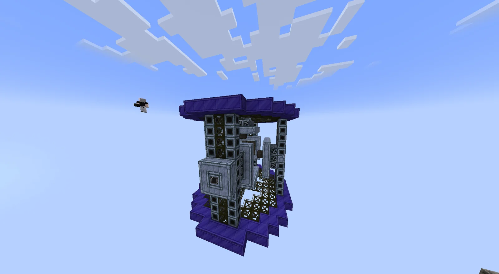
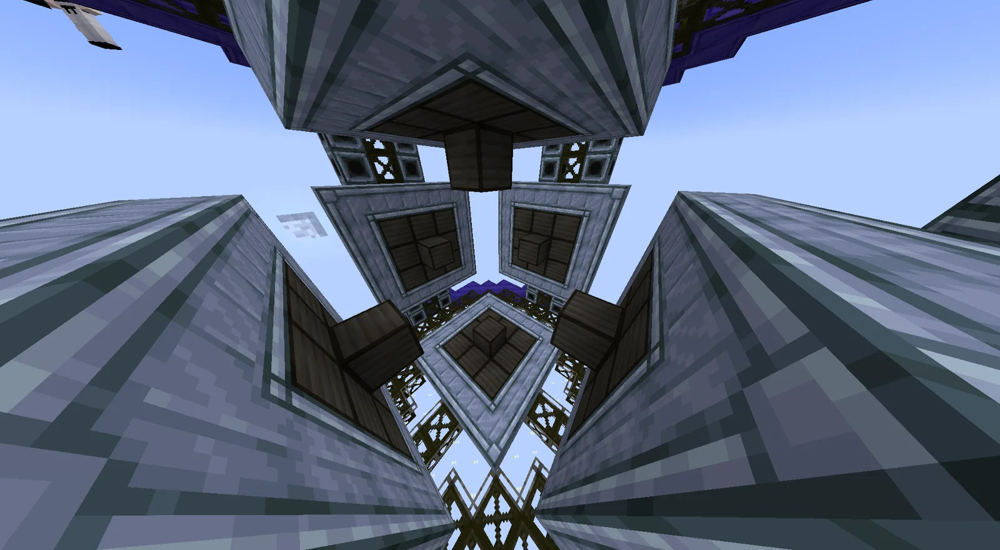
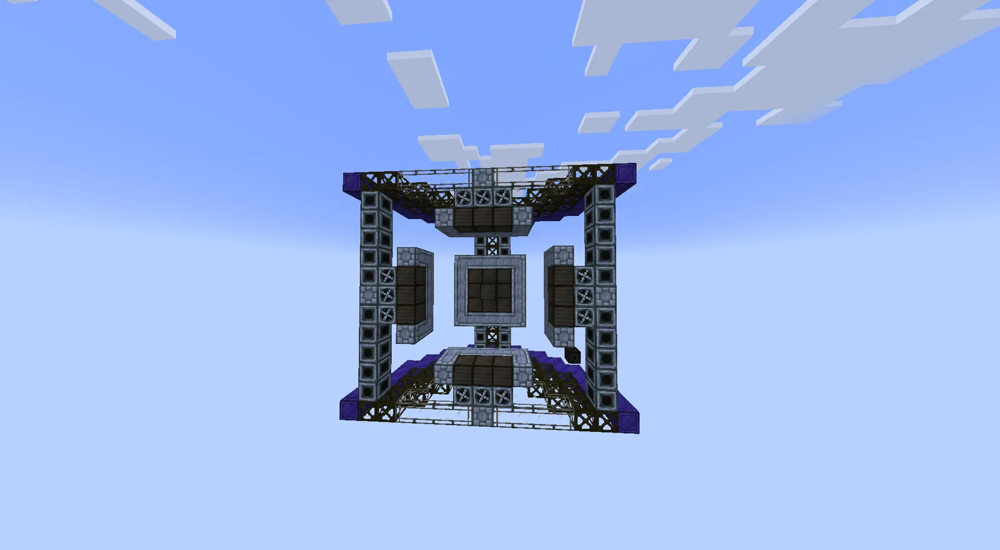

# Acoustic Entanglement Device (AED)
<small>**Submitted by:** Lumen (@deyth), unknown user · Multiblock Design Contest, September 2026</small>

!!! quote ""

| | |
|---|---|
| **Target tier** | <IV>IV</IV> |
| **Role** | Resource generation — ordered-catalyst dust production that does not scale with energy |
| **Schematic** | [aed.txt](Contest_img/acoustic-entanglement-device/aed.txt) |
| **Original post** | [Acoustic entanglement device](https://discord.com/channels/1177211394039484477/1554772873741074432) |

## Summary

The AED produces processed base resources (dusts) in a unique way: it skips the normal processing lines, but its output does not scale with more energy. It is meant as the reward for solving an optional automation challenge, ordered directional catalyst input, which in turn makes resource production and energy generation easier.

The author frames it with a bit of lore: the "void" around the player is actually an ether full of particles, mystical and natural, and the AED uses sound waves to knock those particles out of the air. Every material is "acoustically attuned", though, and must be unattuned before it can be used.

## Mechanics

- **Acoustic attunement.** Every material (hyperbole, per the author) has an attunement: a string of up to 6 "directions" that must be zeroed to unattune it. Example given: Copper is `[up]`, Titanium is `[up, up, down]`, Tungsten is `[up, up, down, up, up, down]`.
- **Ordered catalyst input.** To generate a dust, a catalyst is inserted into the bus on the matching "speaker" in the attunement's order. Zeroing a long attunement also zeroes its shorter prefixes along the way: in the example, producing one Tungsten dust also yields 4 Copper and 2 Titanium.
- **Speed.** Because catalysts must arrive in strict order, the machine is limited to 1 tick per attunement length. The maximum attunement length is dictated by plastic tier.
- **Acoustic reentanglement mode.** The machine can also attune items to specific sound frequencies, unlocking new possibilities:
    - an attuned maintenance hatch increases the fuel efficiency of combustion-based generators (reduced vibration losses);
    - attuned turbines can spin faster (reduced vibration).
- **Possible tweaks** the author lists: replace the catalyst input with a redstone signal, and generate material attunements randomly on world creation.

## Structure

A tall, open frame of Tungsten Frames, Robust Machine Casings, Tungstensteel Pipe Casings, Laminated Glass, Polybenzimidazole blocks and Extreme Engine Intake Casings, with Fluix Steel Casings forming the purple base and top plates and a ring of 11 HV Input Buses serving as the directional "speakers"; the schematic's bounding box is 15 x 13 x 15 blocks.

!!! abstract "Screenshots"

    === "Exterior"
        

    === "Interior, looking up"
        

    === "Axial view"
        

## Files

- [aed.txt](Contest_img/acoustic-entanglement-device/aed.txt) — Building Gadgets-style block-state dump of the structure (JSON), including the required block counts
- [aed-design.txt](Contest_img/acoustic-entanglement-device/aed-design.txt) — the author's in-depth mechanics write-up
