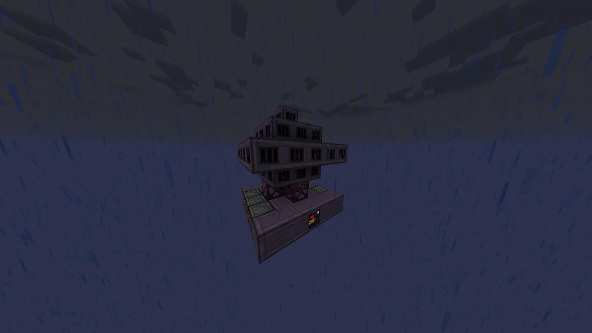
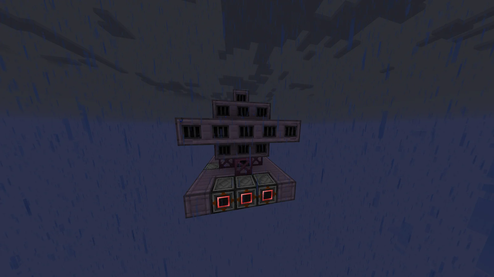
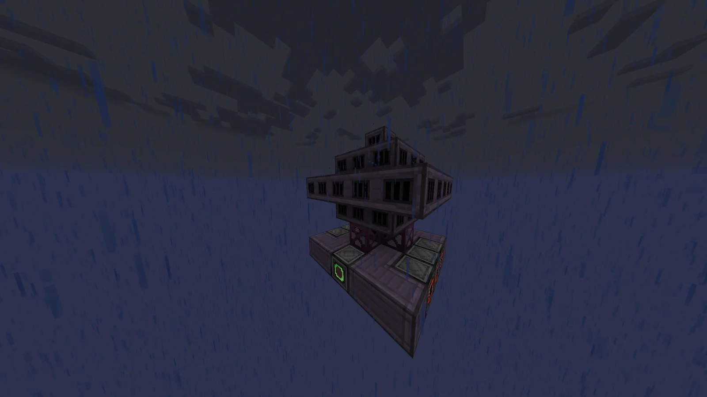
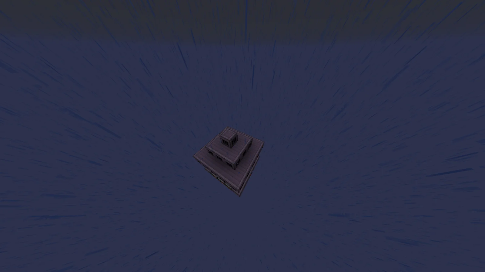
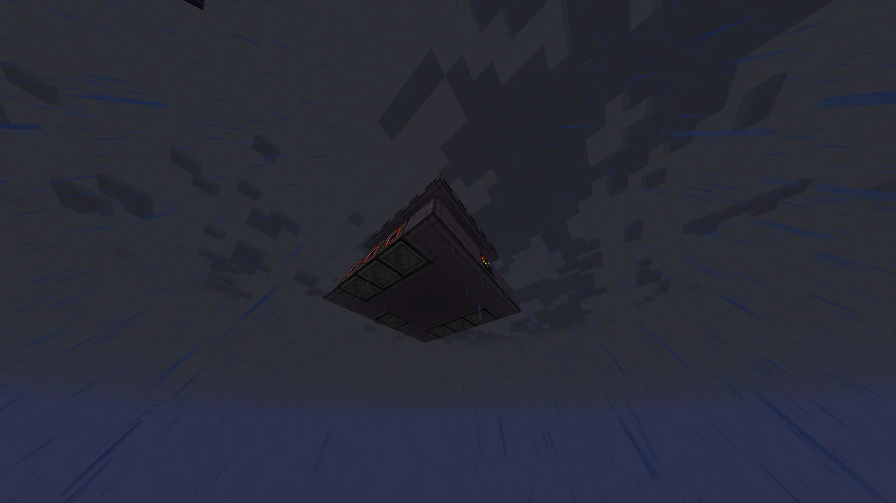

# Atmosphere Dust Collector (A.D.C)
<small>**Submitted by:** enlolers (@enlolers) · Multiblock Design Contest, September 2026</small>

!!! quote ""

| | |
|---|---|
| **Target tier** | <LuV>LuV</LuV> |
| **Role** | Resource generation — collects tiny dust piles from the atmosphere |
| **Schematic** | [atmosphere-dust-collector.json](Contest_img/atmosphere-dust-collector/atmosphere-dust-collector.json) |
| **Original post** | [Atmosphere Dust Collector](https://discord.com/channels/1177211394039484477/1554776173798625331) |

## Summary

A powered multiblock that collects different kinds of dust from the atmosphere. Each cycle produces one tiny pile of every dust in its pool, which the author describes as dusts obtainable before and during <LuV>LuV</LuV>.

## Mechanics

- Consumes power to pull tiny piles of dust out of the atmosphere; no item or fluid input is mentioned.
- One collection cycle takes about **256 seconds**.
- Every cycle yields **one tiny pile of each dust** in the pool. The author gives Tiny Pile of Titanium Dust and Tiny Pile of Ender Pearl Dust as examples and describes the pool as "a lot of tiny piles" of dusts available before and during <LuV>LuV</LuV>; the full list is not given.

## Structure

A squat 5x5 base of Stable Machine Casings and Titanium Firebox Casings carrying a raised, cross-shaped upper deck of Titanium Firebox Casings on Titanium Frames and Titanium Pipe Casings; the schematic spans 5x6x5 blocks. The controller sits in the front wall of the base, with six <LuV>LuV</LuV> Output Buses and one <LuV>LuV</LuV> Energy Input Hatch placed around the base.

!!! abstract "Screenshots"

    === "Controller side"
        

    === "Output buses"
        

    === "Energy hatch side"
        

    === "Top view"
        

    === "Underside"
        

## Files

- [atmosphere-dust-collector.json](Contest_img/atmosphere-dust-collector/atmosphere-dust-collector.json) — block-state template JSON of the structure (block list and positions; uses an IV Large Miner as the placeholder controller)

## Notes from the thread

- A reply questioned why the structure is <LuV>LuV</LuV>-tier; the author gave no justification for the tier choice.
