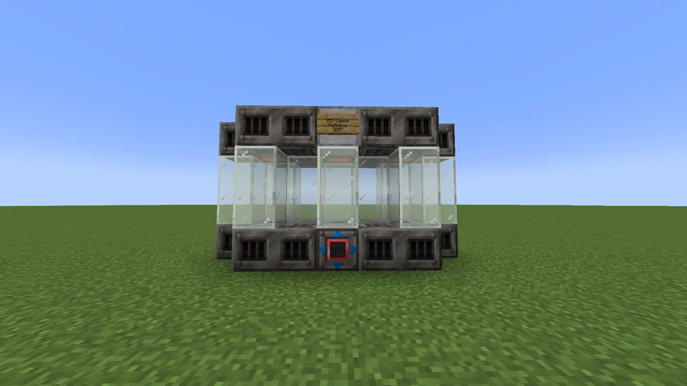
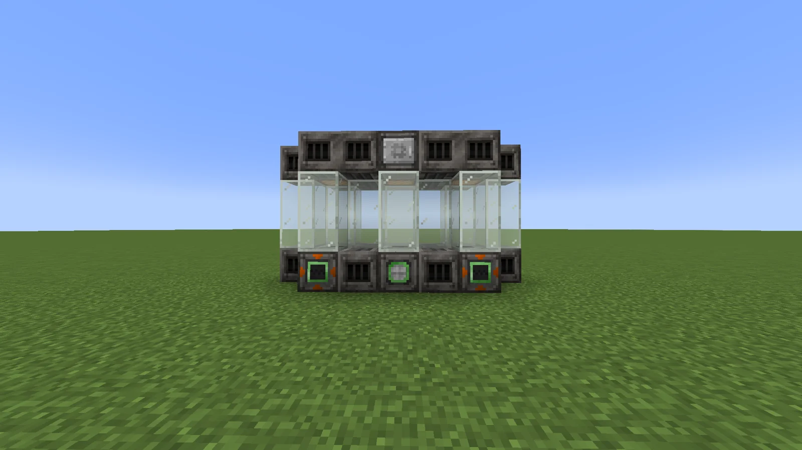
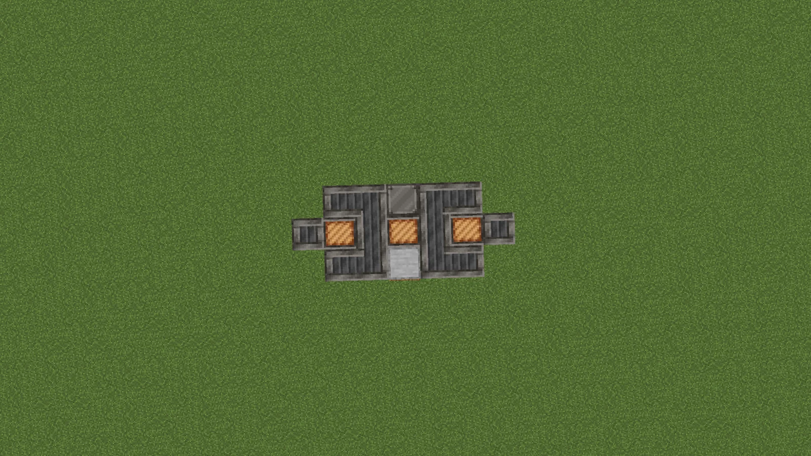
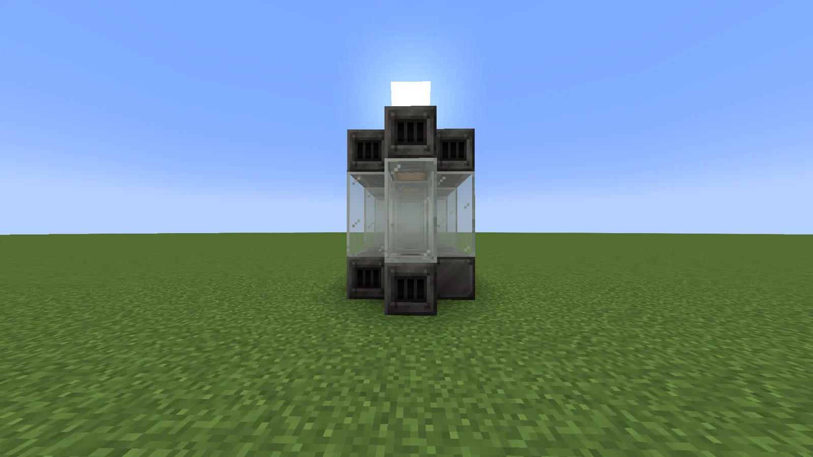
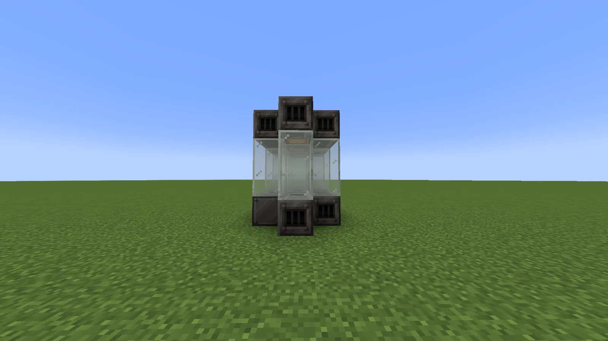

# BIO Diesel Refinery (BDR)
<small>**Submitted by:** TheSilentOne (@thesilentone01) · Multiblock Design Contest, September 2026</small>

!!! quote ""

| | |
|---|---|
| **Target tier** | <LV>LV</LV> |
| **Role** | Processing — one-step Bio-Diesel production for Create: Diesel Generators |
| **Schematic** | [bdr.litematic](Contest_img/bio-diesel-refinery/bdr.litematic) |
| **Original post** | [BIO Diesel Refinery (BDR)](https://discord.com/channels/1177211394039484477/1552687717756706887) |

## Summary

A GregTech-themed alternative for producing Bio-Diesel fuel for Create: Diesel Generators. The multiblock takes in the base ingredients of both the Create Seed Oil recipe and the Create Ethanol recipe and skips straight to outputting Bio-Diesel. The author's intent is to let Create: Diesel Generators scale more effectively and remain a viable power option further into the game, provided the player is willing to spend the resources, while also giving a non-overpowered demonstration of how some multiblocks enable recipe skipping.

## Mechanics

- Consumes the raw inputs of the Create Seed Oil and Create Ethanol recipes and outputs Bio-Diesel directly, without the intermediate fluids.
- Features two input hatches, one per combined recipe, to represent the two recipes being merged. The author notes this is entirely optional if it presents too much of a coding challenge.
- Coil boosting is proposed as a possible option, as long as it does not risk unbalancing the machine.
- In reply to thread feedback, the author argued the concept is not overpowered: a player still needs a primitive power-generation setup to make use of it, and it would act as a precursor to dynamos.

## Structure

A low, three-chamber glass-and-casing block with the controller centered in the bottom front row and the hatches on the back and sides; the author built it as "3 separate fluid chambers", with the middle one representing where the Ethanol and Seed Oil mix, and remarks that the block palette for <LV>LV</LV> multiblocks is somewhat limited. Dimensions were not stated.

!!! abstract "Screenshots"

    === "Front"
        

    === "Back"
        

    === "Top view"
        

    === "Side"
        

    === "Opposite side"
        

## Files

- [bdr.litematic](Contest_img/bio-diesel-refinery/bdr.litematic) — Litematica schematic

## Notes from the thread

- A commenter who ran on Bio-Diesel until around <EV>EV</EV> on both of their playthroughs welcomed the idea; the author responded with the balance reasoning noted under Mechanics.
