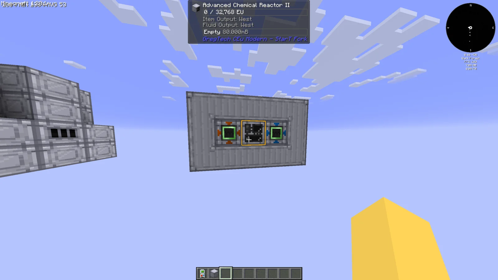
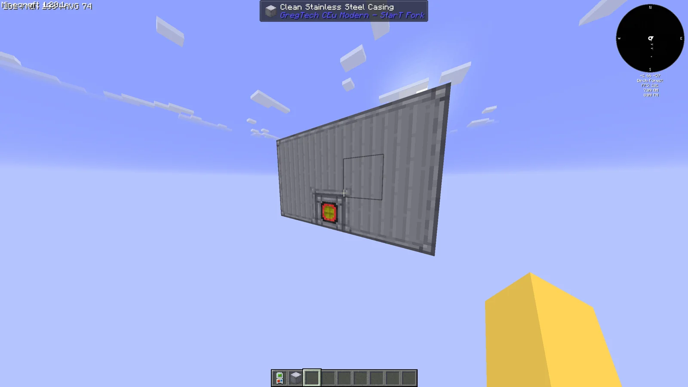
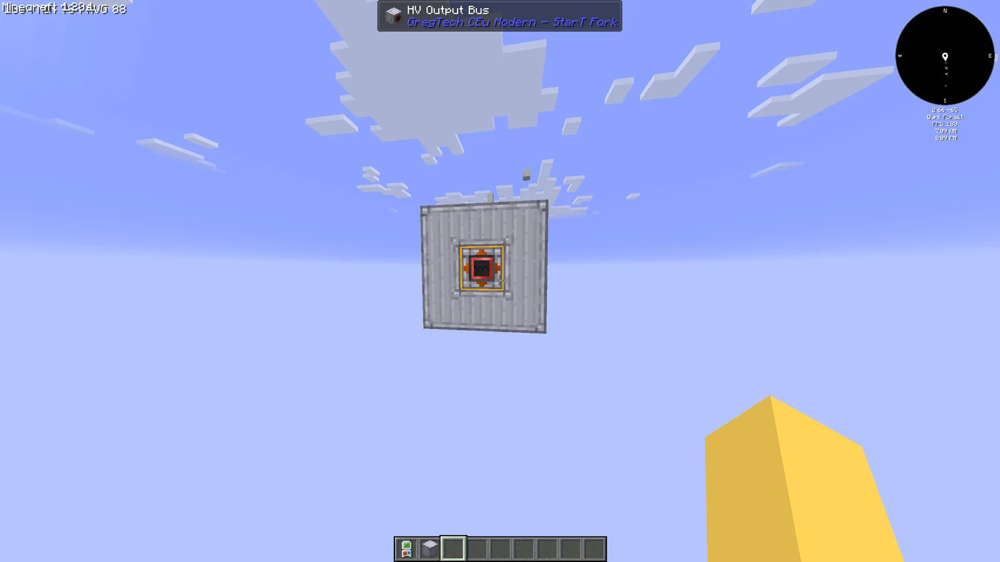
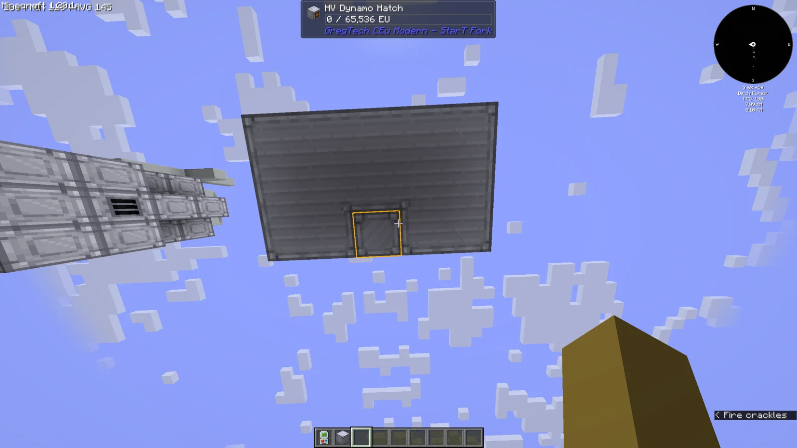
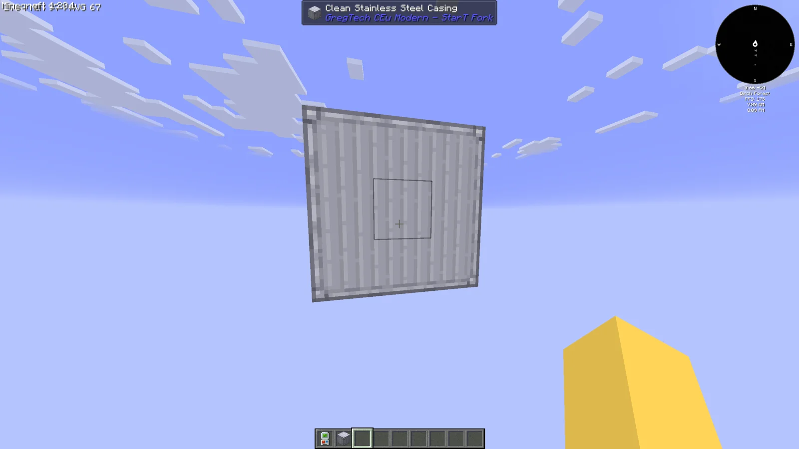
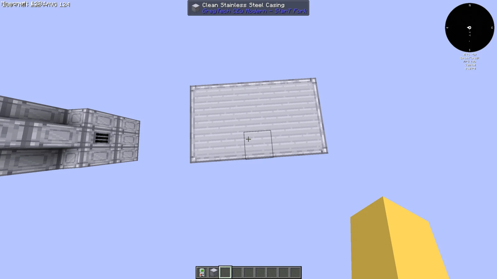

# Bio Reactor
<small>**Submitted by:** enlolers (@enlolers) · Multiblock Design Contest, September 2026</small>

!!! quote ""

| | |
|---|---|
| **Target tier** | <HV>HV</HV> |
| **Role** | Power generation — burns bio fuels into EU with Ash as a byproduct |
| **Schematic** | [bio-reactor.json](Contest_img/bio-reactor/bio-reactor.json) |
| **Original post** | [Bio Reactor](https://discord.com/channels/1177211394039484477/1552744963924561962) |

## Summary

An <HV>HV</HV> generator multiblock that consumes "bio stuff" such as Bio Chaff together with Water to produce power, leaving a tiny pile of Ash behind.

## Mechanics

- Runs on bio fuels (the author gives Bio Chaff as the example) and Water to generate EU.
- Produces Ash as a side product.
- Liquid bio fuels would not need Water; the author suggests Bio Diesel as a possible example.
- No burn rates, EU/t figures, or fuel values were given.

## Structure

A 3x3x5 block of Clean Machine Casings (shown in-game as Clean Stainless Steel Casing) according to the schematic, with the controller centered on the front face flanked by an input bus and an input hatch, an output bus on the back, and an energy output (dynamo) hatch on another face. The mockup uses an HV Chemical Reactor as a stand-in controller.

!!! abstract "Screenshots"

    === "Front (controller)"
        

    === "Side hatch"
        

    === "Back (output bus)"
        

    === "Dynamo hatch"
        

    === "Side"
        

    === "Top"
        

## Files

- [bio-reactor.json](Contest_img/bio-reactor/bio-reactor.json) — JSON schematic with block list (37 Clean Machine Casings, HV Chemical Reactor as controller, HV Input Bus, HV Input Hatch, HV Output Bus, HV Energy Output Hatch)
