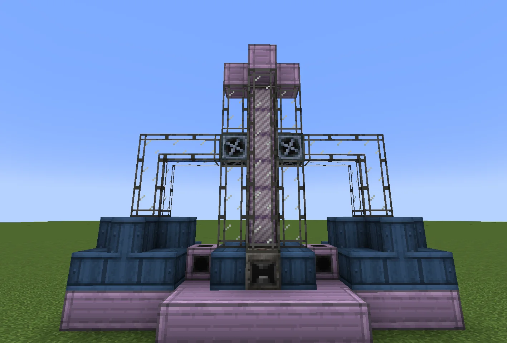
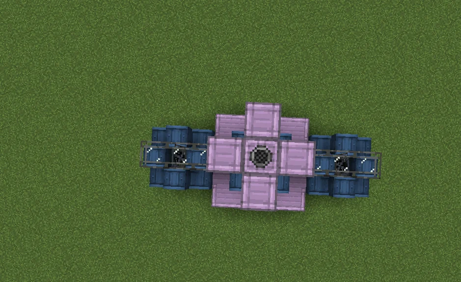

# Catalytic Reaction Chamber (CRC)
<small>**Submitted by:** Thomperso (@thomperso) · Multiblock Design Contest, September 2026</small>

!!! quote ""

| | |
|---|---|
| **Target tier** | <IV>IV</IV>-<LuV>LuV</LuV> |
| **Role** | Processing — chemical loop reactor |
| **Schematic** | [crc.nbt](Contest_img/catalytic-reaction-chamber/crc.nbt) |
| **Original post** | [Catalytic reaction chamber](https://discord.com/channels/1177211394039484477/1553089381580021801) |

## Summary

A chemical multiblock intended for running closed chemical loops. In a loop recipe only the net input is consumed; the chemicals that cycle through the loop are not used up by the machine's recipe. The author's example is the rutile Titanium line, which would then only consume rutile.

## Mechanics

- Runs chemical loops as a single recipe, so only the net input (e.g. rutile for the Titanium line) is consumed and the recycled chemicals are not.
- The author also suggests the Formic Acid loop and other loop recipes as candidates.
- More advanced loops would require better coils.

## Structure

A pink casing base with a raised central column, flanked on both sides by blue casing stacks wrapped in frame scaffolding; two fans sit on the column where the side arms meet it, and the controller is at the base of the column on the front. From above the pink casings form a cross with the side arms extending outward. The author did not state the dimensions.

!!! abstract "Screenshots"

    === "Front"
        

    === "Top view"
        

## Files

- [crc.nbt](Contest_img/catalytic-reaction-chamber/crc.nbt) — structure block (NBT) schematic
