# Cryothermal Equilibrium Layered Liquidising Synthesiser (CELLS), FLUID and ITEM
<small>**Submitted by:** Random² (@randomsquared), Hooded (@hooded5442) · Multiblock Design Contest, September 2026</small>

!!! quote ""

| | |
|---|---|
| **Target tier** | <UHV>UHV</UHV> (all three structures) |
| **Role** | Multi-structure family — layered-input ASG assembly line with a heating and cooling mechanic |
| **Schematic** | [CELLS.litematic](Contest_img/cells-fluid-and-item/cells.litematic), [FLUID.litematic](Contest_img/cells-fluid-and-item/fluid.litematic), [ITEM.litematic](Contest_img/cells-fluid-and-item/item.litematic) |
| **Original post** | [Cryothermal Equilibrium Layered Liquidising Synthesiser (CELLS), FLUID, ITEM](https://discord.com/channels/1177211394039484477/1555018790322970664) |

## Summary

A set of three linked multiblocks meant to replace the Mechanical Assembler step in ASG crafting with something more engaging. The family consists of the **Cryothermal Equilibrium Layered Liquidising Synthesiser (CELLS)**, the **Fractional Layers of Unmitigated Incineration and Desolidification (FLUID)** and the **Insulated Thermal Entropy Minimiser (ITEM)**. Together they build the ASG using layered inputs and a heating and cooling mechanic; the authors describe the design as modular and suggest it could theoretically be adapted to the DSG and beyond.

## Mechanics

- Purpose: a real assembly method for the ASG so that 1 rpm Mechanical Assemblers are no longer needed.
- Inputs are fed in layers, and the process relies on a unique heating and cooling mechanic shared across the three structures.
- The full write-up of the mechanics is in the authors' external document, [FLUID ITEM CELLS](https://docs.google.com/document/d/1IWe6CQrwiAwypF9VYJG6ASQrn77bNlovdrV-r8o97Do/edit?usp=sharing); the post itself only gives the summary above.

## Structure

Three separate structures placed in a line, with CELLS in the middle linking the FLUID tower on one side and the ITEM vessel on the other. Sizes as stated by the authors: CELLS 9x8x13, FLUID 17x25x17, ITEM 10x11x29. The authors note that size approval has been granted.

!!! abstract "Screenshots"

    === "All three"
        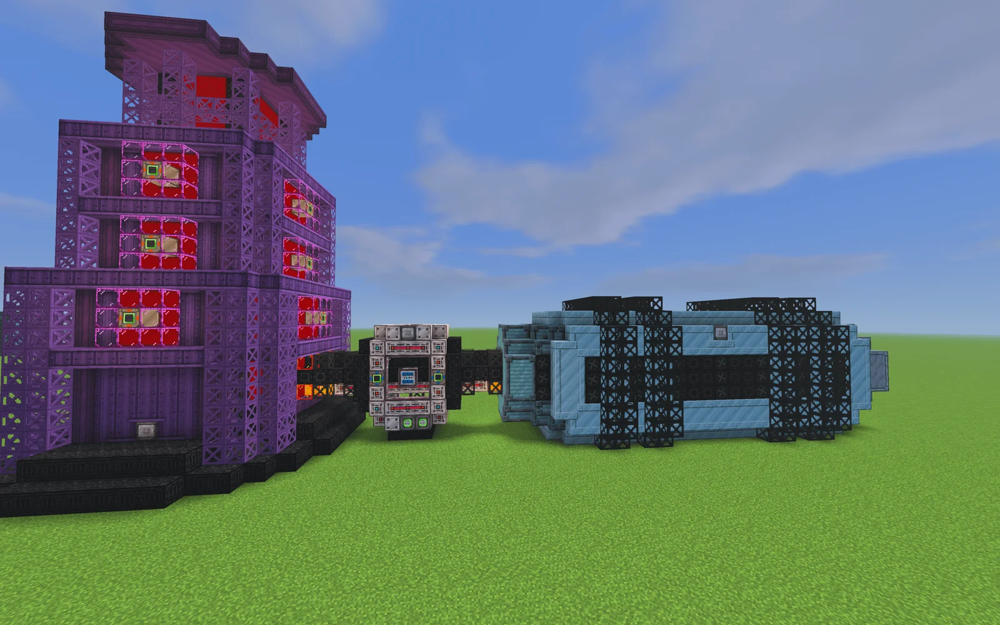

    === "All three, top"
        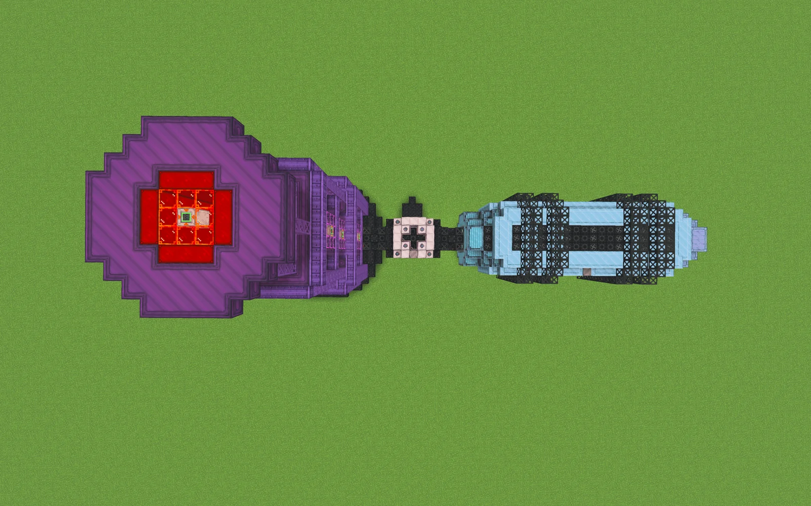

    === "CELLS front"
        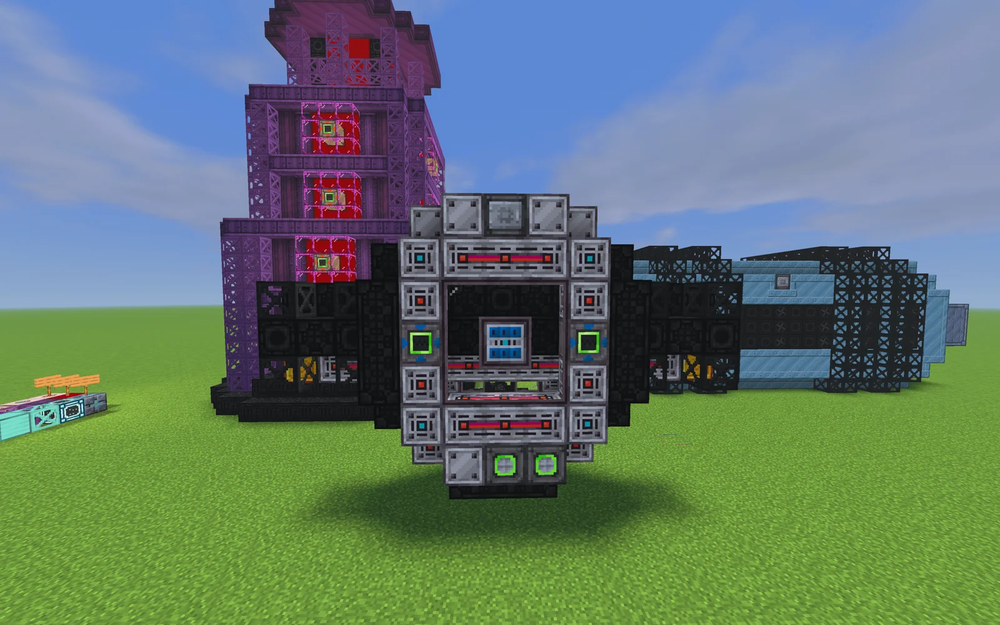

    === "CELLS standalone"
        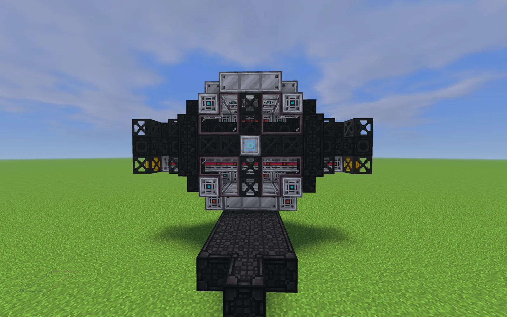

    === "CELLS with ring"
        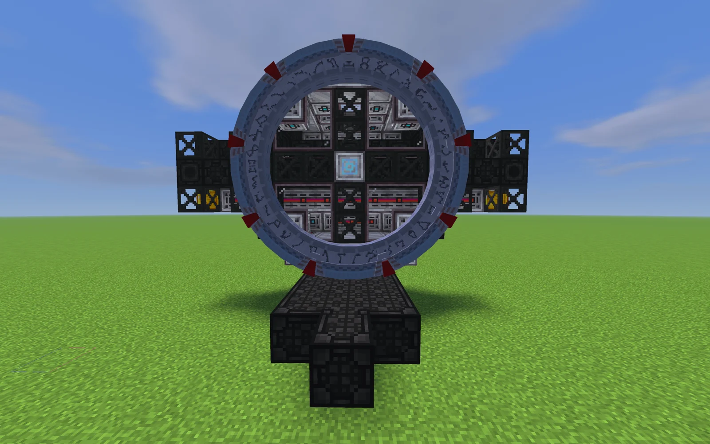

    === "CELLS cross-section"
        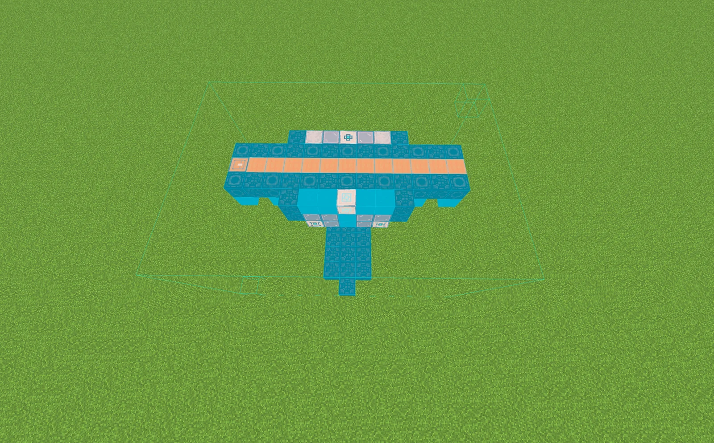

    === "FLUID"
        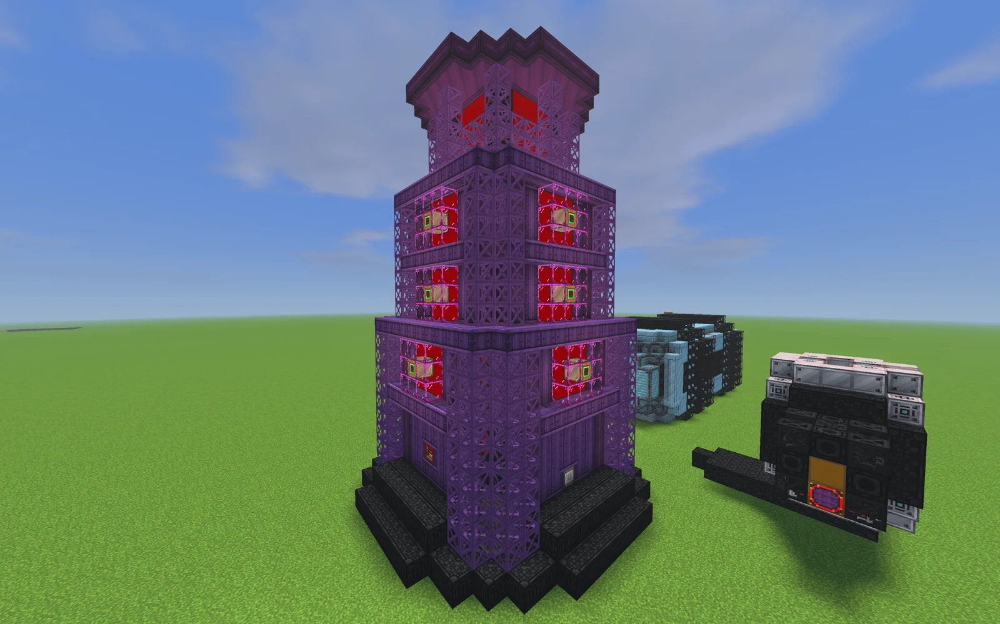

    === "FLUID top"
        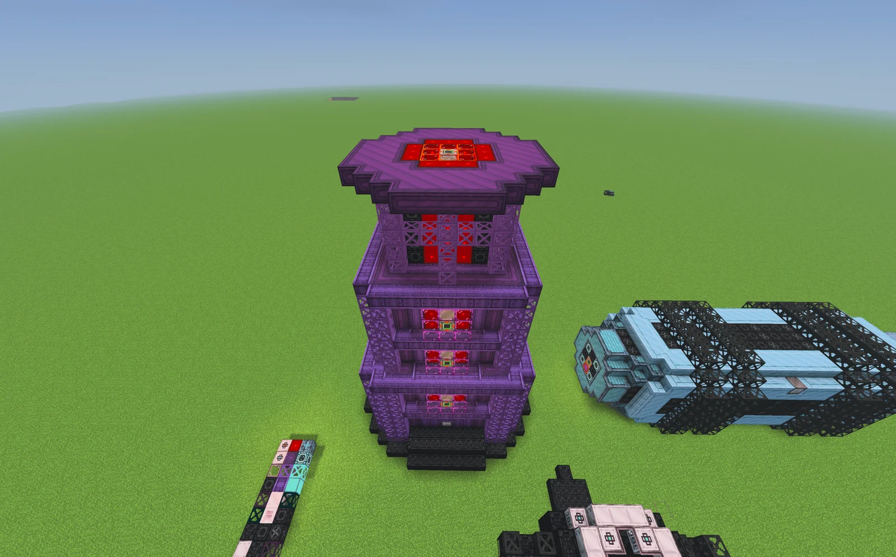

    === "FLUID cross-section, top"
        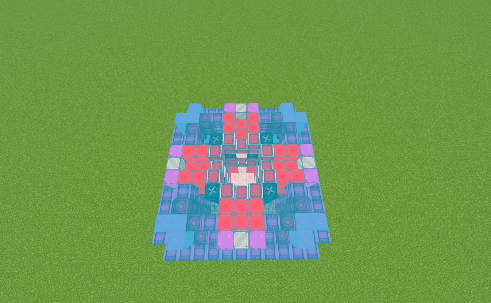

    === "FLUID cross-section, side"
        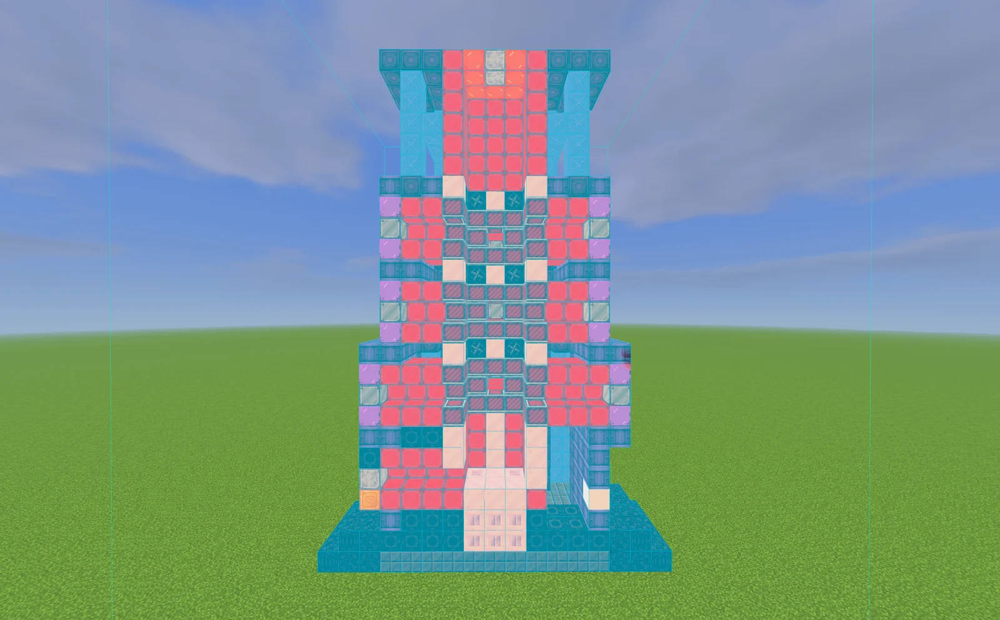

    === "ITEM"
        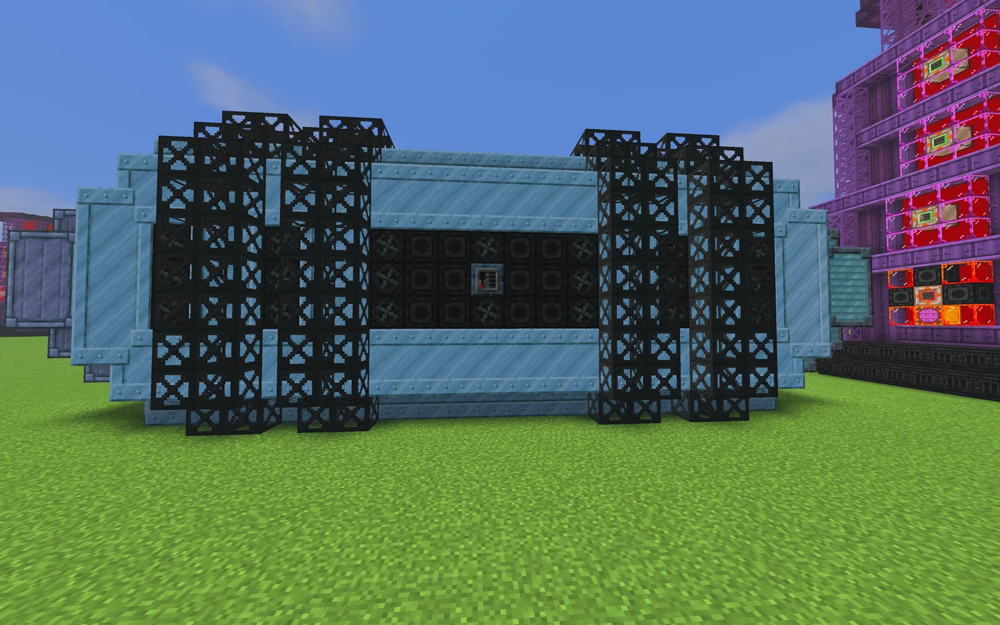

    === "ITEM top"
        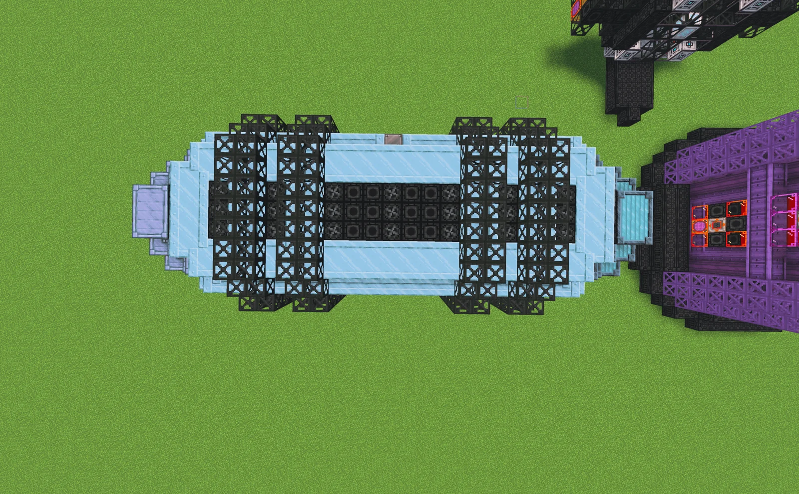

    === "ITEM cross-section, side"
        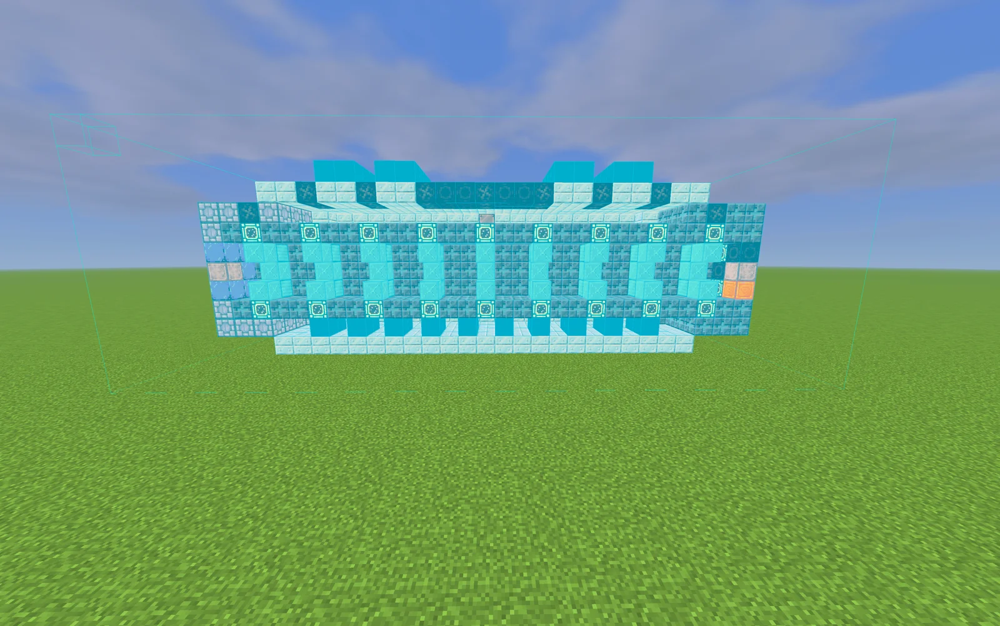

    === "ITEM cross-section, top"
        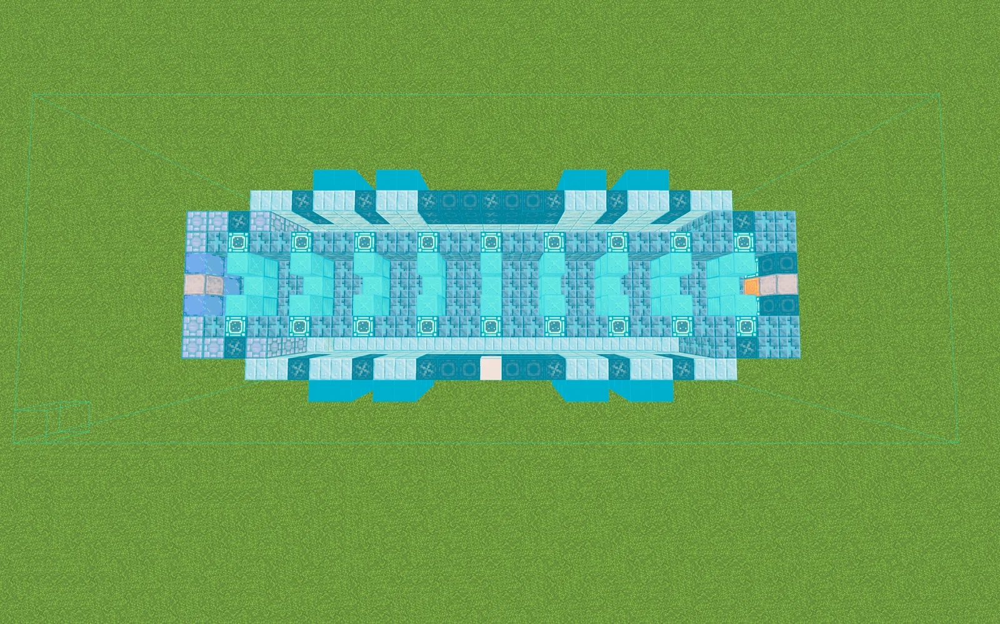

## Files

- [cells.litematic](Contest_img/cells-fluid-and-item/cells.litematic) — Litematica schematic of CELLS
- [fluid.litematic](Contest_img/cells-fluid-and-item/fluid.litematic) — Litematica schematic of FLUID
- [item.litematic](Contest_img/cells-fluid-and-item/item.litematic) — Litematica schematic of ITEM
- [FLUID ITEM CELLS](https://docs.google.com/document/d/1IWe6CQrwiAwypF9VYJG6ASQrn77bNlovdrV-r8o97Do/edit?usp=sharing) — external document with the in-depth mechanics (Google Docs, not archived here)
