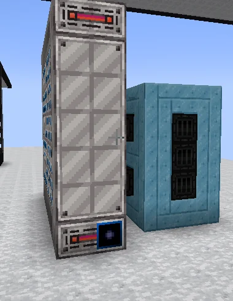

# Chilled IHPCA (CIHPCA)
<small>**Submitted by:** matialox (@matialox), HARIBO (@kaxolotl.) · Multiblock Design Contest, September 2026</small>

!!! quote ""

| | |
|---|---|
| **Target tier** | <UHV>UHV</UHV> |
| **Role** | Research/data — IHPCA variant with built-in, upgradable cooling |
| **Schematic** | [cihpca.nbt](Contest_img/chilled-ihpca/cihpca.nbt) |
| **Original post** | [Chilled IHPCA](https://discord.com/channels/1177211394039484477/1554146670537744504) |

## Summary

A variant of the IHPCA with its own cooling built in. The authors note that some computations need a lot of chilling and that the available chillers are not good enough, so the structure borrows the idea of the Bulk Blast Chiller and adds a rotor holder so the cooling, and with it the computation, can be upgraded.

## Mechanics

- Cooling similar to the Bulk Blast Chiller is part of the structure itself.
- A rotor holder sits on the side of the structure; the amount of cooling depends on the rotor holder and the rotor placed in it. Better cooling allows more computation.
- When asked whether this is an IHPCA with a fixed amount of cooling available from the start, the author clarified that the cooling is not fixed but scales with the rotor holder and rotor.

## Structure

A tall, narrow tower of light casings with the controller in the bottom row, and a shorter block of teal casings attached to its side; the authors did not state the dimensions.

!!! abstract "Screenshots"

    === "Front"
        

## Files

- [cihpca.nbt](Contest_img/chilled-ihpca/cihpca.nbt) — NBT structure file (originally `modular_ihpca.nbt`)
