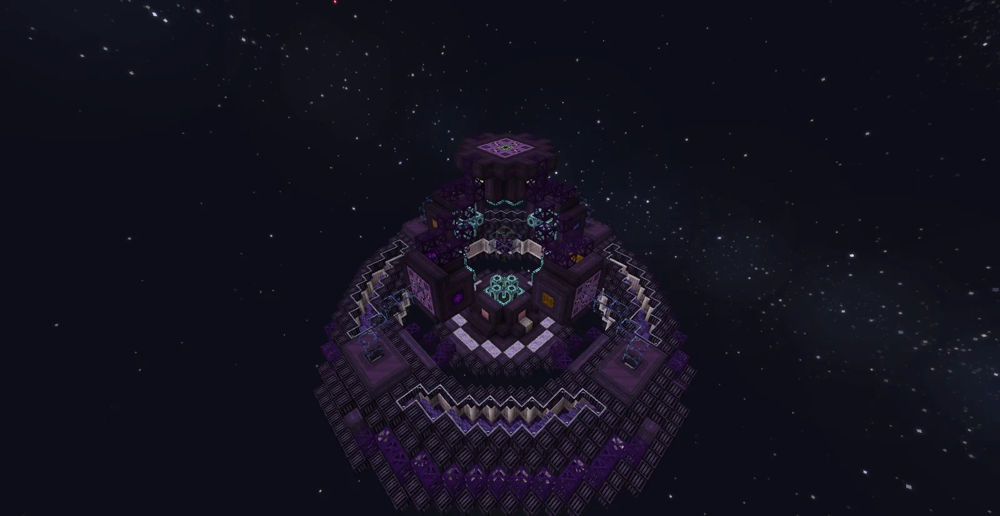
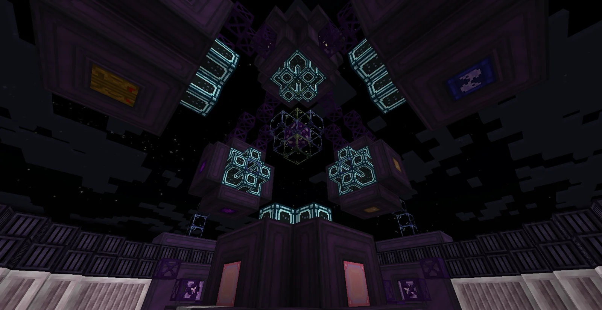

# Condensed Horizon Relativistic Oscillation Nucleus for Output Synthesis (C.H.R.O.N.O.S.)
<small>**Submitted by:** GeneralXHD (@generalxhd) · Multiblock Design Contest, September 2026</small>

!!! quote ""

| | |
|---|---|
| **Target tier** | <UIV>UIV</UIV>+ |
| **Role** | Utility — produces a time-manipulating fluid that boosts late-game recipes |
| **Schematic** | [chronos.txt](Contest_img/chronos/chronos.txt) |
| **Original post** | [C.H.R.O.N.O.S](https://discord.com/channels/1177211394039484477/1554595886334476458) |

## Summary

A late-game multiblock aimed at players struggling with the recipe attributes of endgame machines (the author's term for everything that defines how a recipe runs: time, product, educt, parallels, and so on). The CHRONOS condenses time itself around its core into a fluid, **Dense Temporal Concentrate (DTC)**, which certain machines can consume to alter their recipe parameters. The author presents it as a new "boost" system alongside bulking, threading, and parallels, but more limited: because it cannot be spammed, its effects are meant to be stronger than the traditional boosts.

Only one CHRONOS can exist per world.

## Mechanics

The author stresses that everything below is a suggestion and that the numbers, formulas, conversion rates, effects, recipes, names, and energy amounts are placeholders for the devs to refine.

**Fluids**

- A new recipe in an existing machine: the RmEU produces 100B of **Riftic Temporal Concentrate (RTC)** ("somehow").
- **Temporal Concentrate (TC)** is RTC as it exists in the overworld; 1B of TC is equivalent to 1 m³ of space.
- The CHRONOS concentrates TC into **Dense Temporal Concentrate (DTC)** at a ratio of 10B TC to 1mB DTC. Only DTC leaves the machine.

**Passive production**

- The core has a radius of 2 blocks, so it condenses 4/3 · π · r³ ≈ 33.5B of TC per second, rounded down to 30B/s for convenience.
- That yields **3mB/s of DTC**, produced passively for **1A of <UIV>UIV</UIV>**. In short: 1A UIV gives 3mB of DTC.

**Boosted production with RTC**

- Feeding RTC from the RmEU into the CHRONOS synthesizes additional DTC, but power consumption rises dramatically. The proposed formula is 2^(1 + x/3) − 1, where x is the number of 10B RTC increments (each worth 1mB DTC); the author gives the result in amps of UEV, with f(0) = 1A UIV as the baseline example.
- If the energy supplied is lower than what the current operation needs, the core collapses and all progress is voided. The CHRONOS therefore sizes the current craft by the amount of DTC in the hatch, not by the energy available.

**Operation**

- The core is activated with a compression seed and buffered energy, like a fusion reactor.
- One full craft takes about 1 minute (the author suggests probably more).
- There is no overclocking. For the future the author suggests casing- or core-tier-based overclocks, as in GTNH.

**Using DTC**

- DTC can only be consumed by machines with a specific trait (for example "Time manipulation"); the author expects only a few late-game machines to have it, with the devs deciding which. Such machines may use modules to access its effects.
- Proposed effects (the author finds the actual application hard to pick because of balance):
    1. Decreases recipe duration (the author's favorite)
    2. Applies absolute parallels
    3. Applies "core parallels" — like CPU cores, running different recipe types at once
    4. Uses less educt
    5. Produces less product
- None of the effects scale linearly; the more DTC is used, the less each additional bucket does (1B = 0.5x multiplier, 2B = 0.25x, 3B = 0.125x, and so on). Later in the thread the author described the time reduction as roughly 1/(1 + log(x)), so it cannot be skipped through.
- The author also proposes a custom render for the core, the lasers, and the buffer ring.

## Structure

A 35 × 18 × 35 structure (oversize permission granted by Kolja (@kolja_)): a wide, stepped ring of dark abyssal casings and frames around a raised central chamber, with the core suspended in the middle between emitter blocks and a ring of glowing casings.

!!! abstract "Screenshots"

    === "Exterior"
        

    === "Core chamber"
        

## Files

- [chronos.txt](Contest_img/chronos/chronos.txt) — block template (JSON text) with the block-state list; final version posted on 2026-09-30, replacing an earlier upload the author marked invalid

## Notes from the thread

- The author asked for feedback from players past ASG on whether DTC should add absolute parallels, add a little extra product (11B instead of 10B), or allow paralleling different recipes instead of changing recipe time, noting that the normal parallel and absolute parallel hatches are already very strong for late-game machines, so this must be a new mechanic.
- One reply suggested the fluid could behave like the Hell Forge catalysts, which increase product and shorten recipe time at the same time, and did not see how the parallel options would work.
- Another reply argued that extra product would break the game's stoichiometry (looped materials would appear from nothing), that reducing recipe time is the least game-breaking option as long as the reduction is modest, and that which machines accept the speedup must still be limited (possibly only threading multis) to protect intentionally bottlenecked lines. The author agreed that only a few late-game machines would carry the trait and that the reduction is non-linear.
