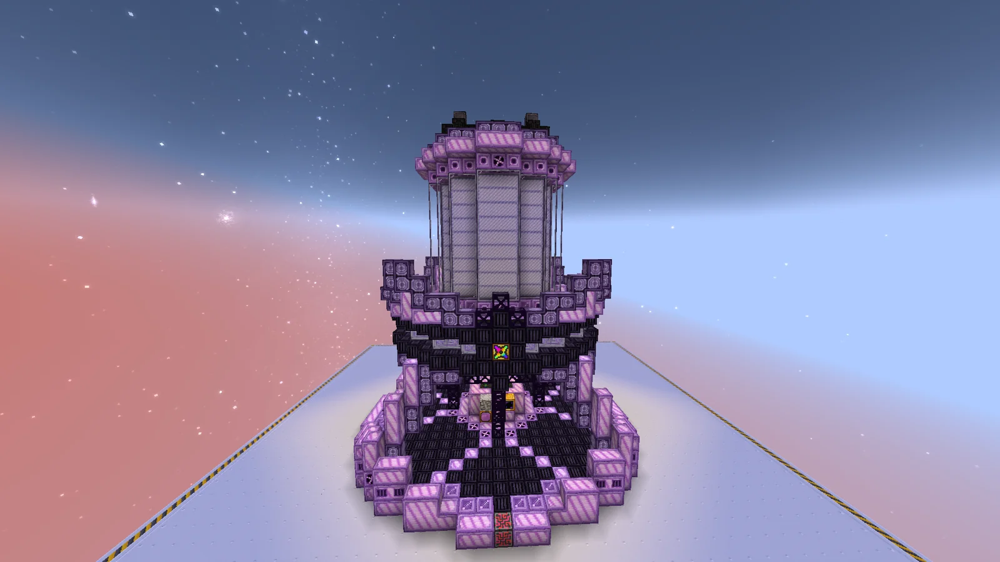
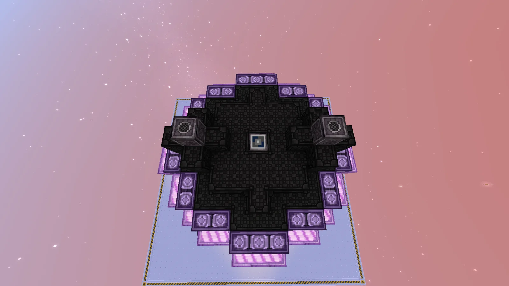
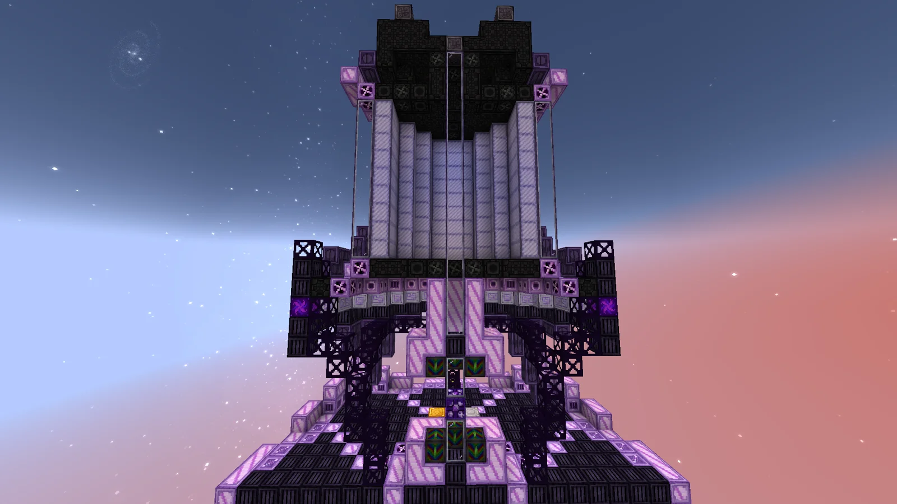
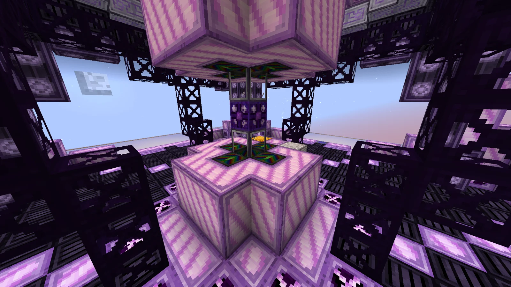

# Concentrated Overthermal Reaction Engine (C.O.R.E.)
<small>**Submitted by:** easymode (@easyymode) · Multiblock Design Contest, September 2026</small>

!!! quote ""

| | |
|---|---|
| **Target tier** | <UIV>UIV</UIV>+ |
| **Role** | Processing — late-game heat chamber with a density-tuning mechanic |
| **Schematic** | [core.nbt](Contest_img/concentrated-overthermal-reaction-engine/core.nbt) |
| **Original post** | [CORE (Concentrated Overthermal Reaction Engine)](https://discord.com/channels/1177211394039484477/1553699357726081085) |

## Summary

The C.O.R.E. is a large multiblock intended to supplement or replace the pack's current thermal processing multiblocks, the Pressure Heat Chamber and the Normal Heat Chamber. The author offers two implementation options: a straightforward threaded or bulking replacement for the existing heat chambers, or a non-threaded heat chamber built around an "inner density" automation challenge that rewards precise control with faster recipes.

## Mechanics

### Design 1 — threaded or bulking replacement

The simplest implementation: the C.O.R.E. acts as a threaded or bulking replacement for the previous heat chambers and accesses the existing heat chamber recipes via machine mode swapping.

### Design 2 — density mechanic

A non-threaded heat chamber that comes with an automation challenge based on the machine's inner density value. Speed bonuses for successful density optimization are the incentive to build it.

- Inner density is measured on a scale of 0 to 1000 Density Units (DU).
- Every recipe has a preset optimal density, D₀ (for example, Igneferous Elixir has a D₀ of 750 DU). When a recipe is input, its D₀ becomes the machine's internal target.
- Crafting only starts once 1 B of Prismatic Hypergurmalium has been supplied and consumed.
- Clicking the Purge button in the controller, or inputting 100 B of Dragon Breath, resets the density to 0 DU.
- At the end of every recipe, inner density drops by 5% of D₀.
- Redstone variadic interfaces would display the current density band through redstone states.

Density is adjusted by feeding the machine certain materials. Rough controls move the chamber toward the target range relatively cheaply; fine controls use more expensive resources for precision and, in turn, faster recipe times.

| Control | Material | Effect |
|---|---|---|
| Rough | Trikoductive Neutro-steel Ultradense Plate | +200 DU per plate |
| Rough | Hyper Voidic Graviton Ultradense Plate | -200 DU per plate |
| Fine | Primordial Residue | +5 DU per 25 mB |
| Fine | Riftic Concentrate | -5 DU per 25 mB |

Recipe speed is multiplied according to the "density band" the machine currently sits in, determined by its distance from D₀:

| Band | Condition | Recipe speed |
|---|---|---|
| Very Low | D < D₀ − 200 | 0.25× |
| Mild | D₀ − 200 ≤ D < D₀ − 25 | 1.0× |
| Optimal | D₀ − 25 ≤ D ≤ D₀ + 25 | 4× |
| High | D₀ + 25 < D ≤ D₀ + 200 | 1.0× |
| Very High | D > D₀ + 200 | 0.25× |

### Open questions raised by the author

- Whether the C.O.R.E. should be able to process the recipes of the two existing heat chambers. Allowing it simplifies progression and reduces machine spam, but creates recipe balance issues and could confuse players at lower heat chamber tiers if, for example, D₀ is listed on every recipe's EMI page. Disallowing it preserves balance and isolates the automation challenge, but adds machine bloat and makes progression awkward.
- One proposed solution is to restrict the density mechanic to specialty recipes in a third machine mode (for example, the unimplemented Hell Forge liquids, which could be given very long recipe times to incentivize reaching the 4× bonus). That removes tooltip and mechanic confusion while still letting the C.O.R.E. act as a final-tier heat chamber, but leaves open what bonus the non-density recipes should get; the author considers a flat % speed bonus possible but "possibly dubious".
- Five redstone interfaces are workable, but the author suggests a specialized interface block might be nicer to automate.
- The author also notes that heat chamber naming and use already need more differentiation, and a third one could complicate that further.

## Structure

A 23x27x23 structure (the author states permission was granted for this size): a broad dark base ring with purple-and-pink casings, a central column running up into a tall tower with a white-and-pink casing crown.

!!! abstract "Screenshots"

    === "Front"
        

    === "Top view"
        

    === "Upper tower"
        

    === "Interior"
        

## Files

- [core.nbt](Contest_img/concentrated-overthermal-reaction-engine/core.nbt) — structure block (NBT) schematic
