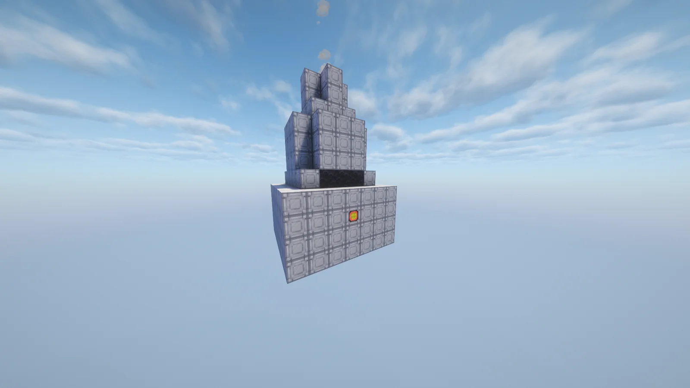
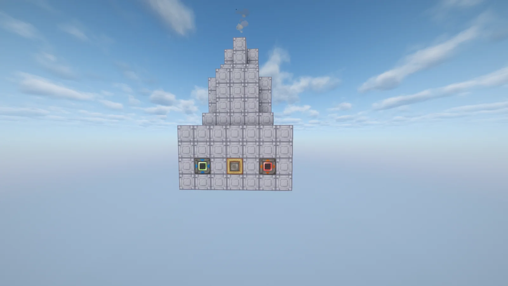
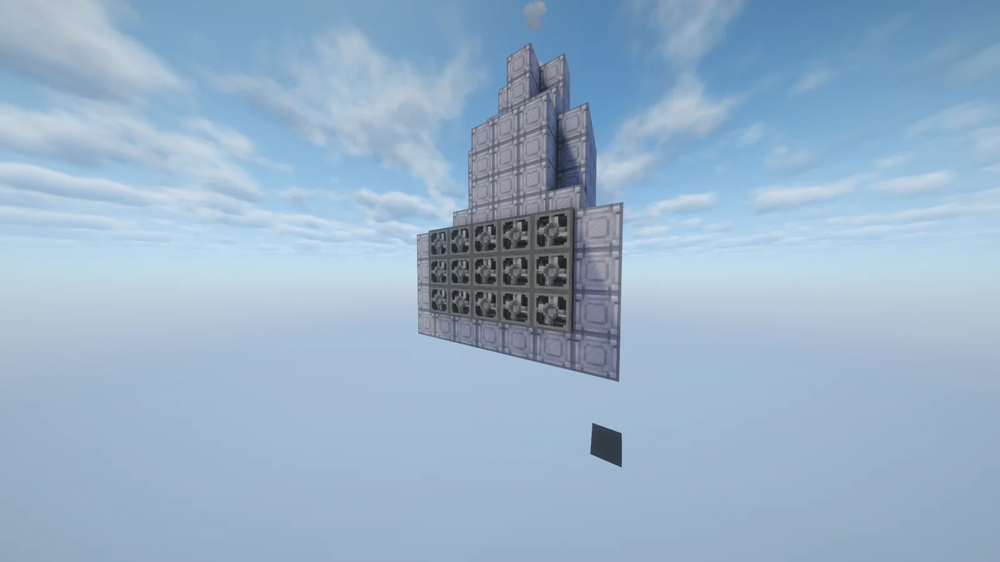
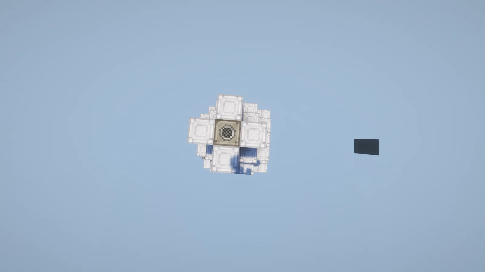
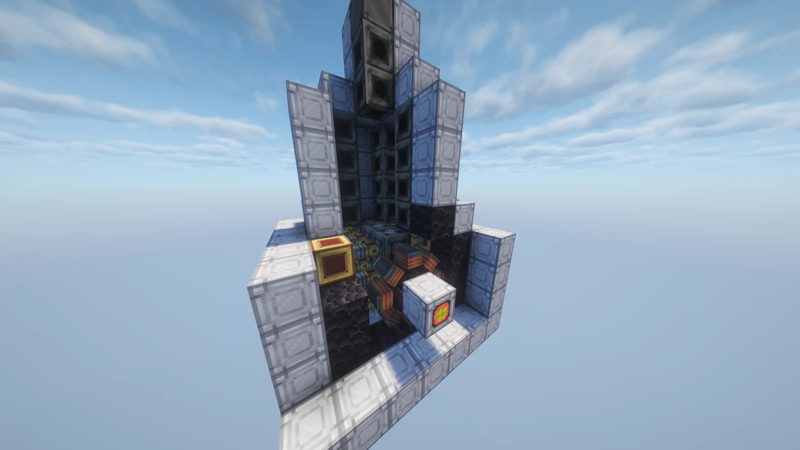

# Crude Biodiesel Generator (CBdG)
<small>**Submitted by:** Corn Chex (@john_nutt) · Multiblock Design Contest, September 2026</small>

!!! quote ""

| | |
|---|---|
| **Target tier** | <HV>HV</HV> |
| **Role** | Power generation — burns Create Crude Biodiesel for EU |
| **Schematic** | [crude-biodiesel-generator.nbt](Contest_img/crude-biodiesel-generator/crude-biodiesel-generator.nbt) |
| **Original post** | [Crude Biodiesel Generator](https://discord.com/channels/1177211394039484477/1553611614844878958) |

## Summary

A GregTech-style multiblock version of the Create diesel engines. It produces power directly from Create Crude Biodiesel, without the separate coil setup the single-block engines need, trading a higher resource cost for more energy output in a smaller footprint.

## Mechanics

- Input: Crude Biodiesel (Create).
- Output: power and Dark Ashes.
- The author's intent is to "gregtech-ify" the Create diesel engines: a setup that is more expensive in resources than the standard engines but produces more energy and needs no separate coil setup. No specific EU/t figures were given.

## Structure

A white-casing block with a stepped tower rising from its top; the exposed Create engine on the front stands in for the multiblock controller. The author notes that the Create radiator fans on one side and the campfire on top are only there to illustrate what the machine might look like when formed and running. Dimensions were not stated.

!!! abstract "Screenshots"

    === "Controller side"
        

    === "Hatch side"
        

    === "Radiator side"
        

    === "Top view"
        

    === "Interior"
        

## Files

- [crude-biodiesel-generator.nbt](Contest_img/crude-biodiesel-generator/crude-biodiesel-generator.nbt) — Create schematic cannon file (.nbt)

## Notes from the thread

- The post originally also contained a Large Fermenting Casket; at Luzifer Senpai (@luzifer_senpai)'s suggestion the author moved it to a separate post, so this entry covers only the generator.
