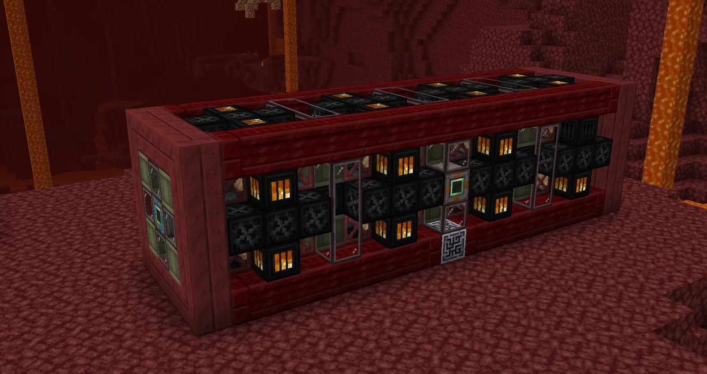
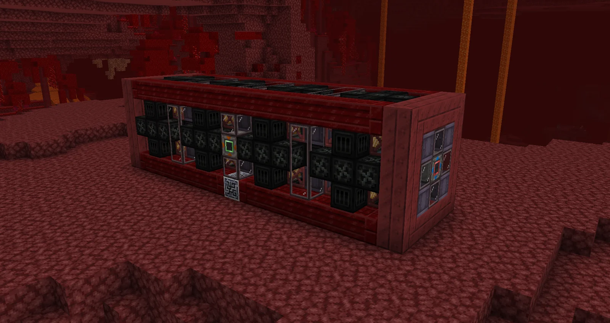
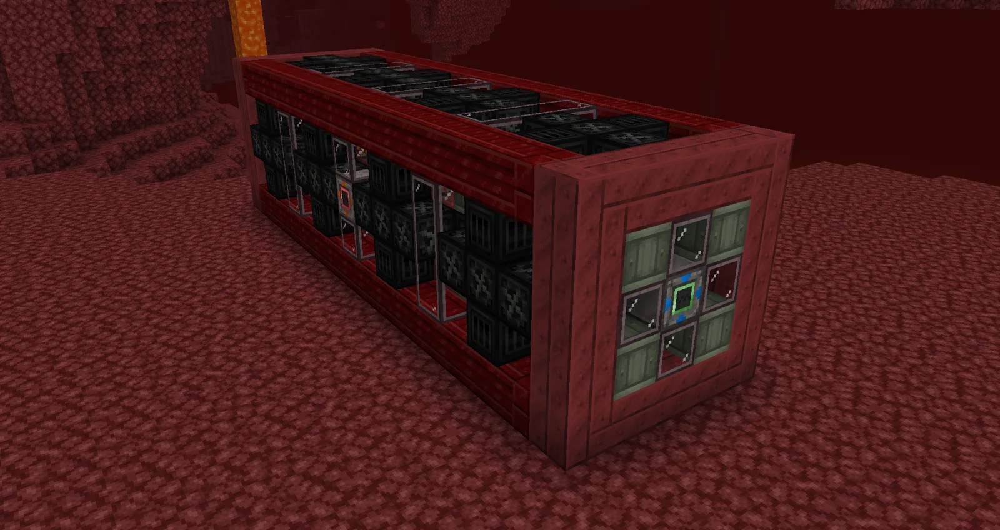
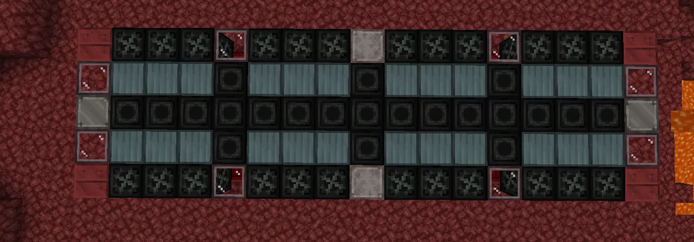
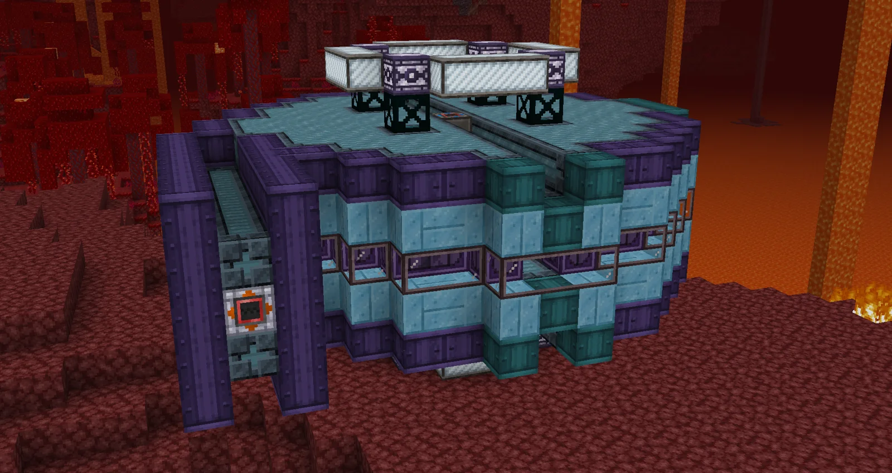
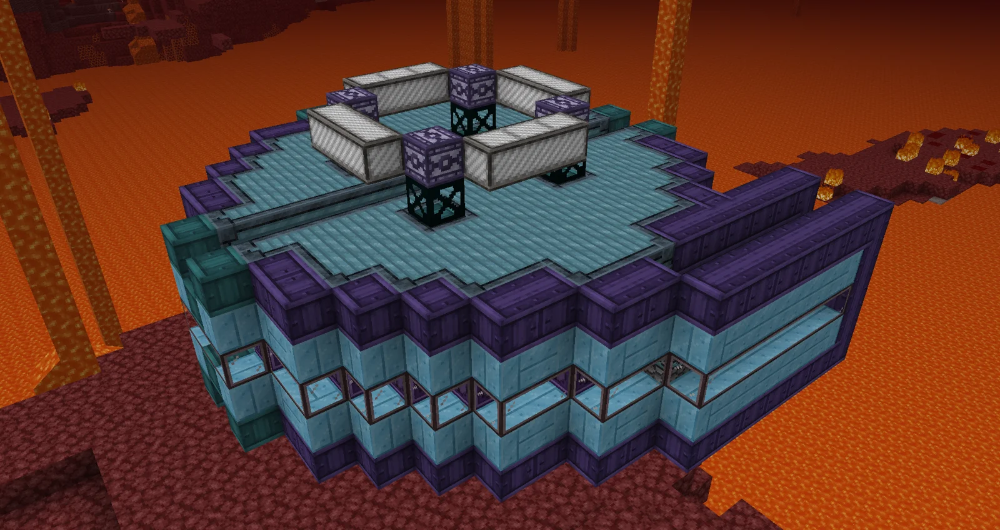
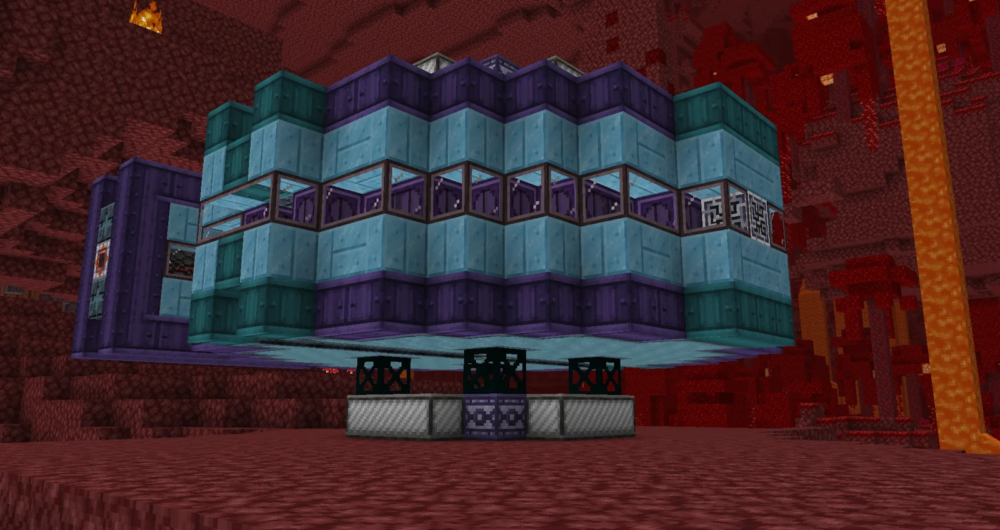
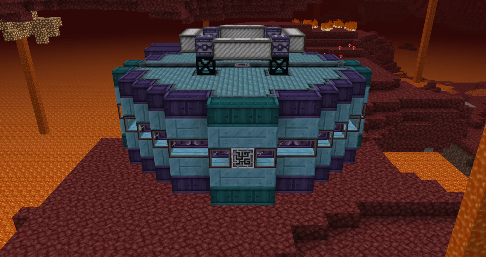
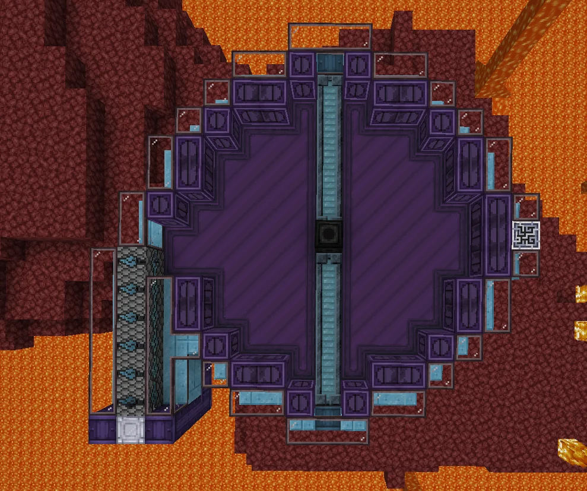

# Cyclotron and Ambient Neutron Activator (ANA)
<small>**Submitted by:** JustObsidian (@justobsidian) · Multiblock Design Contest, September 2026</small>

!!! quote ""

| | |
|---|---|
| **Target tier** | <UEV>UEV</UEV> (mid-UEV, both structures) |
| **Role** | Multi-structure family — fission-line skipping and netherline superheavy boosting |
| **Schematic** | [ana.nbt](Contest_img/cyclotron-and-ambient-neutron-activator/ana.nbt), [cyclotron.nbt](Contest_img/cyclotron-and-ambient-neutron-activator/cyclotron.nbt) |
| **Original post** | [Cyclotron and Ambient Neutron Activator [ANA]](https://discord.com/channels/1177211394039484477/1553846526843953192) |

## Summary

A pair of mid-<UEV>UEV</UEV> multiblocks that work together: the **Ambient Neutron Activator (ANA)** irradiates Dysprosium in the Nether, and the **Cyclotron** consumes that Irradiated Dysprosium to transmute fissile materials into one another. Together they let a player skip certain fission lines and boost netherline superheavy production. The author describes both as optional for progression, but notes they could be made required.

## Mechanics

- The ANA produces Irradiated Dysprosium from Liquid Dysprosium; the Cyclotron consumes Irradiated Dysprosium and returns it as Liquid Dysprosium with a slight loss, so the two form a loop.
- Both structures are targeted at mid-<UEV>UEV</UEV>.
- Per-structure mechanics are detailed in the sections below.

## Ambient Neutron Activator (ANA)

### Summary

The ANA converts Liquid Dysprosium into Irradiated Dysprosium. The author's reasoning: Dysprosium has a high thermal neutron capture cross-section in real life, which makes it a good neutron-capture material. The Diamane blocks in the structure represent moderators that slow neutrons down so the Dysprosium can absorb them.

### Mechanics

- No parallels, but the ANA can be overclocked.
- It can be boosted by depleting fuel rods inserted into it. The author suggests more expensive fuel rod types could give larger boosts or last longer.
- Only works in the Nether.
- Extra hatches (maintenance, variadic, etc.) should replace the Extreme Temperature Smelting Casing.

### Structure

A long rectangular block in a red casing frame, with rows of dark moderator-style blocks and glass panels along its sides, lantern-like blocks on the ends, and the controller on one short end face. The author did not state the dimensions.

!!! abstract "Screenshots"

    === "ANA running"
        

    === "ANA side"
        

    === "ANA controller end"
        

    === "ANA cross section"
        

### Files

- [ana.nbt](Contest_img/cyclotron-and-ambient-neutron-activator/ana.nbt) — Create schematic of the Ambient Neutron Activator

## Cyclotron

### Summary

The Cyclotron transmutes fissile materials between each other, which can be used to skip some fission lines. The author's example is Uranium 238 -> Plutonium 239, and it should also work to make materials such as Fermium. The design mirrors real cyclotrons, which use superconducting magnets above and below the chamber to direct particles from the center outward in a spiral, accelerating them until they reach an exit that leads to a target chamber.

### Mechanics

- Input and output are handled by the same inventory, represented by the HV Output Bus in the schematic. The author notes this may need a custom bus, since GT buses cannot always be both inserted into and extracted from.
- Leaving a material in the Cyclotron for too long could turn the product into something else, or destroy it.
- Requires a supply of Irradiated Dysprosium to run, which it converts back into Liquid Dysprosium with a slight loss. Upgrading the neutron reflectors lowers the amount of Irradiated Dysprosium needed.
- Should also convert Atomic Nether Sludge Dust into Flerovium-Rich Re Sludge Dust, Hafnastide-Rich Sludge Dust, and Pologium-Rich Sludge Dust at a slightly higher efficiency than the normal Manifold Centrifuging recipe.
- Does not have to be in the Nether.
- Extra hatches should replace the Subzero Casings.

### Structure

A wide, flat, roughly circular drum of light blue and purple casings with a ring of glass around its middle, a smaller magnet assembly on top, and a matching assembly underneath; a short rectangular target chamber extends from one side. The author did not state the dimensions.

!!! abstract "Screenshots"

    === "Cyclotron running"
        

    === "Cyclotron top"
        

    === "Cyclotron side"
        

    === "Cyclotron controller"
        

    === "Cyclotron cross section"
        

### Files

- [cyclotron.nbt](Contest_img/cyclotron-and-ambient-neutron-activator/cyclotron.nbt) — Create schematic of the Cyclotron

## Structure

Two separate builds: the long, red-framed ANA and the wide, blue-and-purple Cyclotron drum with its side target chamber. Both are shown built in the Nether in the author's screenshots, although only the ANA is required to be there. Screenshots for each are in the sections above.

## Files

- [ana.nbt](Contest_img/cyclotron-and-ambient-neutron-activator/ana.nbt) — Create schematic of the Ambient Neutron Activator
- [cyclotron.nbt](Contest_img/cyclotron-and-ambient-neutron-activator/cyclotron.nbt) — Create schematic of the Cyclotron
