# Ancient Belief Yielding Data Optimization Sanctum and Eye of Horus (A.B.Y.D.O.S. and E.O.H.)
<small>**Submitted by:** Luck (@luckytg.), Dungeon Six Potion (@dungeonsixpotion), Cry (@dzinhth0), Martin_mc (@martin_mc) · Multiblock Design Contest, September 2026</small>

!!! quote ""

| | |
|---|---|
| **Target tier** | <UV>UV</UV>+ (A.B.Y.D.O.S.) / <UV>UV</UV> (progression gating) and above (E.O.H.) |
| **Role** | Multi-structure family — Abydos-locked resource generation through the Classic Stargate |
| **Schematic** | [abydos.litematic](Contest_img/data-optimization-sanctum-and-eye-of-horus/abydos.litematic), [eoh.litematic](Contest_img/data-optimization-sanctum-and-eye-of-horus/eoh.litematic) |
| **Original post** | [(A.B.Y.D.O.S. & E.O.H.) Ancient Belief Yielding Data Optimization Sanctum & Eye Of Horus](https://discord.com/channels/1177211394039484477/1554774954451537950) |

## Summary

A pair of <UV>UV</UV> multiblocks, submitted together as the "Abydos & Stargate Revitalization Project", that are meant to replace plop-and-forget drills for the key Abydos resources with an automation challenge. The **A.B.Y.D.O.S.** consumes Abydos coordinate crystals as offerings and produces data; the **E.O.H.**, locked to the Abydos dimension, takes that data plus PCB Coolant, operates the Classic Stargate and laser-drills the dimension through it, producing ores and fluids that scale with how long it has been running.

The team proposes the two structures as progression gates: resources needed for <UV>UV</UV> and later <UHV>UHV</UHV> progression, such as Zapolite ores and Gritty Akreyrium, would only be obtainable past certain ramping tiers of the E.O.H. (recipes that currently need Gritty Akreyrium, such as the Molden Destabilizer, could be changed to require something else). A second goal is to give the Classic Stargate a purpose after the player has reached Abydos once. The authors say they do not know what the development team has planned for the dimensional overhaul and hope the structures can be part of the Abydos content update.

An ASG variant for Nether resources was planned but dropped for time; the team said they would like to design it after the contest if the entry is picked.

## Mechanics

- The two multiblocks form a chain: the A.B.Y.D.O.S. produces data, which is carried to the E.O.H. over optical fiber, and the E.O.H. turns it (together with PCB Coolant) into Abydos ores and fluids.
- Both structures passively use PCB Coolant while operating.
- Consumption rates, timers, lock durations and output quantities are all left to the development team; the numbers and resource names the authors give are explicitly arbitrary examples.
- The team suggests the E.O.H.'s Critical Velocity mechanic could be split into separate reusable mechanics, such as **[Ramping]** and **[Dimensional Overclock]**, if the development team wants to use parts of it in other multiblocks.

## Ancient Belief Yielding Data Optimization Sanctum (A.B.Y.D.O.S.)

### Summary

Target tier <UV>UV</UV>+. The A.B.Y.D.O.S. consumes Abydos coordinate crystals at random intervals and uses them to recreate, mimic and restore the faith of the ancient Abydosians. That faith grants passage to resources of Abydos that no regular drill can locate and extract, in the form of data that is passed to the E.O.H. over optical fiber.

### Mechanics

**[Offertory]**

- In addition to the PCB Coolant it uses passively, the A.B.Y.D.O.S. must have an input bus at a specified position in the structure. That bus may hold at most one Abydos coordinate crystal at a time.
- Inserting the first crystal activates the machine, which then operates normally.
- After a random amount of time (intervals up to the development team), the machine demands another crystal and starts a very short timer (duration up to the development team; the author personally recommends less than 3 seconds).
- If no crystal is inserted within that time, the machine halts completely for some time (locking duration up to the development team) before it accepts offerings again.
- To make this automatable, the authors suggest either an item cover designed for the controller block or a Redstone Variadic Interface that emits a redstone signal when an offering is needed.

### Structure

A temple-like building on a dark base with a central stepped pyramid flanked by two tall pylons topped with crystal cages; the controller sits in the front of the pyramid. The schematic spans 24x24x25 and uses computer casings, enriched naquadah and pallaridium casings, PEEK casings, fusion coils, fusion glass, shellite glass, gold blocks, sand, a nether star block, golden idols, and a computation transmitter hatch.

!!! abstract "Screenshots"

    === "Front"
        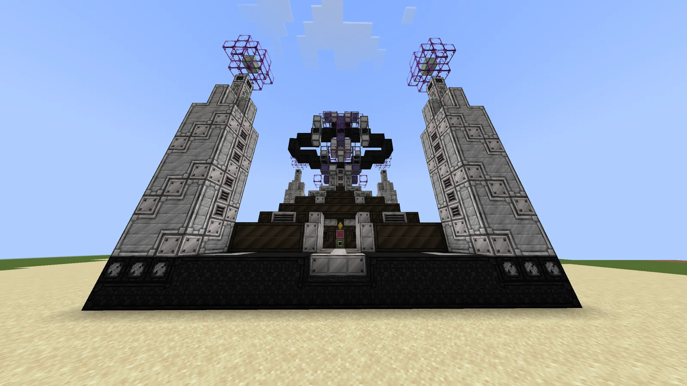

    === "Front, low angle"
        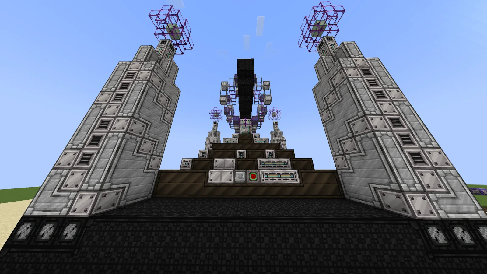

    === "Angled view"
        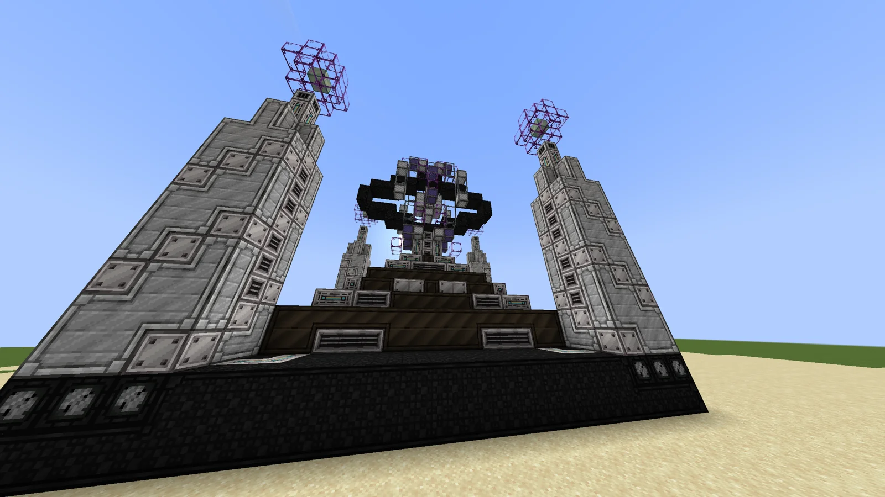

    === "Crown"
        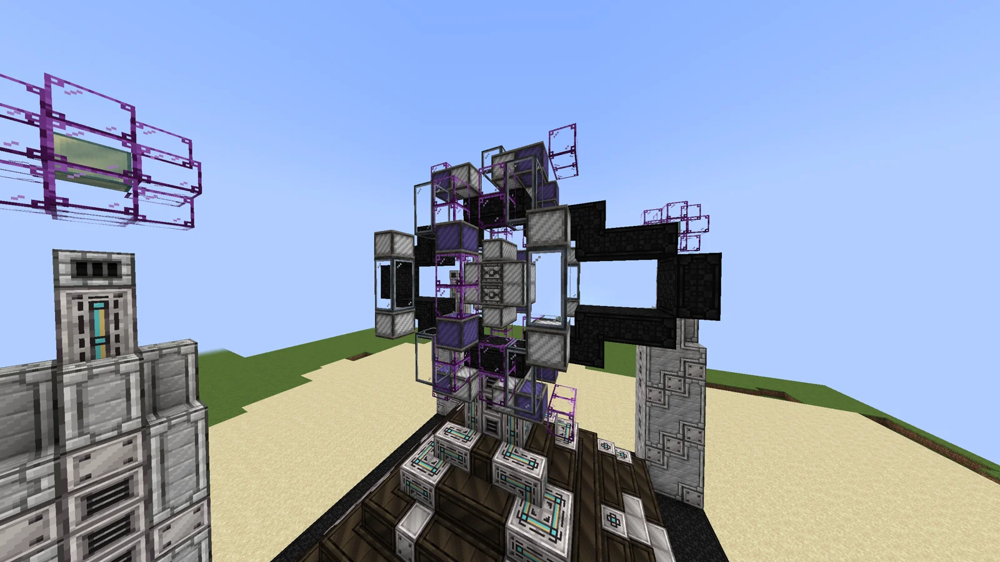

    === "Interior"
        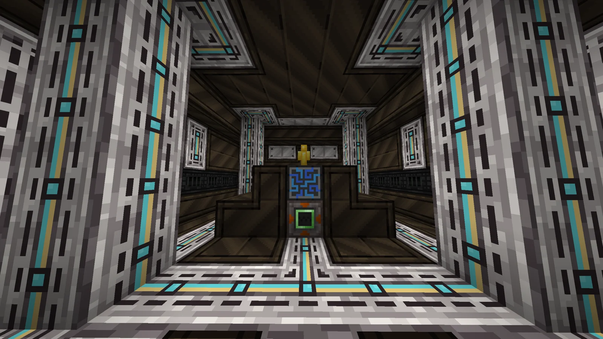

    === "Interior from above"
        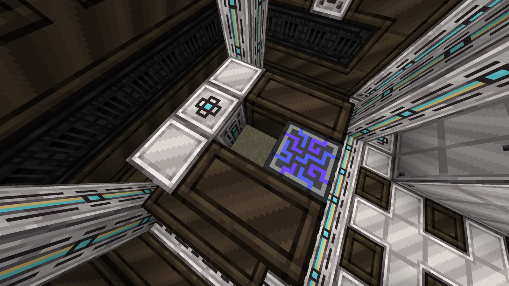

### Files

- [abydos.litematic](Contest_img/data-optimization-sanctum-and-eye-of-horus/abydos.litematic) — Litematica (Forgematica) schematic, "Version 4"

## Eye of Horus (E.O.H.)

### Summary

Target tier <UV>UV</UV> (progression gating) and above. An Abydos-dimension-locked multiblock. When supplied with PCB Coolant and the data produced by the A.B.Y.D.O.S., the E.O.H. comprehends the data and translates it into a language the Classic Stargate can understand. The Classic Stargate is then operated to tear open space at the exact coordinates, and the E.O.H. fires a concentrated beam through it to laser-drill the area.

### Mechanics

**[Critical Velocity]**

- A ramp-up mechanic: the machine consumes PCB Coolant and A.B.Y.D.O.S. data at increasing rates the longer it runs (rates up to the development team). As consumption rises, the machine outputs significantly higher quantities and, most importantly, higher quality of ores and fluids.
- The team proposes using this ramp to gate important progression resources, such as Zapolite ores and Gritty Akreyrium, behind specific ramping stages.
- **Upgrading:** the multiblock can be upgraded to reach ramping tiers the previous tier could not. In the screenshots, neutronium blocks stand in as a placeholder for tier 1 (the author hopes a neutronium machine casing can be used instead); tier 2 would use Ancient Runicalium casings.
- **Speed overclocking:** the team also hopes for an overclock that lets the machine consume more energy, coolant and, most importantly, A.B.Y.D.O.S. data to run the highest currently available ramping recipe faster.
- Illustrative example given by the author, with completely arbitrary numbers and resource names: the machine starts at ramp 0; as it ramps up to ramp 2 it produces various Abydos resources such as X Titanite ores; at ramp 5 (the maximum at tier 1) it produces Y Zapolite ore and 3X Titanite; upgraded to tier 2 it can reach ramp 8, producing 5Y Zapolite, 10X Titanite and Z buckets of Gritty Akreyrium.

### Structure

A floating cube with a dark frame of casings and teal coils, pink T-shaped arms on each face, and a square opening in the front through which the Classic Stargate ring is visible; a corridor inside leads to the controller. The schematic spans 18x22x21 and uses neutronium blocks (placeholder, see above), dragonsteel, enderium, prismalium, melodium, stellarium, lumium, signalum, shellite, twinite and laser casings, enriched naquadah and pallaridium casings, fusion glass and reinforced fusion glass, dragonsteel, naquadah alloy and trinaquadalloy frames, naquadah, trinium and superconducting coils, a Classic Stargate with its ring, golden idols, and a computation receiver hatch.

!!! abstract "Screenshots"

    === "Front"
        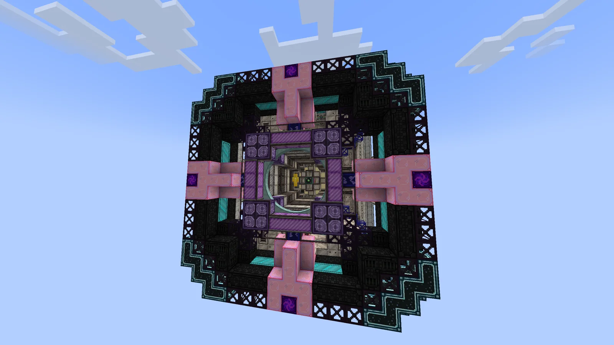

    === "Angled view"
        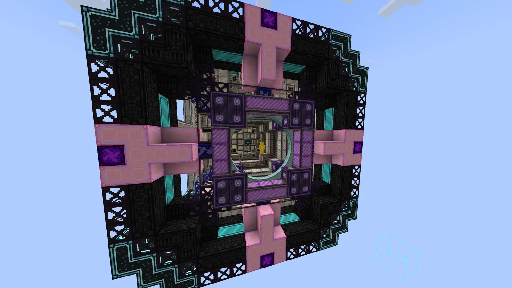

    === "Side"
        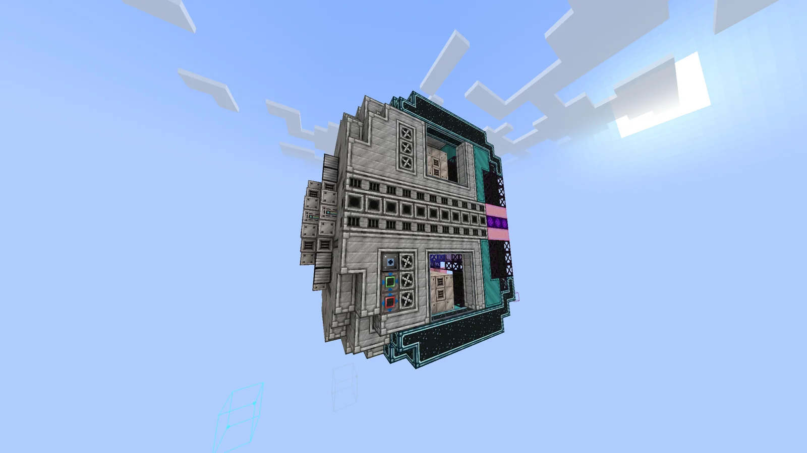

    === "Back"
        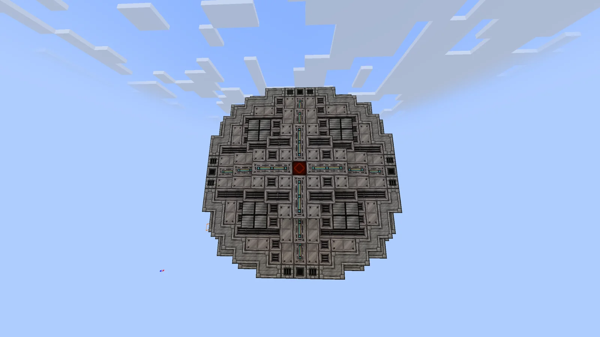

    === "Interior, looking up"
        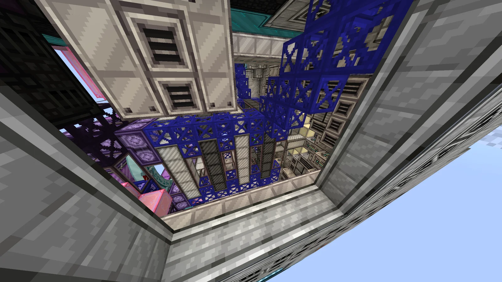

    === "Interior corridor"
        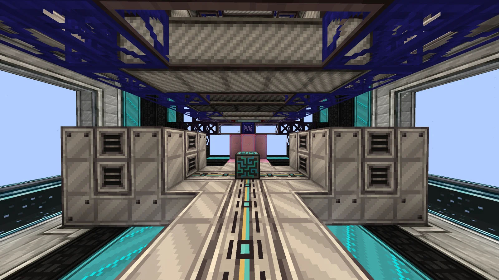

### Files

- [eoh.litematic](Contest_img/data-optimization-sanctum-and-eye-of-horus/eoh.litematic) — Litematica schematic, "Version 6"

## Structure

Both multiblocks exceed the 17x17x17 contest limit; the author states that permission for this was given by Kolja (@kolja_). The A.B.Y.D.O.S. is a sand-colored temple with two pylons and a stepped pyramid (24x24x25 in the schematic); the E.O.H. is a dark, floating cube built around the Classic Stargate (18x22x21 in the schematic).

## Files

- [abydos.litematic](Contest_img/data-optimization-sanctum-and-eye-of-horus/abydos.litematic) — A.B.Y.D.O.S. Litematica (Forgematica) schematic, "Version 4"
- [eoh.litematic](Contest_img/data-optimization-sanctum-and-eye-of-horus/eoh.litematic) — E.O.H. Litematica schematic, "Version 6"
