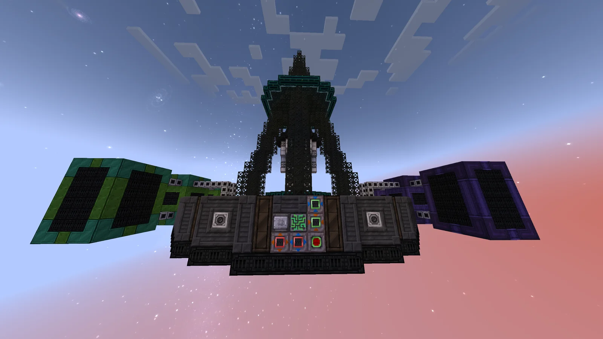
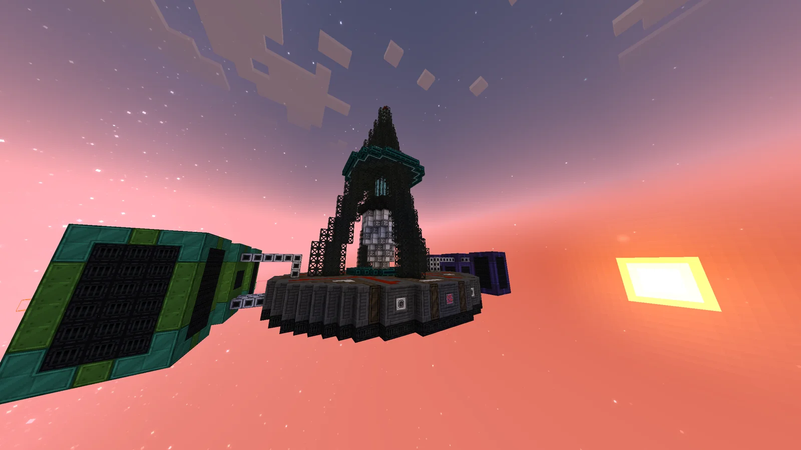
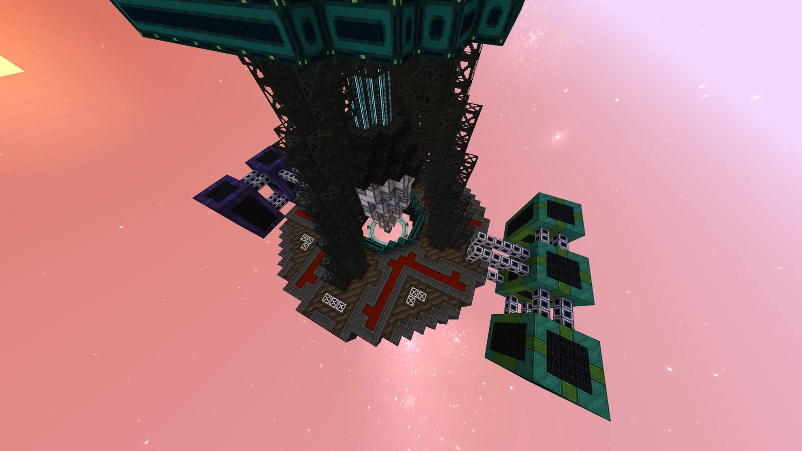
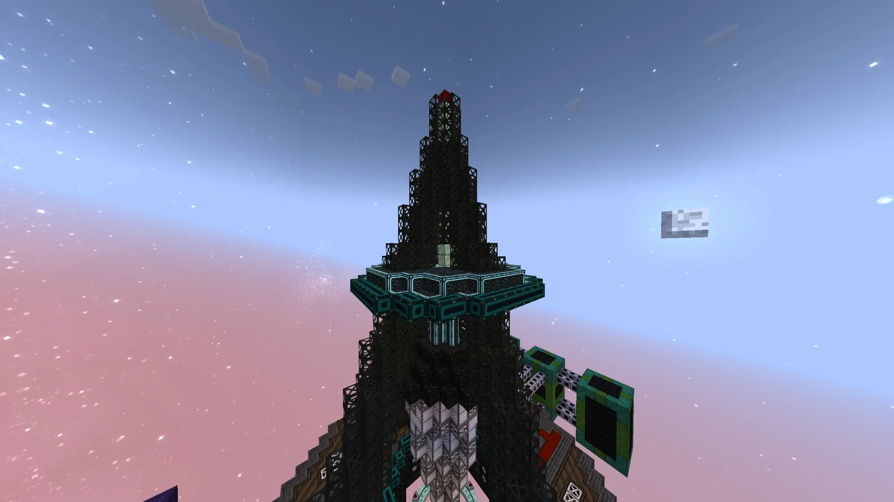
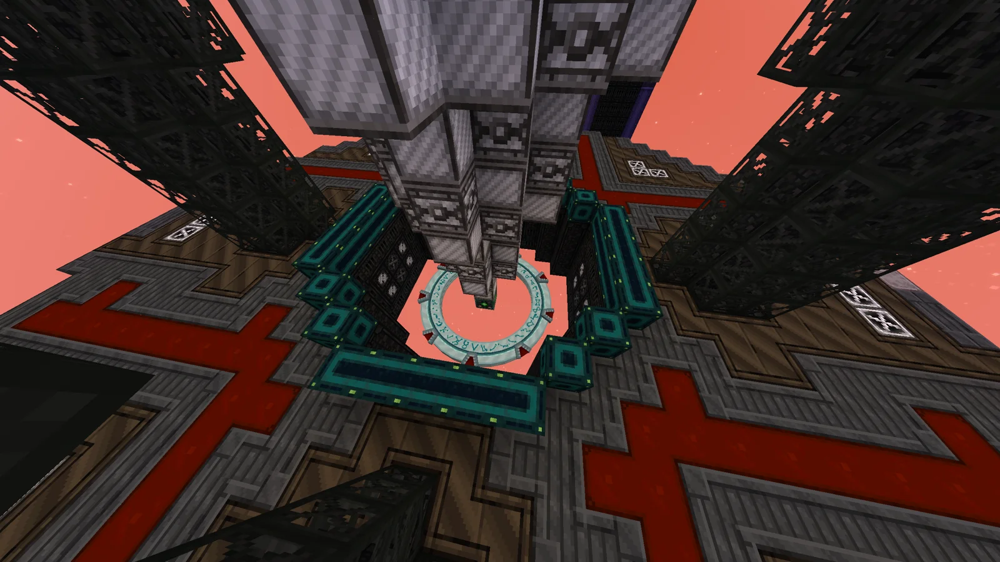
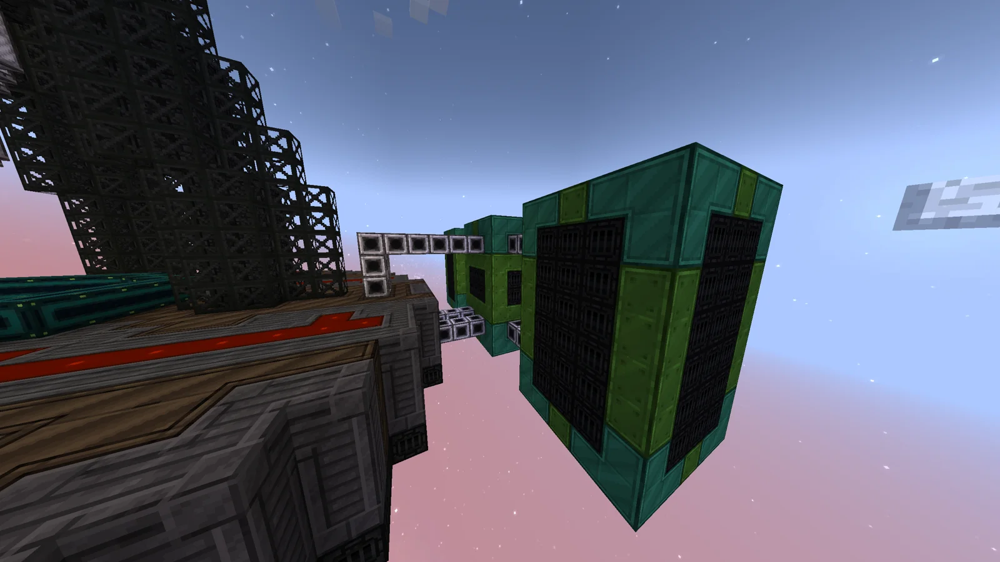
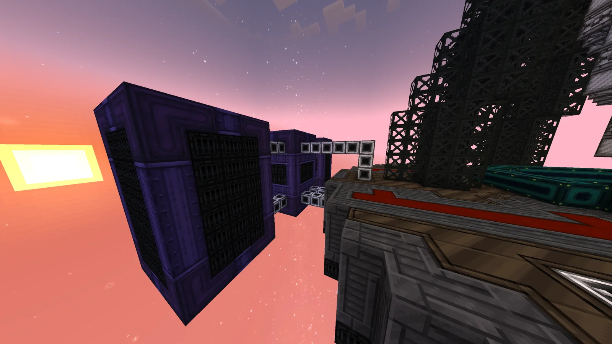

# Diffracting Resource Inter-Dimensional Lithic Loader (D.R.I.L.L.)
<small>**Submitted by:** Luck (@luckytg.), Cry (@dzinhth0), Dungeon Six Potion (@dungeonsixpotion), Martin_mc (@martin_mc) · Multiblock Design Contest, September 2026</small>

!!! quote ""

| | |
|---|---|
| **Target tier** | <UV>UV</UV> |
| **Role** | Processing — Chemical Plant for ores |
| **Schematic** | [drill.litematic](Contest_img/diffracting-resource-inter-dimensional-lithic-loader/drill.litematic) |
| **Original post** | [(D.R.I.L.L.) Diffracting Resource Inter-dimensional Lithic Loader](https://discord.com/channels/1177211394039484477/1554844630451880016) |

## Summary

A <UV>UV</UV> ore-processing multiblock that the authors describe as "essentially a Chemical Plant for ores". It is part of the same team's Stargate Revitalization Project (Abydos), and the authors ask readers to look at that [main submission](https://discord.com/channels/1177211394039484477/1554774954451537950) first, since it holds the full information on the project.

## Mechanics

- **Diffusive Leaching:** the machine outputs the crushed ore variants of Rock Filtrator ores and Molten Ore Mixture ores directly, skipping the extra cutting and macerating steps, for maximum value.
- It can also process sludges and fluids straight down to their final outputs. The authors' example is Rare Ore Residue yielding all of the rare earth dusts and the other dusts that come from Rare Ore Residue.

## Structure

A round casing platform with a Stargate ring set into its center, a tall dark truss drill tower rising above it, and two detached wing modules (one green, one purple) linked to the base by frame and pipe lines; the controller and hatches sit on the front face of the platform. The authors did not state the dimensions.

!!! abstract "Screenshots"

    === "Front"
        

    === "Side"
        

    === "Top view"
        

    === "Drill tower"
        

    === "Stargate base"
        

    === "Green wing"
        

    === "Purple wing"
        

## Files

- [drill.litematic](Contest_img/diffracting-resource-inter-dimensional-lithic-loader/drill.litematic) — Litematica schematic ("Version 3 final")

## Notes from the thread

- Asked whether the Stargate is required for the build, the co-authors replied that it is completely optional and gives better yield.
- Thread feedback found the PEEK casing distracting and suggested a custom casing; a co-author replied that they were unsure what to use and had added Enderium casings to break up the flat look.
