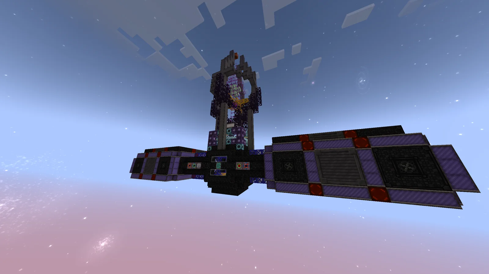
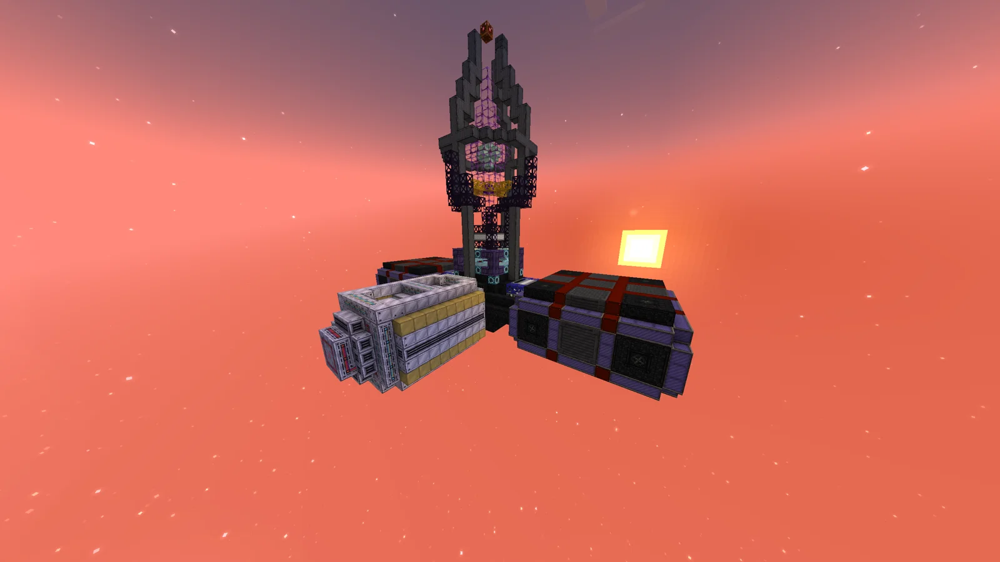
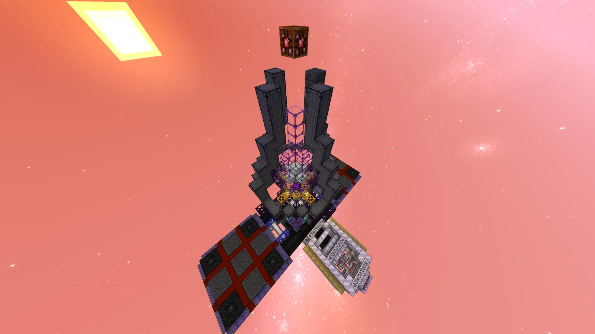
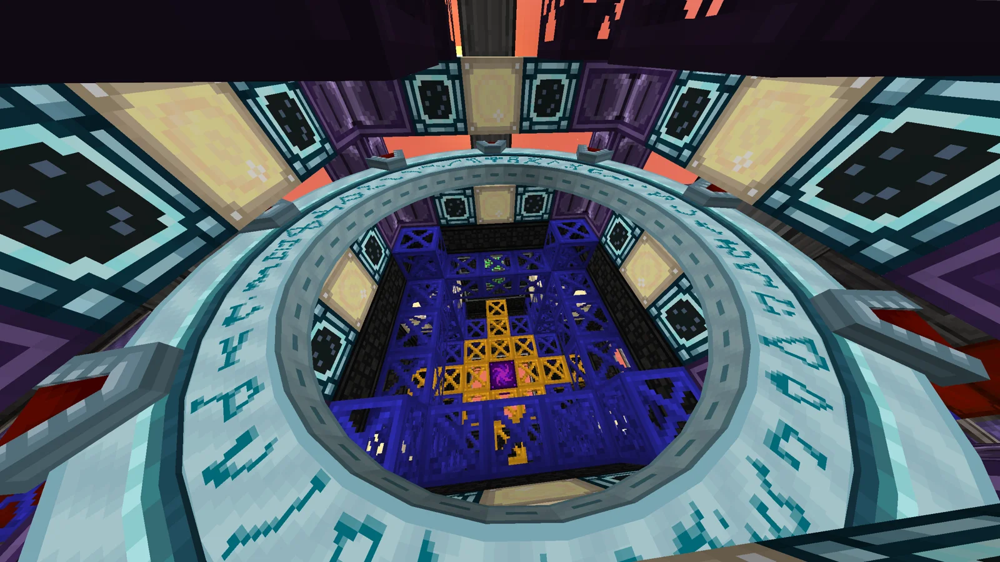
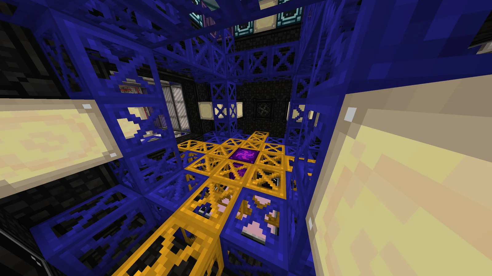
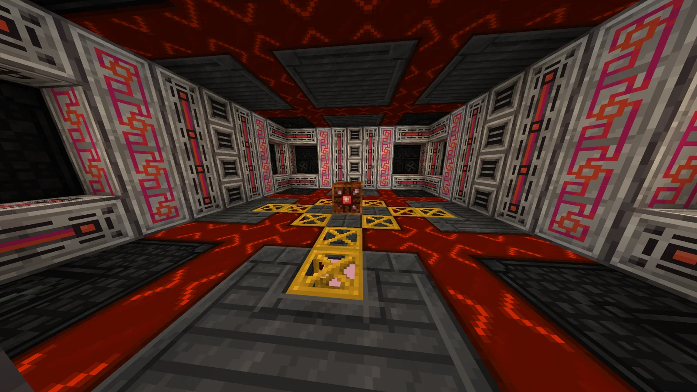

# Dimensional Resonator (D.R.)
<small>**Submitted by:** Luck (@luckytg.), Dungeon Six Potion (@dungeonsixpotion), Cry (@dzinhth0), Martin_mc (@martin_mc) · Multiblock Design Contest, September 2026</small>

!!! quote ""

| | |
|---|---|
| **Target tier** | <UV>UV</UV>+ |
| **Role** | Resource generation — successor to the Dimensional Destabiliser for ASG-gated materials |
| **Schematic** | [dimensional-resonator.litematic](Contest_img/dimensional-resonator/dimensional-resonator.litematic) |
| **Original post** | [(D.R.) Dimensional Resonator](https://discord.com/channels/1177211394039484477/1555259346064252958) |

## Summary

A successor to the Dimensional Destabiliser that lets you obtain materials currently gated behind the ASG earlier in progression, at the cost of Gravi-stars. It can also run as a regular Dimensional Destabiliser. The entry is part of the authors' "Abydos & Stargate Revitalization Project"; they ask that their [A.B.Y.D.O.S. & E.O.H.](https://discord.com/channels/1177211394039484477/1554774954451537950) submission be read first, as that is their main focus and holds the full information on the project.

## Mechanics

- **Reality tearing:** using Gravi-stars, the Dimensional Resonator warps the local fabric of reality until it starts to bleed alien materials.
- The authors suggest UHV catalyst cores as an optional input for higher throughput.
- Optionally, Nether or End coordinate crystals focus the tears toward that dimension, yielding much more of the materials associated with it at the cost of losing the outputs from the other dimensions.
- The structure can also function as a Dimensional Destabiliser.

## Structure

A tall dark-casing spire with a glowing core, flanked by two long low wings (one in purple/red casings, one in white/yellow casings) and topped by a ring; the interior holds a blue-framed core chamber with a golden grid and a red-and-white hall. Co-author Martin_mc notes that the proportions are based on the Abydos pyramids: the tip of the pyramid and the spawners are where the Keelagravers sit, the controller is where the ring panel is, and the Stargate is centered on where the transport rings are. The authors did not state the dimensions.

!!! abstract "Screenshots"

    === "Front"
        

    === "Back"
        

    === "Top view"
        

    === "Ring, looking down"
        

    === "Core chamber"
        

    === "Interior hall"
        

## Files

- [dimensional-resonator.litematic](Contest_img/dimensional-resonator/dimensional-resonator.litematic) — Litematica schematic ("D.R. Version 3 final final")
