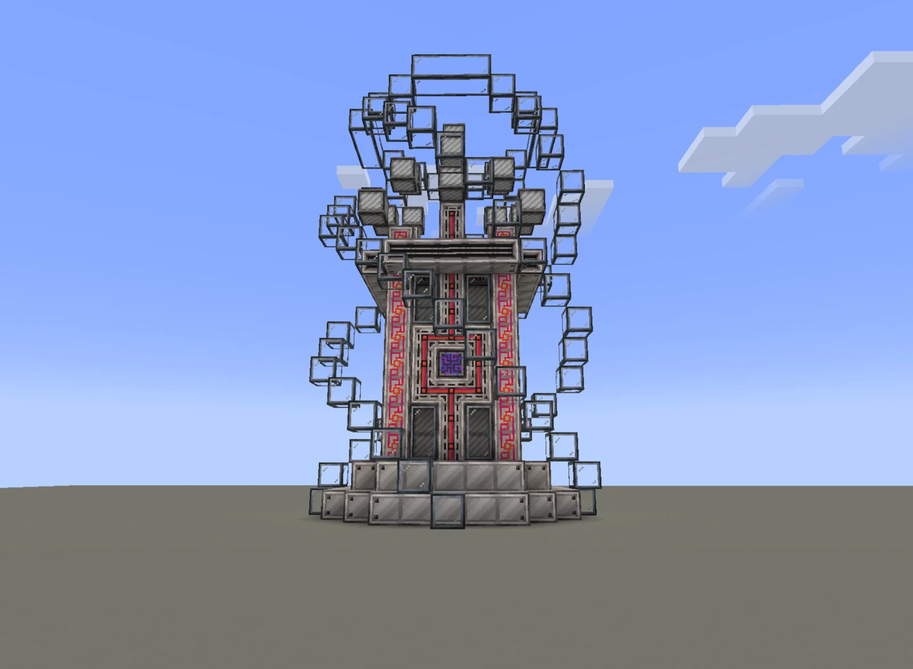
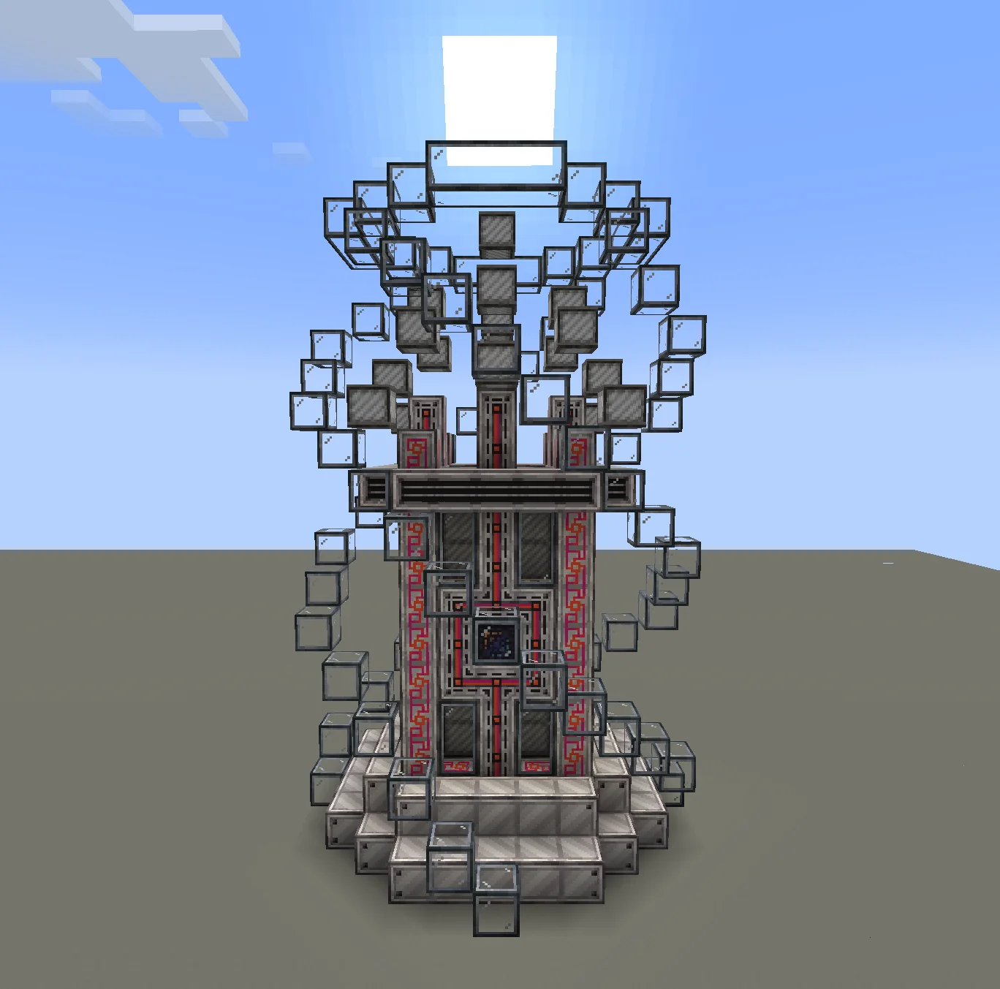
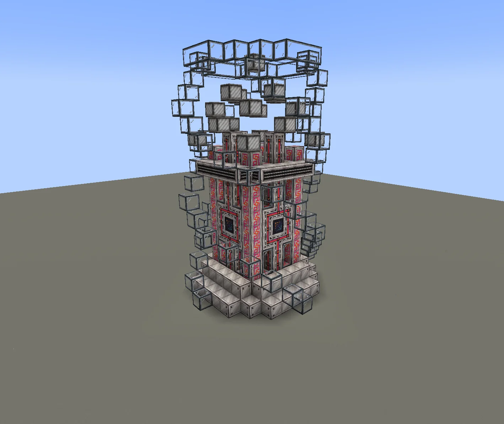
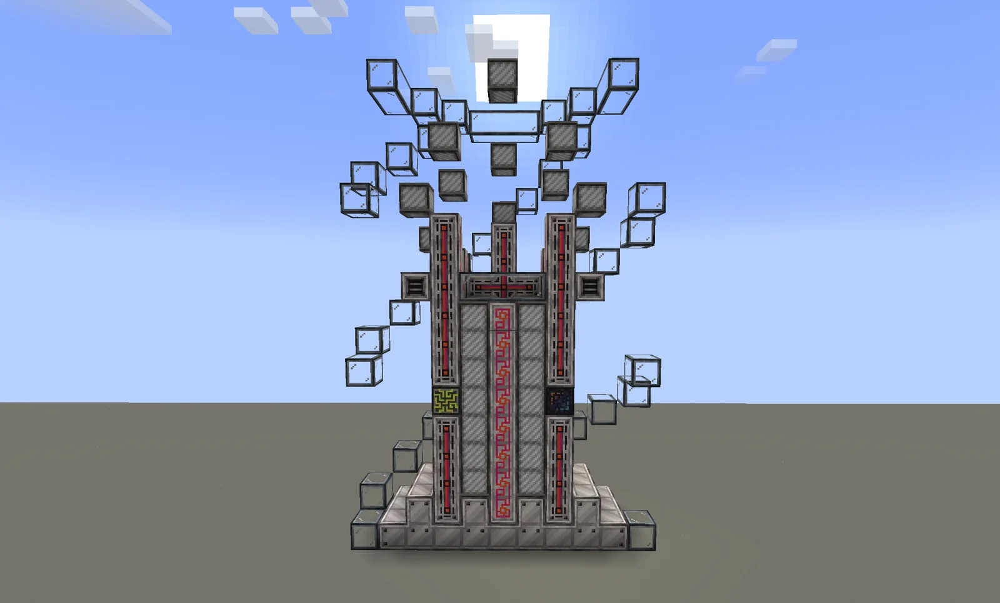
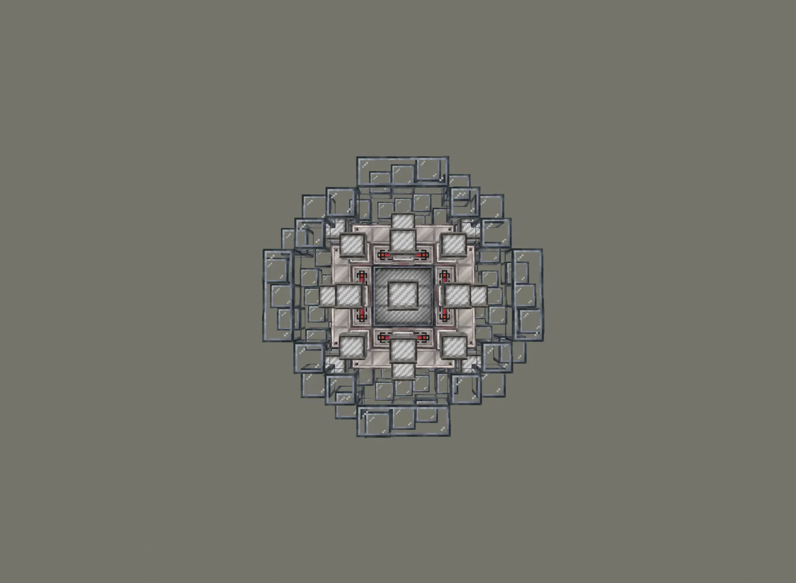

# Dimensional Runically Engraved Energy Access Medium (DREEAM)
<small>**Submitted by:** ggki (@ggki) · Multiblock Design Contest, September 2026</small>

!!! quote ""

| | |
|---|---|
| **Target tier** | <UHV>UHV</UHV> (post-RIMM) |
| **Role** | Utility — one-way cross-dimensional energy transfer |
| **Schematic** | [dreeam-schematic.txt](Contest_img/dimensional-runically-engraved-energy-access-medium/dreeam-schematic.txt) |
| **Original post** | [Dimensional Runically Engraved Energy Access Medium [DREEAM]](https://discord.com/channels/1177211394039484477/1553848171300397179) |

## Summary

A <UHV>UHV</UHV> multiblock that moves energy between dimensions. Two DREEAMs linked together form a **1:1, one-way, cross-dimensional** energy link that uses laser hatches, so a base can be powered regardless of the dimension it sits in. The author's motivation is that there is currently no way to move large amounts of power across dimensions other than spamming energy converters with Flux Networks.

## Mechanics

- Unlocked in <UHV>UHV</UHV>, after the RIMM.
- The only hatches it accepts are **laser hatches**, which replace Computer Casing blocks in the structure.
- Its role is set by the hatches used: **Laser Source Hatches** make it a **receiver**, **Laser Target Hatches** make it a **transmitter**. All hatches on one structure must be of the same orientation (all source or all target).
- A pair is linked with a **data stick**, similar to how ME pattern buffers and proxies are linked.
- The link fails if two transmitters or two receivers are connected together, and also if more than two DREEAMs are connected together.
- Transfer is 1 to 1; the structure consumes **1% of the energy transferred** to power itself.

## Structure

A tall tower of Runic High Power Casings and Runic Computer Casings on a Computer Casing base, wrapped in a loose shell of Fusion Glass and topped with Superconducting Coils and Computer Heat Vents; the controller (shown with a Futura ME controller texture) sits in the middle of the front face. The author did not state the dimensions; the attached schematic has an 11 x 17 x 11 bounding box.

!!! abstract "Screenshots"

    === "Front"
        

    === "Front (low angle)"
        

    === "Angled"
        

    === "Side"
        

    === "Top view"
        

## Files

- [dreeam-schematic.txt](Contest_img/dimensional-runically-engraved-energy-access-medium/dreeam-schematic.txt) — block-state schematic dump (JSON text) with the required block list: 125 Fusion Glass, 97 Computer Casing, 73 Superconducting Coil, 72 Runic Computer Casing, 56 Runic High Power Casing, 20 Computer Heat Vent, 3 Runic Transportation Casing, 1 controller placeholder.
