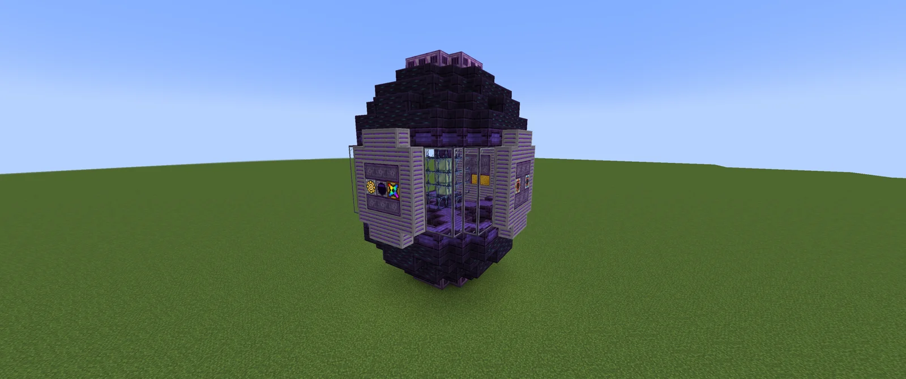
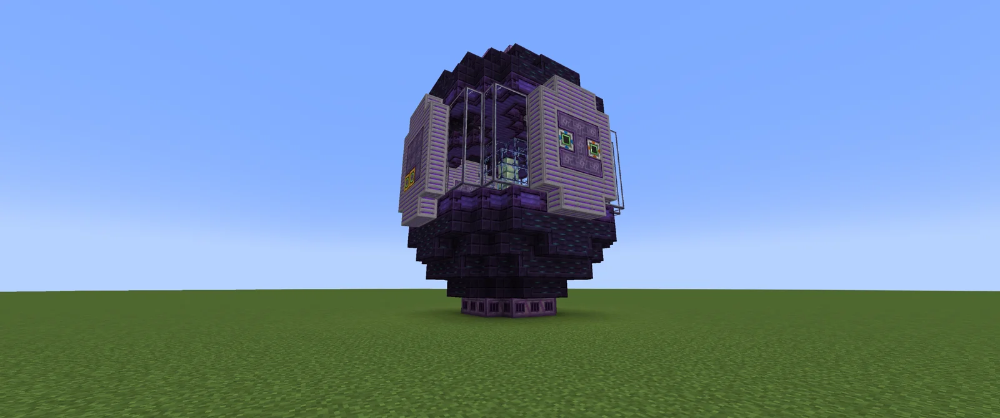
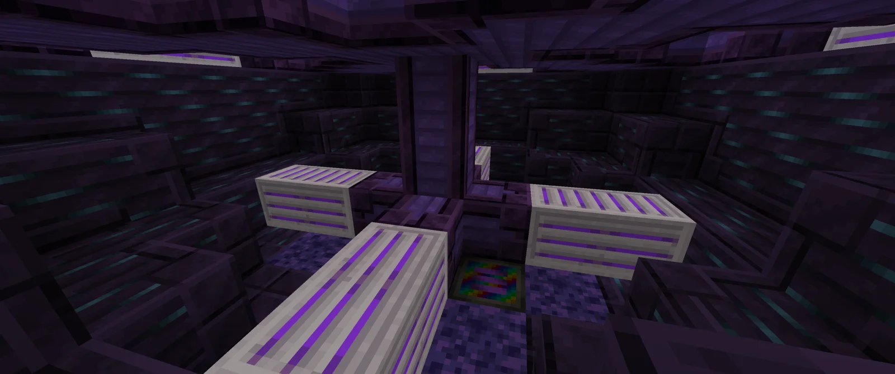
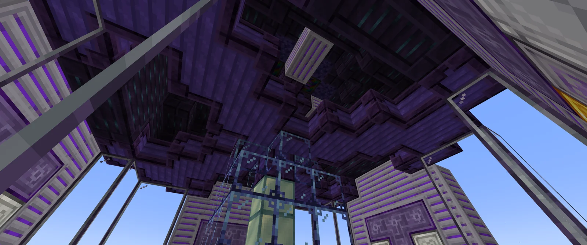

# Draconic Life Breeding Chamber (DLBC)
<small>**Submitted by:** Sonix_790 (@sonix_790) · Multiblock Design Contest, September 2026</small>

!!! quote ""

| | |
|---|---|
| **Target tier** | <UIV>UIV</UIV>, <UXV>UXV</UXV> (just before the DSG) |
| **Role** | Resource generation — Draconic cell production |
| **Schematic** | [dlbc.nbt](Contest_img/draconic-life-breeding-chamber/dlbc.nbt) |
| **Original post** | [Draconic Life Breeding Chamber (D.L.B.C)](https://discord.com/channels/1177211394039484477/1552727651083354242) |

## Summary

A proposed late-game multiblock that offers a more convenient way of obtaining Draconic cells, meant to ease the grind toward the DSG and beyond. It grows the cells on a new growth medium influenced by the environment of the abyss. The convenience comes at a cost: the structure must maintain a specific internal atmosphere, it draws more power (forced overclock to <UXV>UXV</UXV>), and the recipe is slow, since it would essentially be duplicating Draconic cells.

## Mechanics

- **Atmosphere upkeep:** the chamber consumes some kind of void fluid to prime its internal atmosphere first, then consumes a smaller amount to maintain it. The author compares this to the heat mechanic of the Hell Forge or the saturation mechanic of the Abyssal Isolation Chamber.
- **Power:** recipes are force-overclocked to <UXV>UXV</UXV>.
- **Time:** the recipe is intentionally long, as it amounts to duplicating Draconic cells.
- **Threading:** the author includes threading as a way to accelerate the very long recipe and to expand the machine's options.
- **Draco-peptide production (proposed):** with the same idea, the machine could double as a Draco-peptid producer, based on a possibly expensive craft of a self-replicating strain.
- The author notes they are not familiar with progression at this point and asks to be told if the design is game-breaking.

## Structure

An egg-shaped build of dark purple blocks with a band of purple-striped casings and glass windows around the middle, a central pillar inside, and the controller on one face of the casing band. The author did not state the dimensions.

!!! abstract "Screenshots"

    === "Front"
        

    === "Back"
        

    === "Interior"
        

    === "Interior ceiling"
        

## Files

- [dlbc.nbt](Contest_img/draconic-life-breeding-chamber/dlbc.nbt) — structure block (NBT) schematic

## Notes from the thread

- The author originally wanted to call the structure "EGG"; the thread suggested alternative names, but the submission keeps "Draconic Life Breeding Chamber".
- Asked whether the machine could make dragons, the author suggested a recipe for incubating an embryo could be added.
