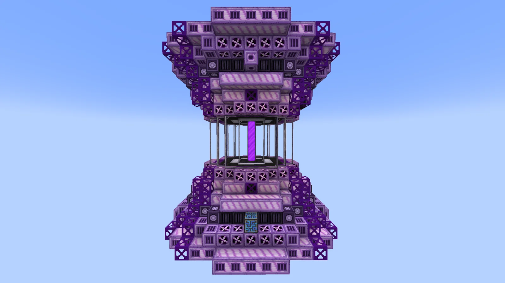
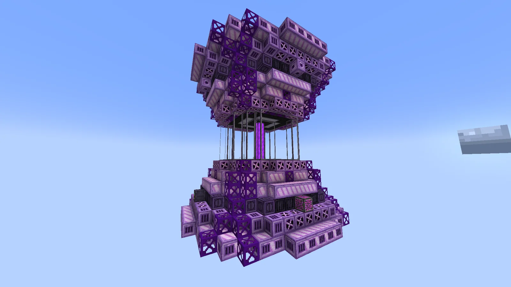
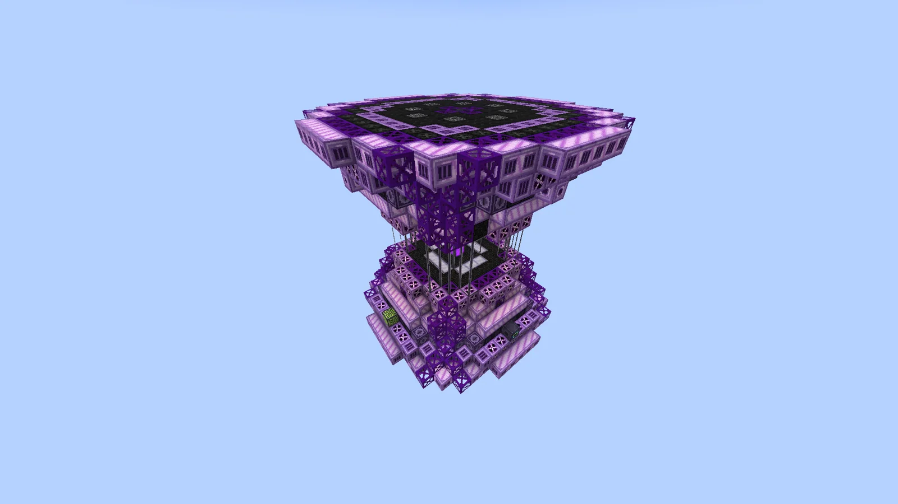
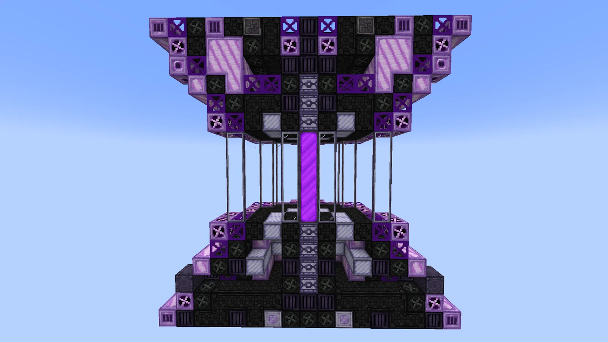
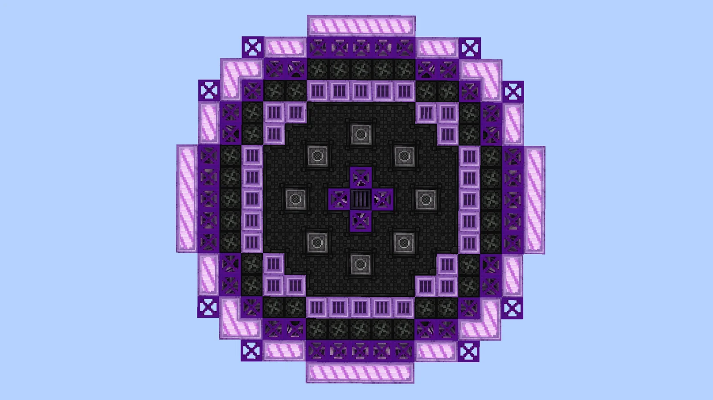
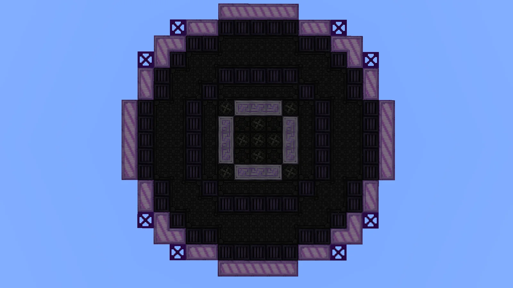

# Draconic Nuclear Reactor (DNR)
<small>**Submitted by:** Smephy (@smephy) · Multiblock Design Contest, September 2026</small>

!!! quote ""

| | |
|---|---|
| **Target tier** | <UEV>UEV</UEV> |
| **Role** | Processing — bulk Nuclear Reactor for endgame Fermium |
| **Schematic** | [dnr-template.txt](Contest_img/draconic-nuclear-reactor/dnr-template.txt) |
| **Original post** | [Draconic Nuclear Reactor](https://discord.com/channels/1177211394039484477/1554982596533026896) |

## Summary

A post-draconic, pre-abyssal multiblock that runs the nuclear reactor recipes (the ones that use fuel rods) in bulk. The author describes it as a simple bulk nuclear reactor whose purpose is to mass-produce Fermium in the endgame; it adds no new mechanics beyond that.

## Mechanics

- Runs the existing nuclear reactor recipes (fuel-rod recipes) in bulk.
- No additional mechanics; the author states it is "just a simple bulk nuclear reactor".
- Intended for mass production of Fermium at <UEV>UEV</UEV>, after the draconic stage and before the abyssal stage.
- Hatch layout: 1 controller, 1 input bus, 1 input hatch, and 1 output bus, one on each face of the multiblock.

## Structure

An hourglass-shaped purple structure: two wide, stepped casing blocks (top and bottom) joined by an open column of frames around a central glowing pillar. The author did not state the dimensions.

!!! abstract "Screenshots"

    === "Front"
        

    === "Angled view"
        

    === "Top"
        

    === "Cross-section"
        

    === "Interior layer 1"
        

    === "Interior layer 2"
        

## Files

- [dnr-template.txt](Contest_img/draconic-nuclear-reactor/dnr-template.txt) — block-state template of the structure (JSON block list saved as a .txt file)

## Notes from the thread

- A commenter questioned the target tier, arguing that GCrops trivialize Fermium and Einsteinium after <UHV>UHV</UHV>.
- Another commenter noted that fission is currently being reworked; the author replied that they had not gone deep into the concept and mainly wanted to propose a new reactor design.
