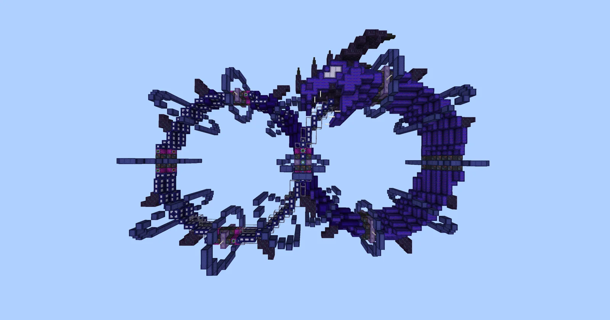
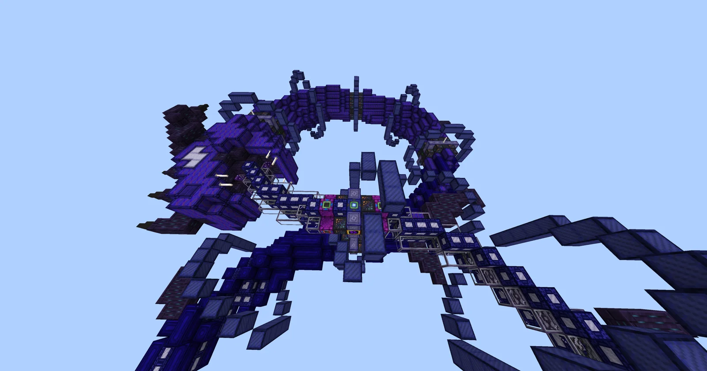
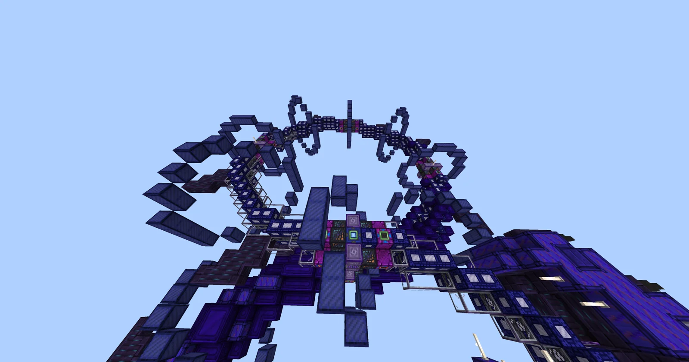
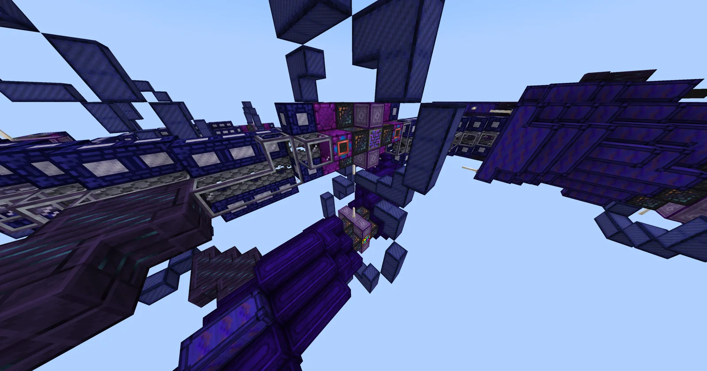
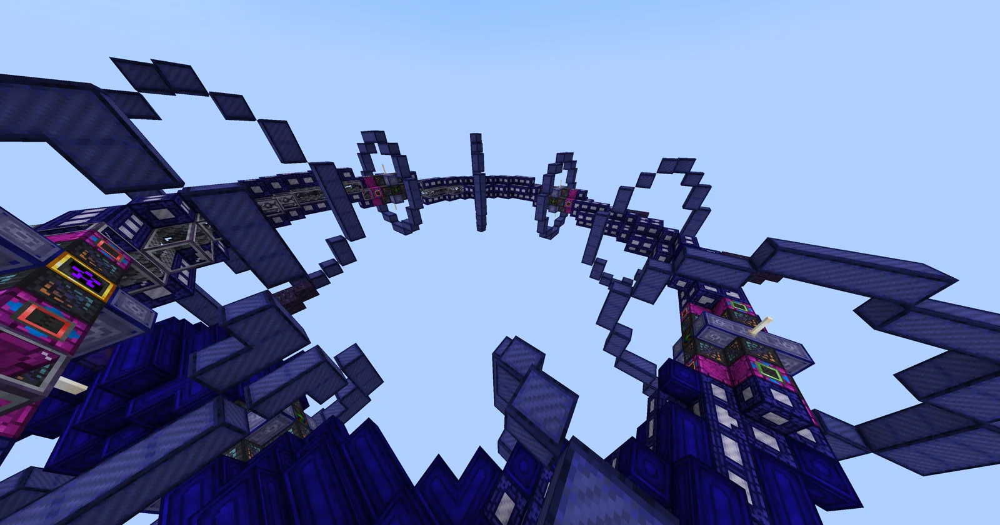
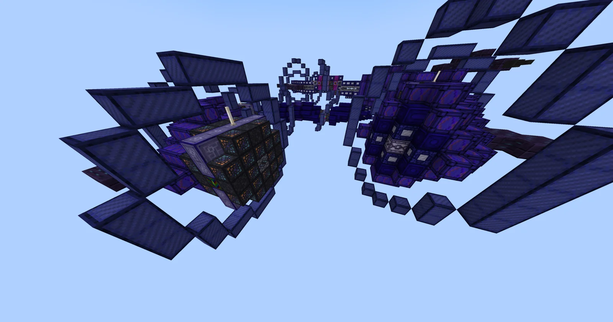
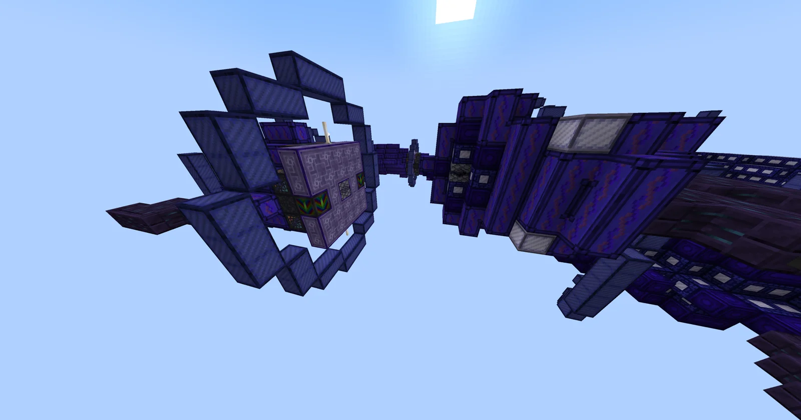
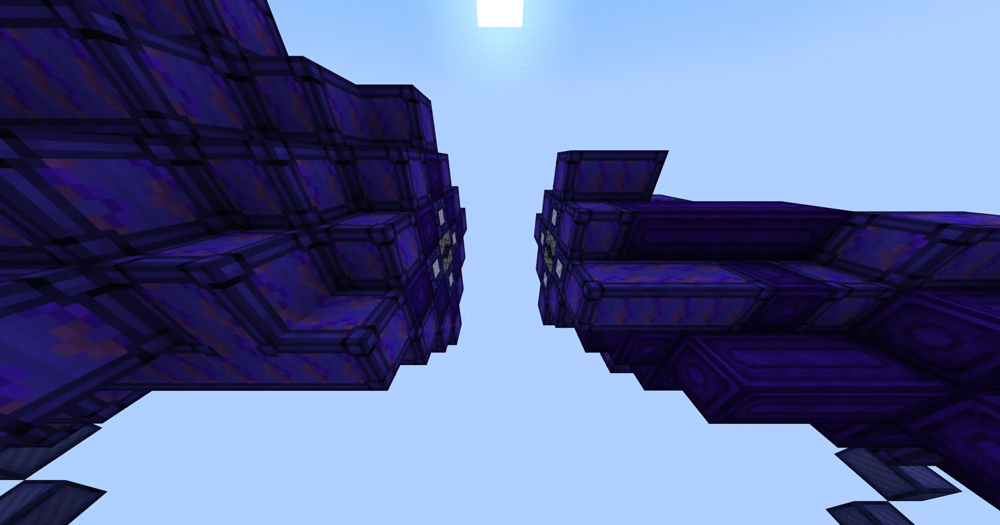

# Draconic Reactor for Accelerated Generation of Ouroboric Nanofusion (DRAGoN)
<small>**Submitted by:** Kiiyoko (@kiiyoko) · Multiblock Design Contest, September 2026</small>

!!! quote ""

| | |
|---|---|
| **Target tier** | <OpV>OpV</OpV> (post-DSG) |
| **Role** | Processing — threaded, absolute-parallel Fusion Reactor |
| **Schematic** | [dragon.json](Contest_img/draconic-reactor/dragon.json) |
| **Original post** | [Draconic Reactor for Accelerated Generation of Ouroboric Nanofusion [DRAGoN]](https://discord.com/channels/1177211394039484477/1553147869052149893) |

## Summary

An absolute-parallel, threading, bulking and batching Fusion Reactor built as a dragon eating its own tail. The concept comes from a developer idea channel; the author got permission to build the structure for it. It is intended as a post-DSG machine and replaces the usual energy hatches with laser inputs so that the EU cost of running many different plasmas at once through multi-threading can be covered.

## Mechanics

- Accepts an absolute parallel hatch, a threading controller, and 13 threading helices.
- Does not accept energy hatches like a traditional Fusion Reactor; it has two laser inputs instead, to accommodate the EU cost of multi-threading many different plasmas.
- All other threading stat points are expected to work as usual.
- The structure counts 138 reflector casings, 543 reactor casings, and 395 fusion coils.
- As a post-DSG structure the author expects the casings to be higher tier than the ones used; no matching casings exist yet, so the build uses what is already in the game. The author wanted to retexture them via KubeJS but could not, since the fusion coils and casings come from the core mod.

## Structure

A serpentine dragon roughly 42x20x71 blocks (far beyond the normal 17x17x17 limit, with permission granted). The body forms a closed loop with the tail ending in the dragon's mouth; the controller sits in the central hatch column next to the ME controller (visible in the "Controller and hatches" screenshot). The glass is used to make the tail look thinner near the mouth and ideally should not be swappable. Wire NBT is not saved by the copy-paste tool, so the wires can be removed if they render badly in EMI or are incompatible with GT structures.

!!! abstract "Screenshots"

    === "Full view"
        

    === "Body and head"
        

    === "Central hub"
        

    === "Controller and hatches"
        

    === "Interior ring"
        

    === "Head and tail"
        

    === "Head"
        

    === "Jaw"
        

## Files

- [dragon.json](Contest_img/draconic-reactor/dragon.json) — copy-paste tool schematic (JSON block-state dump; wire NBT is not included)

## Notes from the thread

- Luzifer Senpai (@luzifer_senpai) confirmed that the size limit can be exceeded when permission is requested, credited the underlying concept as his own original sketch, and called the build a very good representation of it. The final name was also suggested by Luzifer.
- Scarlet (@cosmic_rampage) raised that the end rods used as teeth may not work because the structure file cannot specify rotation; Luzifer replied that the startup script can define rotation, existing multis already use it, and support would be added if needed.
- Asked where the controller is, the author pointed to the fourth screenshot, next to the ME controller.
