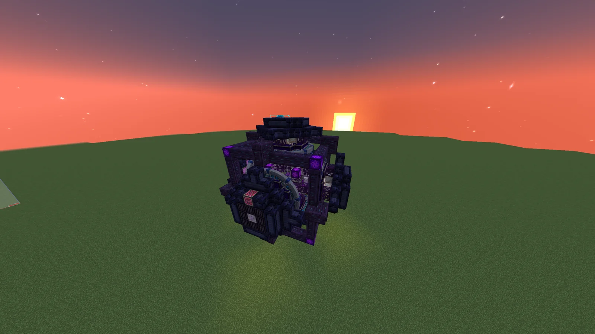
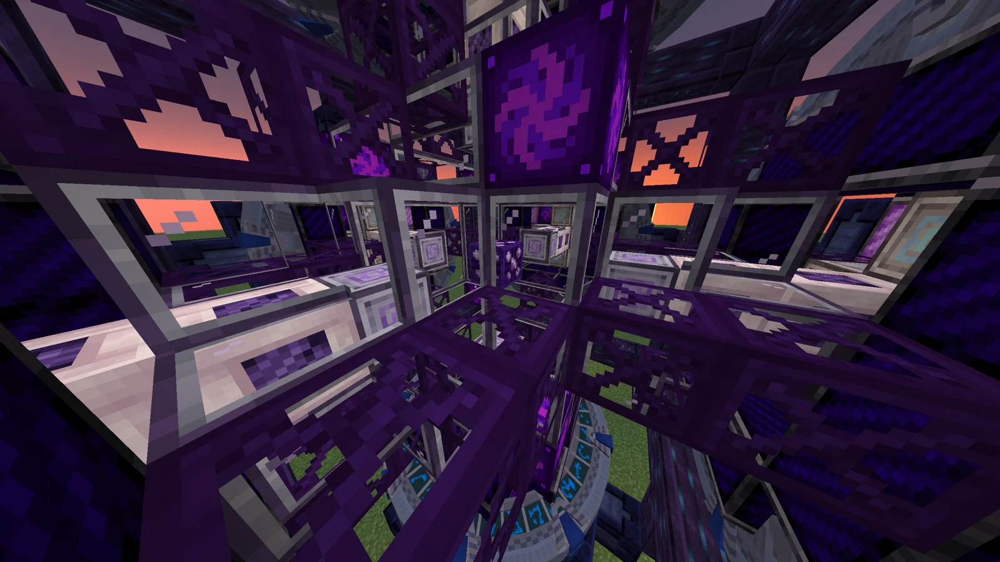
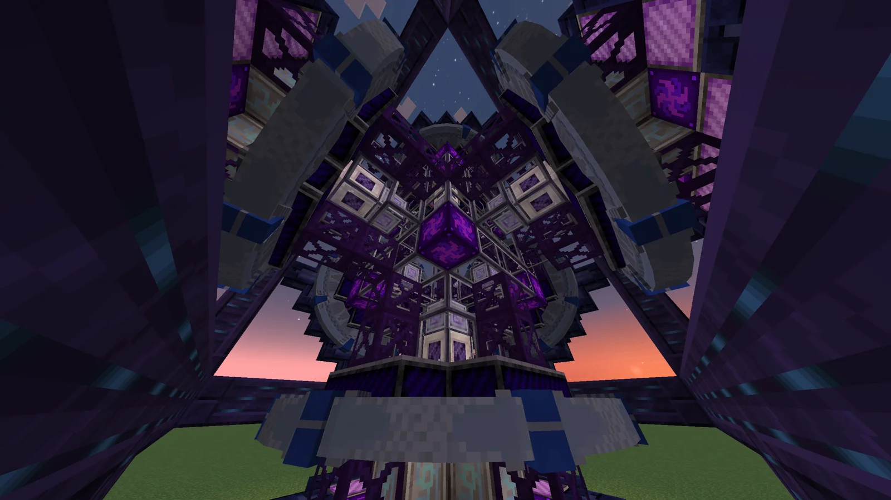
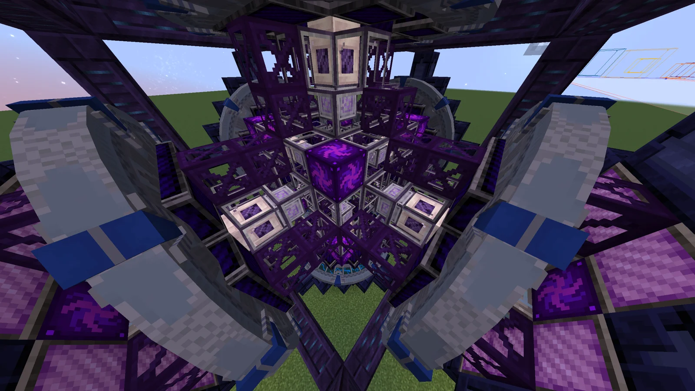

# Draconic Stargate Guided Circuit Assembler
<small>**Submitted by:** Luck (@luckytg.), Cry (@dzinhth0), Martin_mc (@martin_mc), Dungeon Six Potion (@dungeonsixpotion) · Multiblock Design Contest, September 2026</small>

!!! quote ""

| | |
|---|---|
| **Target tier** | Post-DSG |
| **Role** | Processing — endgame circuit assembler |
| **Schematic** | [dsg-circuit-assembler.litematic](Contest_img/draconic-stargate-guided-circuit-assembler/dsg-circuit-assembler.litematic) |
| **Original post** | [Draconic Stargate Guided circuit assembler](https://discord.com/channels/1177211394039484477/1555276507155275857) |

!!! warning "Incomplete submission"

    The post gives no mechanics beyond a one-line summary: no recipes, parallels, speed, or power figures are stated, and the target tier is given only as "Post-DSG" rather than a voltage tier.

## Summary

A "super ultra" circuit assembler intended for the very end of the pack, after the DSGs are available. The authors describe it as the be-all-end-all of circuit assembly: with the power of the DSGs, they hope it will cover every circuit assembly need until the end of the adventure.

## Mechanics

- Functional summary as stated by the authors: a super ultra circuit assembler.
- Powered by the DSGs; no further mechanics, numbers, or recipe details were given.

## Structure

A roughly cubic structure built from dark purple and lilac blocks, with a lighter cross-braced frame and a central purple cube visible through the open interior. The authors did not state the dimensions.

!!! abstract "Screenshots"

    === "Exterior"
        

    === "Interior looking up"
        

    === "Interior core"
        

    === "Interior from above"
        

## Files

- [dsg-circuit-assembler.litematic](Contest_img/draconic-stargate-guided-circuit-assembler/dsg-circuit-assembler.litematic) — Litematica/Forgematica schematic
