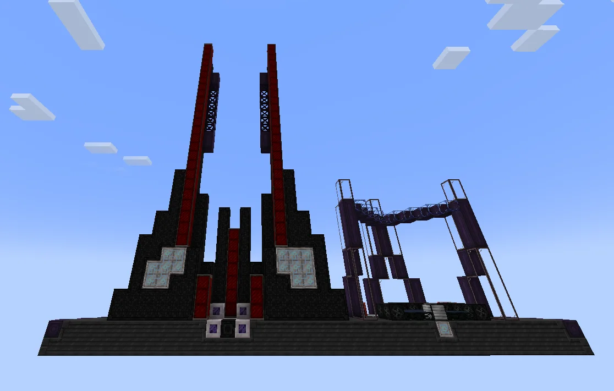
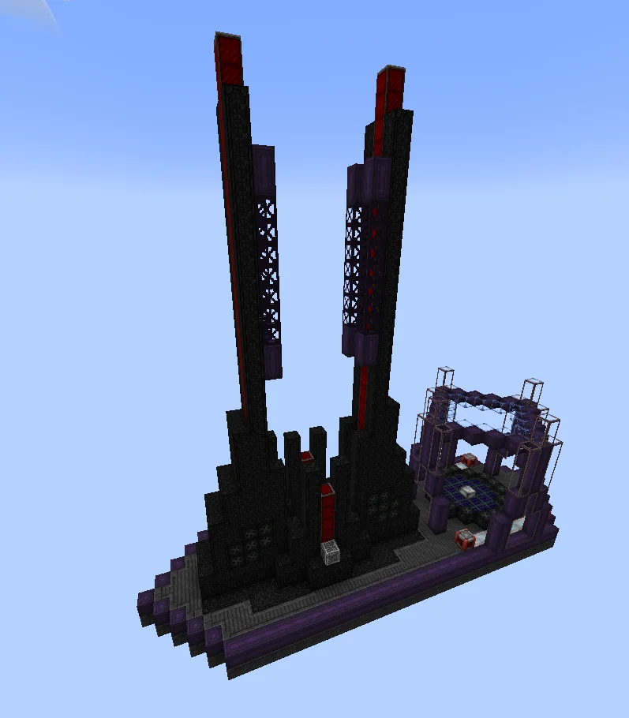
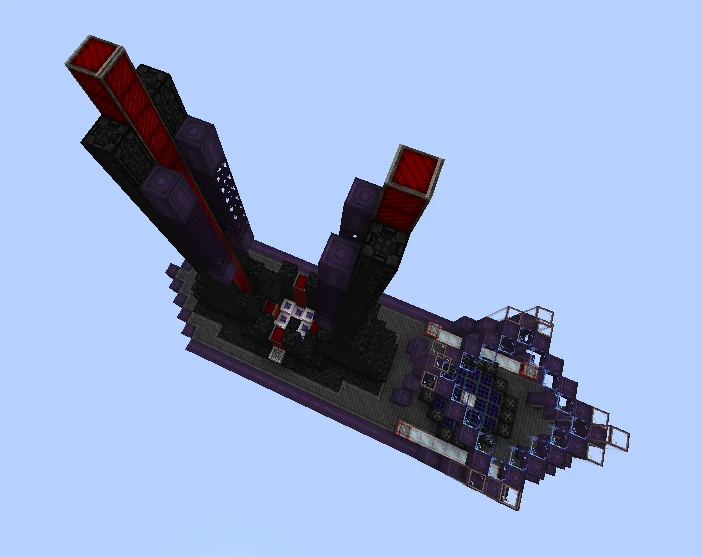
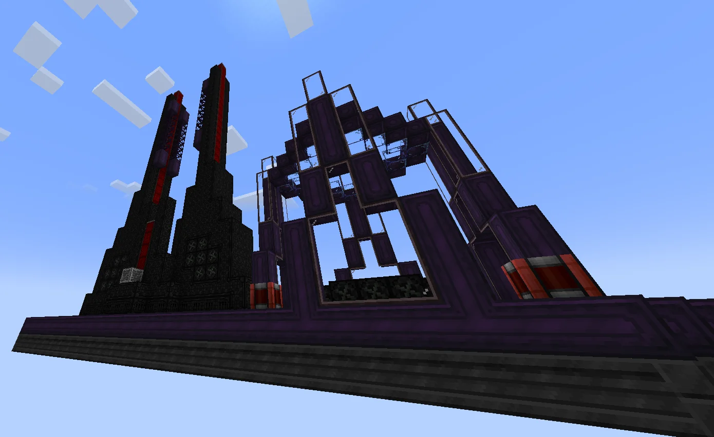

# Dyson Swarm Rail Cannon (DSRC)
<small>**Submitted by:** Dylan the Deltawolfy (@dylan_the_deltawolfy) · Multiblock Design Contest, September 2026</small>

!!! quote ""

| | |
|---|---|
| **Target tier** | <UHV>UHV</UHV> |
| **Role** | Power generation — drone-boosted solar array that also runs at night |
| **Schematic** | [dsrc.nbt](Contest_img/dyson-swarm-rail-cannon/dsrc.nbt) |
| **Original post** | [Dyson Swarm Rail Cannon (DSRC)](https://discord.com/channels/1177211394039484477/1554753607453122580) |

## Summary

A solar power multiblock that builds on Star Technology's premise for solar, where valuable high-tier chip materials are spent for power instead of fuel. The DSRC multiplies the output of the solar panels it holds by consuming manufactured Dyson Swarm Drones, which the author intends to bring solar up to par with other energy sources. Unlike regular solar, it also works at night.

## Mechanics

- The DSRC is a solar array that runs parallels, effectively multiplying its output, depending on the drone it is supplied with.
- It has **20** solar panel slots and accepts any panel. The array stresses the panels to their limit, immediately setting their temperature to **950 K** regardless of conditions.
- The cycle is still 6 seconds. Every 6 seconds the machine consumes one Dyson Swarm Drone and launches it into interplanetary space.
- The output of all solar panels is then multiplied by **X**, where X depends on the tier and complexity of the drone; more drone options are unlocked at various points of progression.
- At <UHV>UHV</UHV> the author suggests X could be **8**, making the array roughly equal to a slightly worse <UHV>UHV</UHV> solar array, with the added benefit of running at night.
- Swarm drones should be complex to craft but come in large quantities, for example **200** per craft.
- The machine only works with laser hatches.
- The author notes that the numbers above can easily be subject to change.

## Structure

An oversized two-part structure on a shared purple-and-gray base: on the left, a black-and-red launch cannon with two tall angled rails; on the right, an open-framed receiver lens that holds the solar cells. The author states the structure is oversize and that permission for this was given; dimensions were not stated.

!!! abstract "Screenshots"

    === "Front"
        

    === "Angled overview"
        

    === "Top view"
        

    === "Receiver lens"
        

## Files

- [dsrc.nbt](Contest_img/dyson-swarm-rail-cannon/dsrc.nbt) — structure block (NBT) schematic

## Notes from the thread

- Asked how the machine receives power, the author clarified that the right-hand structure is the receiver lens with the solar cells.
- A commenter noted that a Dyson sphere multiblock had already been showcased by someone else; the author replied that the two concepts are far apart beyond sharing the Dyson idea.
