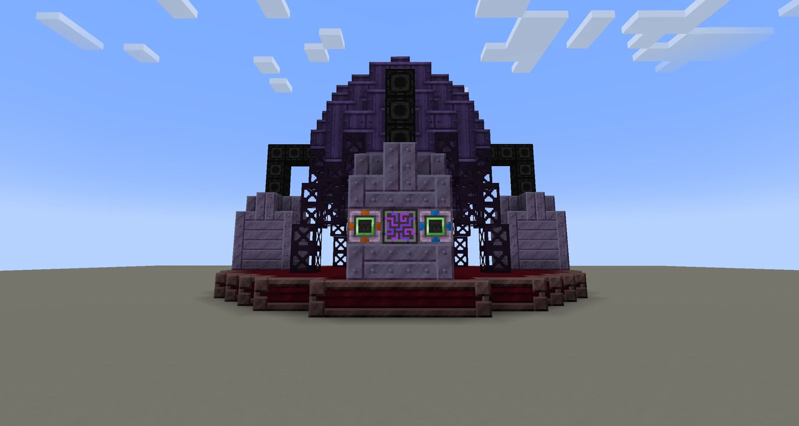
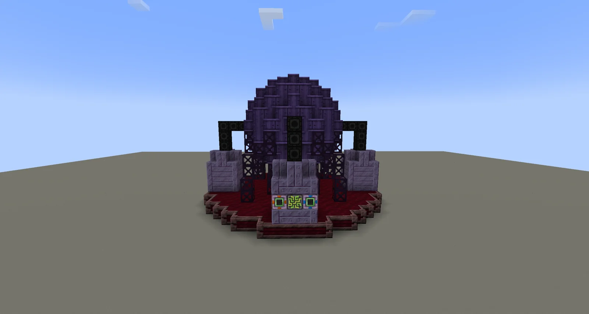
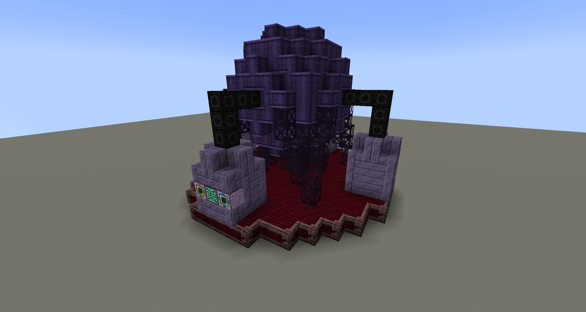
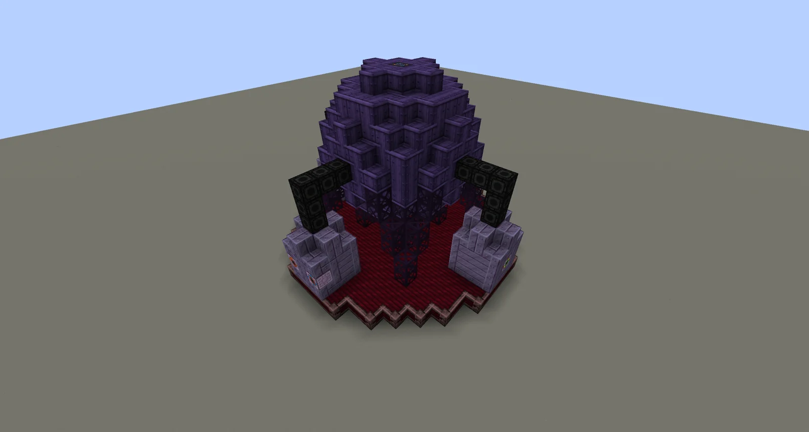
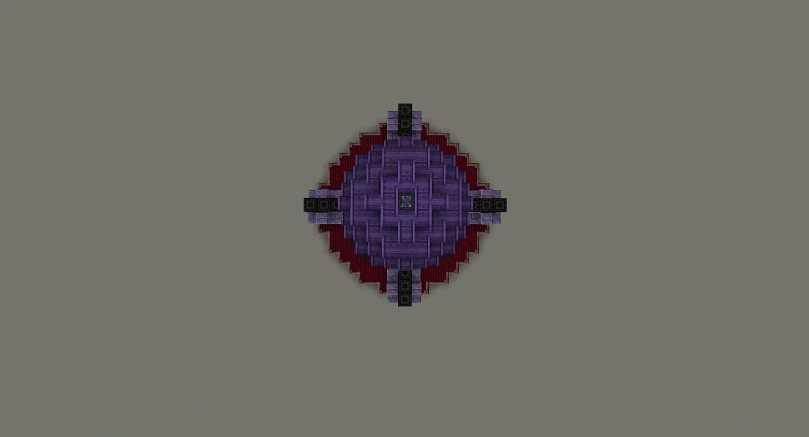
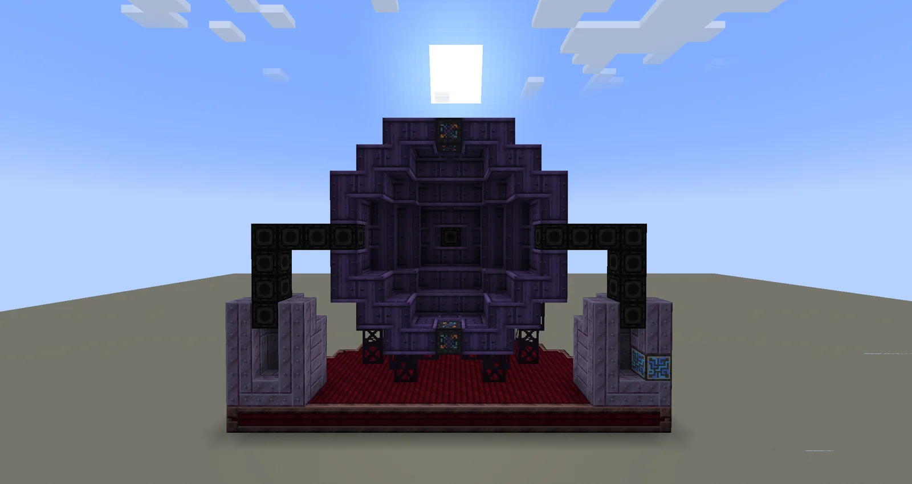

# Forgotten Phase Shifter (FPS)
<small>**Submitted by:** GenerusWeebius (@generusweebius), ggki (@ggki) · Multiblock Design Contest, September 2026</small>

!!! quote ""

| | |
|---|---|
| **Target tier** | Late <UHV>UHV</UHV> - Early <UEV>UEV</UEV> (ASG line) |
| **Role** | Processing — changes the phase of input matter through an automation challenge |
| **Schematic** | [fps-schematic.txt](Contest_img/forgotten-phase-shifter/fps-schematic.txt) |
| **Original post** | [Forgotten Phase Shifter](https://discord.com/channels/1177211394039484477/1553428854394200175) |

## Summary

A late-game multiblock inspired by pressure-temperature phase diagrams. Given matter in one state (for example a gas or a liquid), it lets you produce that same matter in a different state (for example Liquid Helium to Superfluid Helium) by solving an automation challenge. The authors propose that it replaces the ability to make Oganesson BEC and Helium Superfluid in the CQC, and that it also enables exotic phases of matter such as liquid crystals.

## Mechanics

- Input: matter in a given state; output: the same matter in a different phase.
- The phase change is not a plain recipe but an automation challenge, inspired by pressure-temperature phase diagrams. The full challenge is described in the authors' Google Doc (linked under Files); the authors note the machine is "pretty complex" and invite questions in the thread.
- Intended to take over the Oganesson BEC and Helium Superfluid recipes currently made in the CQC.
- Intended to unlock exotic phases of matter such as liquid crystals.
- Targeted at the ASG line, late <UHV>UHV</UHV> to early <UEV>UEV</UEV>.

## Structure

A large purple dome-shaped body of Tritanic Blasting Casing and Noble Mixing Casing sits on a raised dark red platform, braced by Trinaquadalloy Frame struts and black Enriched Naquadah Pipe Casing columns at the four cardinal sides; four short Sturdy Machine Casing pillars around the base carry the hatches and the controller. The schematic lists 647 blocks in total: 221 Tritanic Blasting Casing, 212 Noble Mixing Casing, 109 Sturdy Machine Casing, 68 Trinaquadalloy Frame, 28 Enriched Naquadah Pipe Casing, 2 Runic Stabilization Casing, 2 Input Hatches, 2 Input Buses, 1 Output Hatch, 1 Output Bus and 1 controller. The authors did not state the dimensions.

!!! abstract "Screenshots"

    === "Front"
        

    === "Hatch side"
        

    === "Angled view"
        

    === "Elevated view"
        

    === "Top view"
        

    === "Cross-section"
        

## Files

- [fps-schematic.txt](Contest_img/forgotten-phase-shifter/fps-schematic.txt) — block-state schematic dump (JSON) with the full block list; the hatches in it are EV-tier placeholders and a Chisel block stands in for the controller (posted by co-author ggki)
- [Critical Phase Shifter StarT Submission](https://docs.google.com/document/d/10AsslWUoEqr6129mItdMffL8xRPJI0HEBnTIcuyT3gM/edit?usp=drivesdk) — external Google Doc with the in-depth mechanics and the automation challenge
