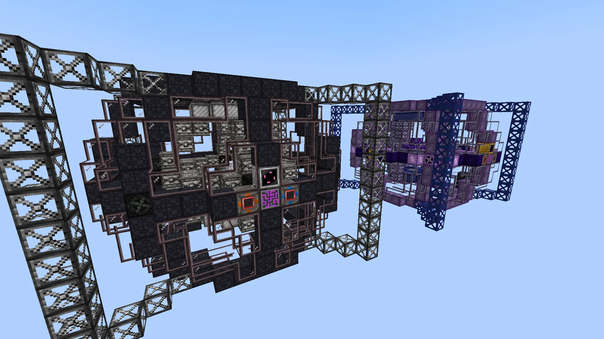
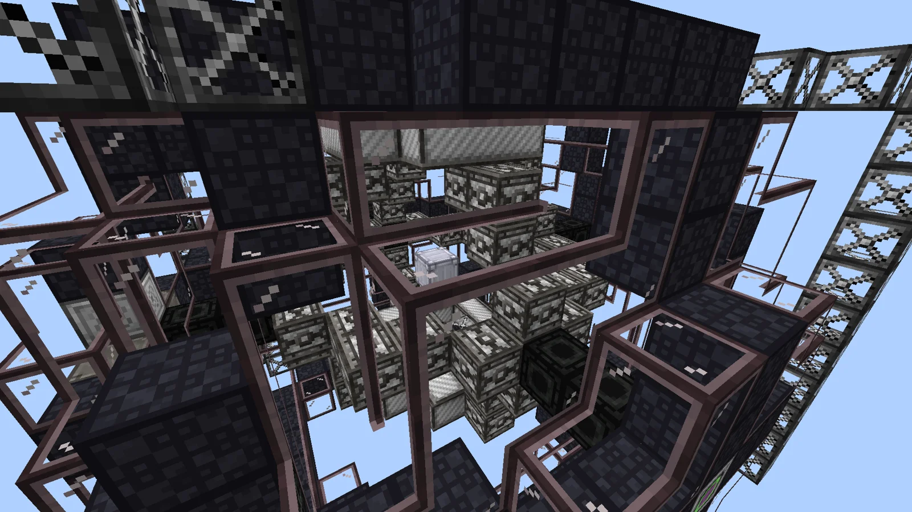
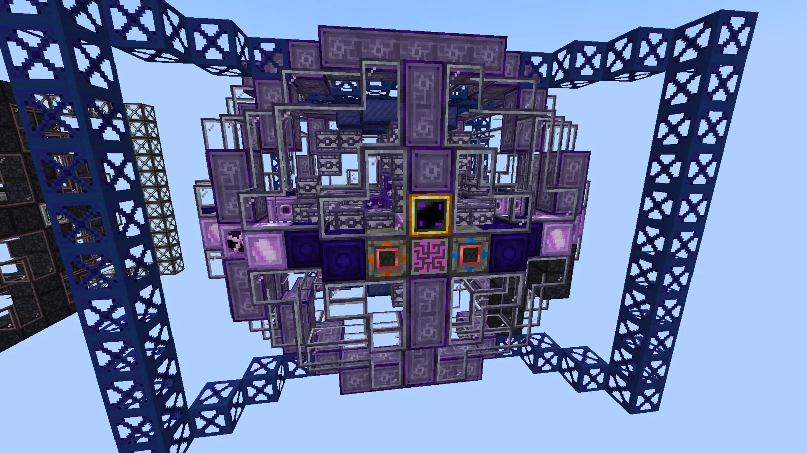
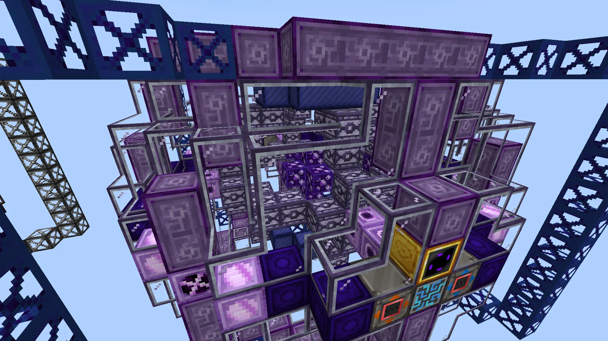
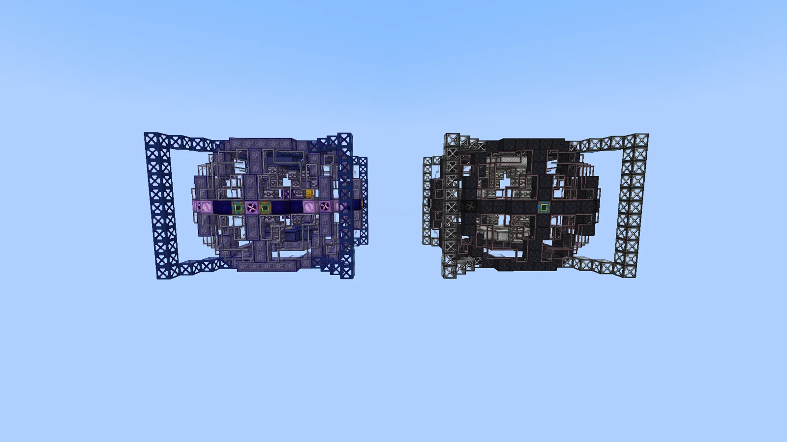
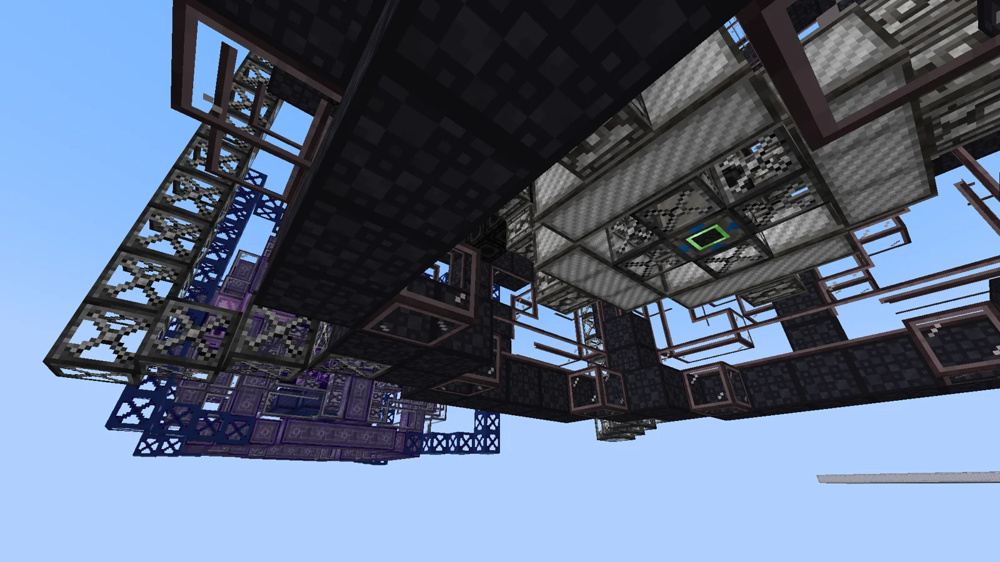
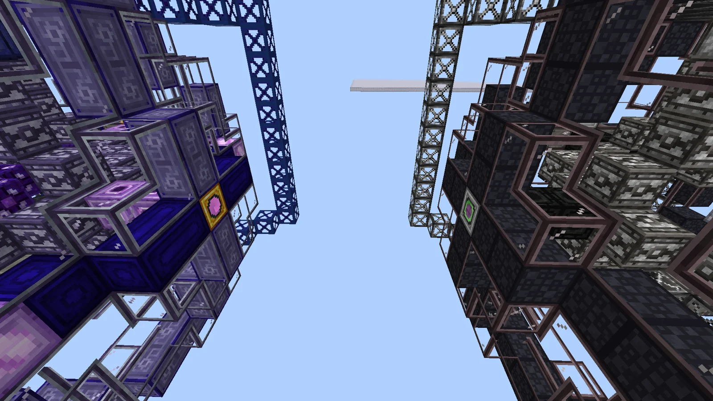

# Fusion Reactor On Zero Energy Nodes and Crushed Riftic μonic Cold Internal Borealic Engine (FROZEN and CRμCIBLE)
<small>**Submitted by:** 2treehouse2 (@2treehouse2_7771), 2treehouse1 (@2treehouse1) · Multiblock Design Contest, September 2026</small>

!!! quote ""

| | |
|---|---|
| **Target tier** | <UHV>UHV</UHV> (FROZEN) and <UXV>UXV</UXV> (CRμCIBLE) |
| **Role** | Multi-structure family — two Cold Fusion Reactors that output solids |
| **Schematic** | [frozen.nbt](Contest_img/frozen-and-crucible/frozen.nbt), [crucible.nbt](Contest_img/frozen-and-crucible/crucible.nbt) |
| **Original post** | [FROZEN and CRμCIBLE(names too long to fit)](https://discord.com/channels/1177211394039484477/1554022003319767070) |

## Summary

Two Cold Fusion Reactors at different tiers. Both require an input of muon-dense akreyrium to function; in exchange they output fusion products as **solids** instead of plasma (a recipe that would normally make a plasma makes a gas instead). The FROZEN is the <UHV>UHV</UHV> multiblock and the CRμCIBLE is the <UXV>UXV</UXV> multiblock. Some recipes are exclusive to the CRμCIBLE and require neutral riftions to create new products.

The authors say the lower-tier reactor is based on the real concept of muon-catalyzed fusion, where muons make molecules so small that they can randomly fuse.

## Mechanics

Shared by both reactors:

- Each reactor tracks a **muonic saturation** value. If it is too low, fusion reactions do not occur; if it is too high, other side reactions occur instead.
- Saturation is managed by inputting (or withholding) muon-dense akreyrium. Every 5 seconds the muon saturation drops by 1/4 of its current value.
- Muonic saturation must be managed for the cold fusion reactions (the reactions available in the basic Fusion Reactor). The side-reaction products from excessive saturation are proposed as a resource-generation source, possibly for future content.
- The inputs and outputs cannot be moved. The Futura block in the schematics marks where the controller would be placed.

## Fusion Reactor On Zero Energy Nodes (FROZEN)

### Summary

The <UHV>UHV</UHV> reactor. It runs the cold fusion recipes under the muonic saturation mechanic described above and has no exclusive recipes.

### Structure

The dark, iron-and-black-casing reactor with brownish framing, surrounded by scaffolding frames. The authors did not state the dimensions.

!!! abstract "Screenshots"

    === "Front"
        

    === "Interior"
        

### Files

- [frozen.nbt](Contest_img/frozen-and-crucible/frozen.nbt) — structure schematic (NBT)

## Crushed Riftic μonic Cold Internal Borealic Engine (CRμCIBLE)

### Summary

The <UXV>UXV</UXV> reactor. In addition to the shared cold fusion recipes, it has exclusive recipes that need neutral riftions to create new products.

### Mechanics

- The CRμCIBLE-exclusive recipes also require a **Riftion Flavour** and a **Riftion Saturation** value.
- The riftion flavour is managed by inputting different riftions.
- Riftion saturation is managed the same way as muon saturation, except that it drops to 0 below a certain value, which allows the riftion flavour to change.
- For the exclusive recipes there are byproducts from too-high muon saturation and different byproducts from too-high riftion saturation; the authors suggest these side reactions could be useful for future-content resource generation.

### Structure

The purple-and-blue reactor with grey framing, surrounded by dark-blue scaffolding frames. The authors did not state the dimensions.

!!! abstract "Screenshots"

    === "Front"
        

    === "Interior"
        

### Files

- [crucible.nbt](Contest_img/frozen-and-crucible/crucible.nbt) — structure schematic (NBT)

## Structure

Both reactors share the same overall shape: a roughly cubic core enclosed by a cage of framed casings, with scaffolding frames on the outside. According to 2treehouse1, the scaffolding was added so the structure does not look like it would fall apart; 2treehouse2 reduced the number of scaffolding beams.

!!! abstract "Screenshots"

    === "Both reactors"
        

    === "Both, front angle"
        

    === "Underside"
        

    === "Between the reactors"
        

## Files

- [frozen.nbt](Contest_img/frozen-and-crucible/frozen.nbt) — FROZEN structure schematic (NBT)
- [crucible.nbt](Contest_img/frozen-and-crucible/crucible.nbt) — CRμCIBLE structure schematic (NBT)
