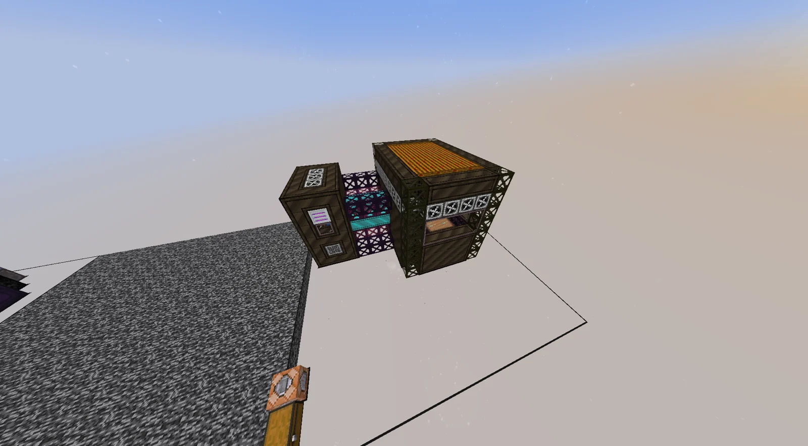
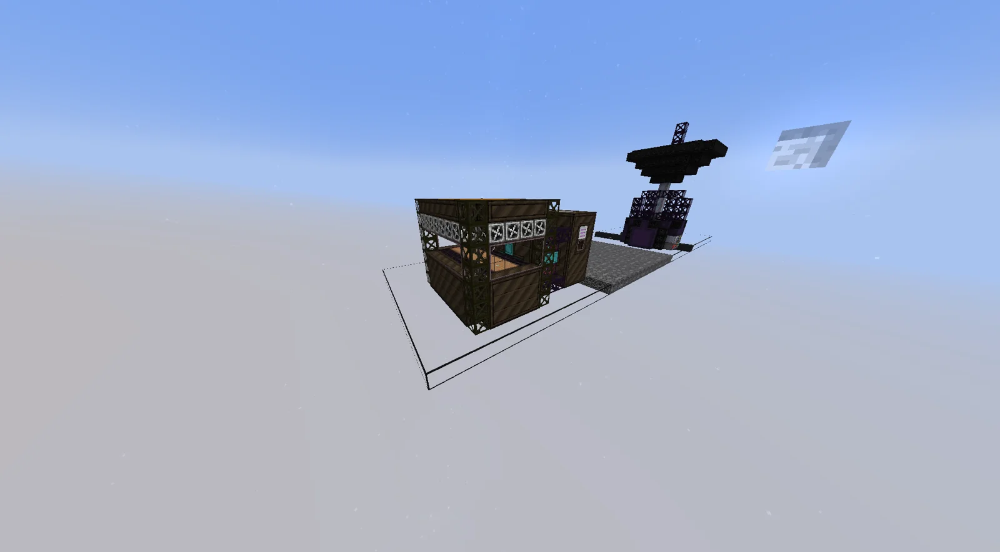
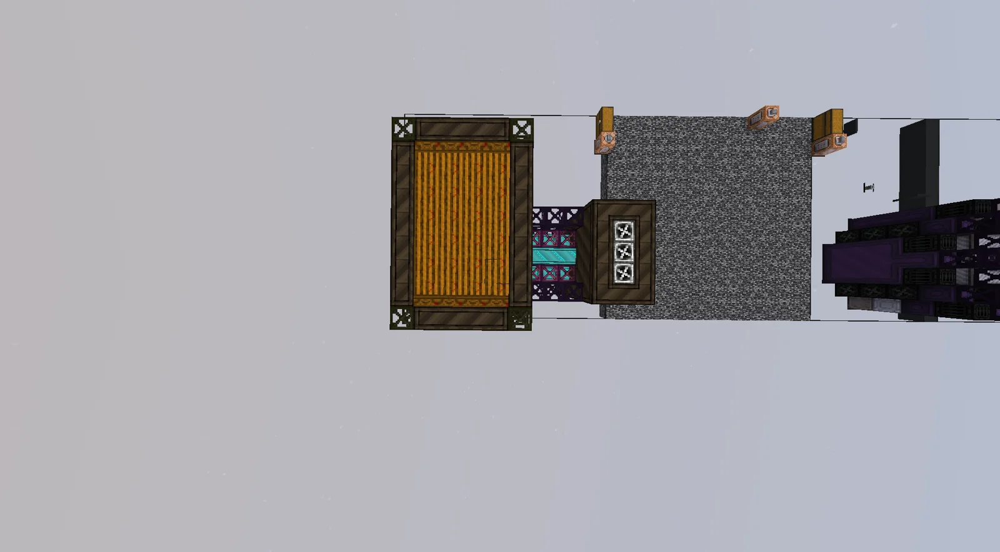
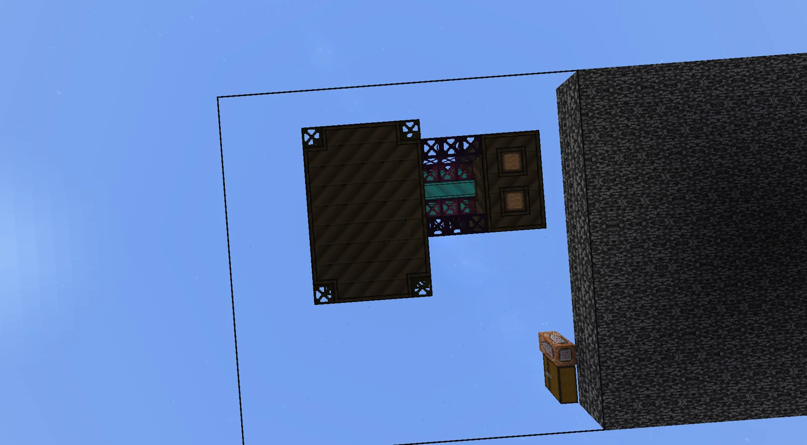
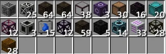

# gCrop Breeding-havesting Complex Array (gBhCA)
<small>**Submitted by:** Peaplant (@peaplant_) · Multiblock Design Contest, September 2026</small>

!!! quote ""

| | |
|---|---|
| **Target tier** | <UEV>UEV</UEV> |
| **Role** | Resource generation — gCrop duplication and fruit/flower harvesting in one step |
| **Schematic** | [gbhca.nbt](Contest_img/gcrop-breeding-havesting-complex-array/gbhca.nbt) |
| **Original post** | [gCrop Breeding-havesting Complex Array[gBhCA]](https://discord.com/channels/1177211394039484477/1554492215630372974) |

## Summary

A combined version of the EgCHP and the gCFA. The gBhCA duplicates a gCrop and grows it into its fruit or flower form in a single step, so the two separate gCrop multiblocks no longer have to be chained in a loop. The author built it after setting up gCrop loops and wondering why no combined version of the two machines existed.

## Mechanics

- Duplicates the input gCrop and grows the copies into their result (fruit or flower) form.
- Recipes are generated from the tier and traits of the gCrop being processed.
- Each recipe needs 1 B of Fermented Biomass and Fertilizer, plus the growth materials that the gCrop Harvester recipe for that tier would require.
- The amount of material consumed and the amount of result produced both scale with the crop's traits.
- A Climate Hatch can be used to provide the climate the gCrop needs (per the controller tooltip).
- Any PEEK Casing in the structure can be replaced with an item/fluid hatch, bus, energy hatch, maintenance hatch, or climate hatch.
- The author suggests the controller recipe should need a <UEV>UEV</UEV> circuit and <UHV>UHV</UHV> parts.
- The author would have preferred a watertight or crop-themed casing, but those only become available after ASG in the pack, so PEEK Casings are used instead.

## Structure

Two joined chambers, reusing the chamber designs of the harvester and the mutator: a larger framed chamber with a hay-bale roof, linked through a short pink-and-purple casing section to a smaller cube that carries the controller. The author did not state the dimensions; a block count is included in the screenshots.

!!! abstract "Screenshots"

    === "Angled view"
        

    === "Side"
        

    === "Top view"
        

    === "Bottom view"
        

    === "Controller tooltip"
        

    === "Block list"
        

## Files

- [gbhca.nbt](Contest_img/gcrop-breeding-havesting-complex-array/gbhca.nbt) — NBT structure file of the multiblock
