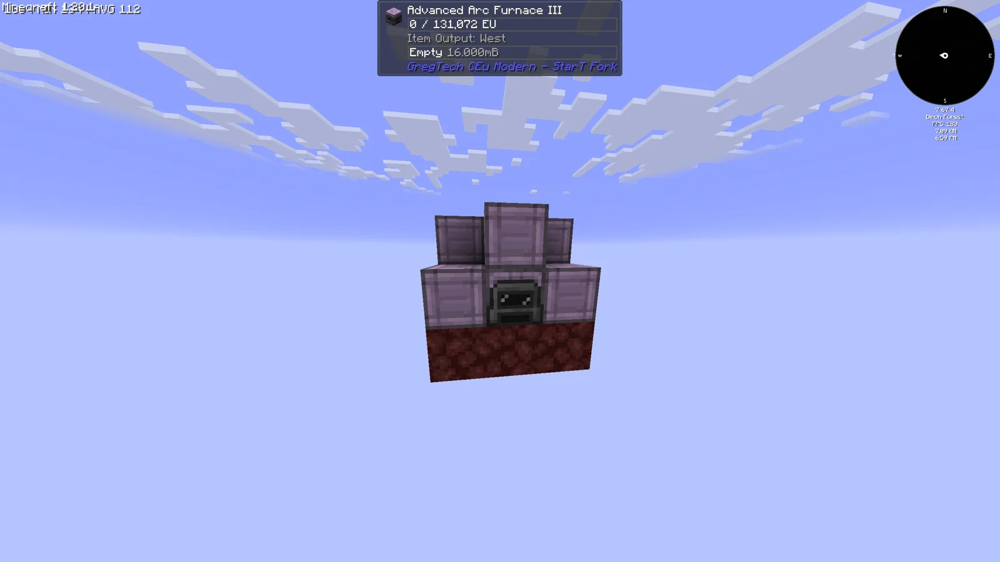
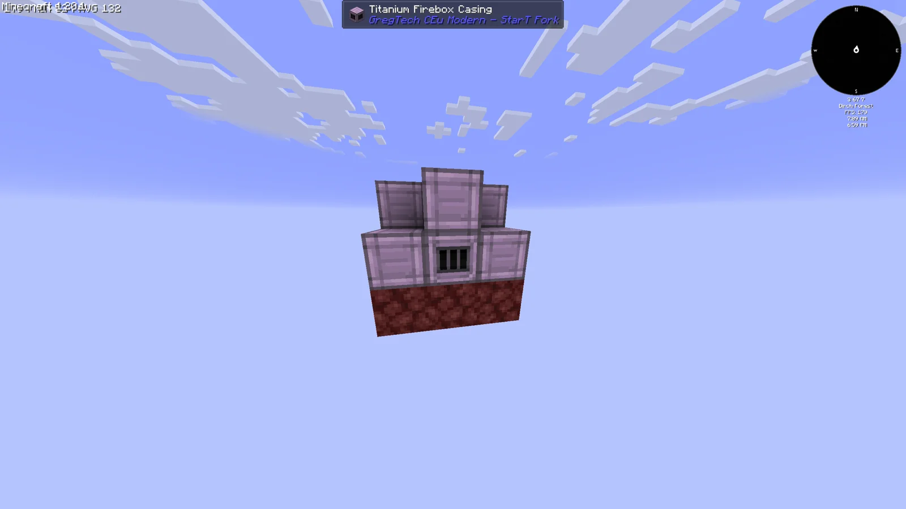
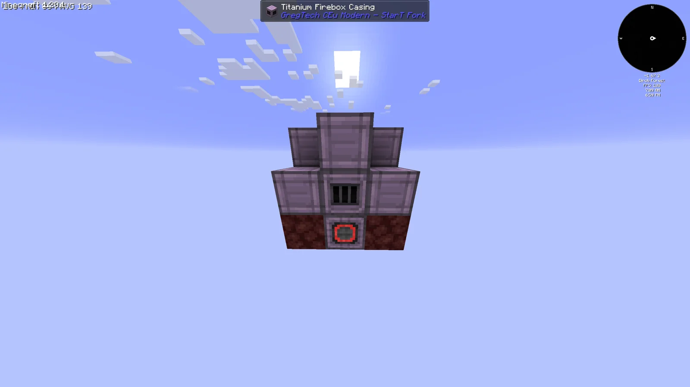
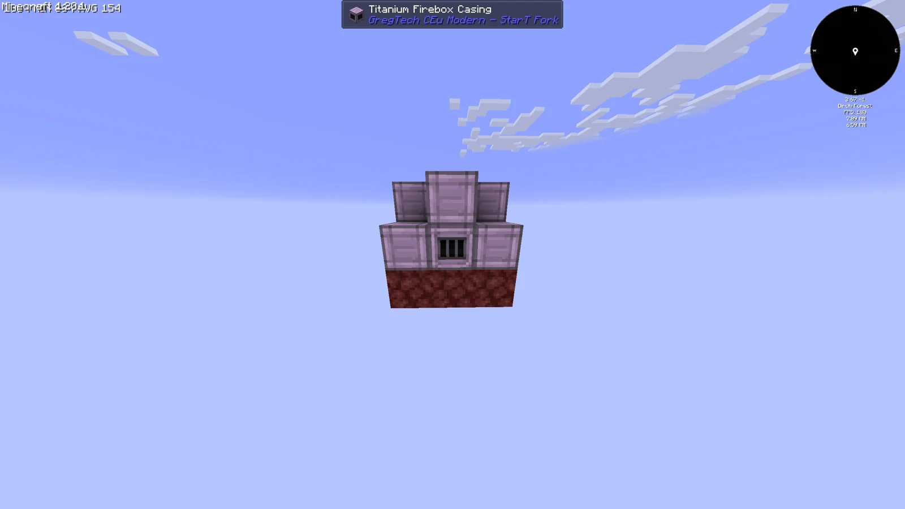
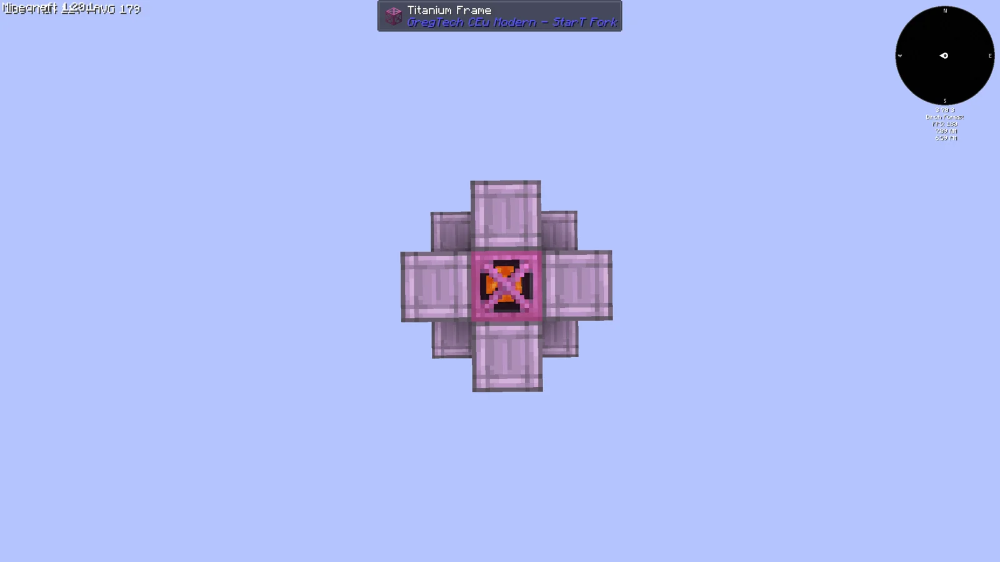
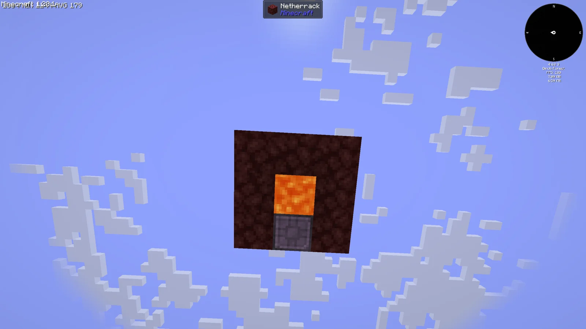

# Geothermal Plant (G.P)
<small>**Submitted by:** enlolers (@enlolers) · Multiblock Design Contest, September 2026</small>

!!! quote ""

| | |
|---|---|
| **Target tier** | <EV>EV</EV> (the author's tentative pick) |
| **Role** | Power generation — Lava boils Water to make EU |
| **Schematic** | [geothermal-plant.json](Contest_img/geothermal-plant/geothermal-plant.json) |
| **Original post** | [Geothermal Plant](https://discord.com/channels/1177211394039484477/1552728295747887204) |

!!! warning "Incomplete submission"

    The mechanics are a single sentence and no power output figure is given (the author leaves the number to the devs). The author also notes that the build is missing a Fluid Input Hatch for Water (and possibly Lava) and asks for one to be added somewhere in the structure.

## Summary

An <EV>EV</EV> power generator that produces power from Lava: the Lava boils Water, and the resulting steam is converted into power inside the same structure.

## Mechanics

- Consumes Lava and Water; the Lava heats the Water and the structure generates power from it.
- The author did not specify the power output or the fluid consumption rates and leaves them to the devs to decide.
- The mockup has no Fluid Input Hatch; the author asks that one be included for Water (and possibly Lava).

## Structure

A small 3x3 footprint, three blocks tall. The base layer is Netherrack with a Lava source block in the center and an EV Energy Output Hatch set into one edge; the middle layer has Stable Machine Casings on the corners, Titanium Firebox Casings in the middle of three sides and the controller (an EV Arc Furnace stands in for it in the mockup) on the fourth, around a central Titanium Frame column; the top layer is a plus of Stable Machine Casings around the top of the frame column (block list taken from the schematic).

!!! abstract "Screenshots"

    === "Front"
        

    === "Side"
        

    === "Back"
        

    === "Other side"
        

    === "Top"
        

    === "Bottom"
        

## Files

- [geothermal-plant.json](Contest_img/geothermal-plant/geothermal-plant.json) — JSON block-state schematic with the required block list (3x3x3, posted by the author later the same day after being asked for a copy-paste gadget export)

## Notes from the thread

- The author was asked to provide a copy-paste gadget schematic instead of a WorldEdit one and to link it from the top post; the JSON file above was posted in reply, but the author could not edit the link into the first message.
- A question about whether the Netherrack base gates the build behind ASG was withdrawn after others pointed out that Netherrack is obtainable from Lava and Redstone in the LCR.
