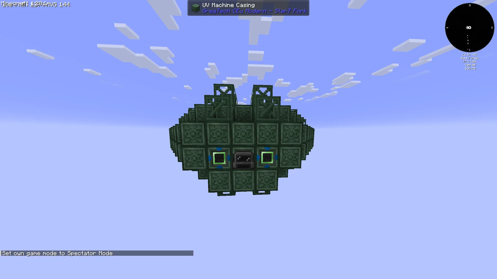
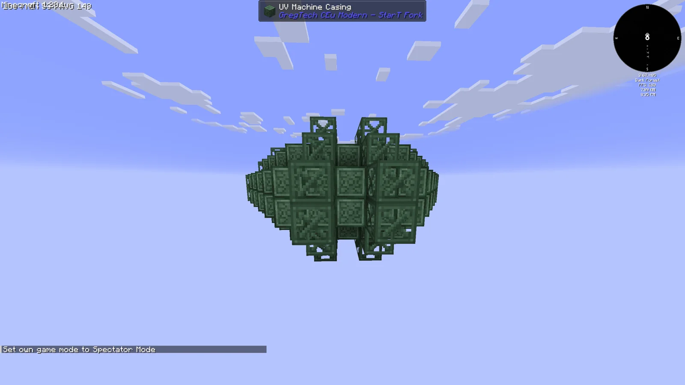
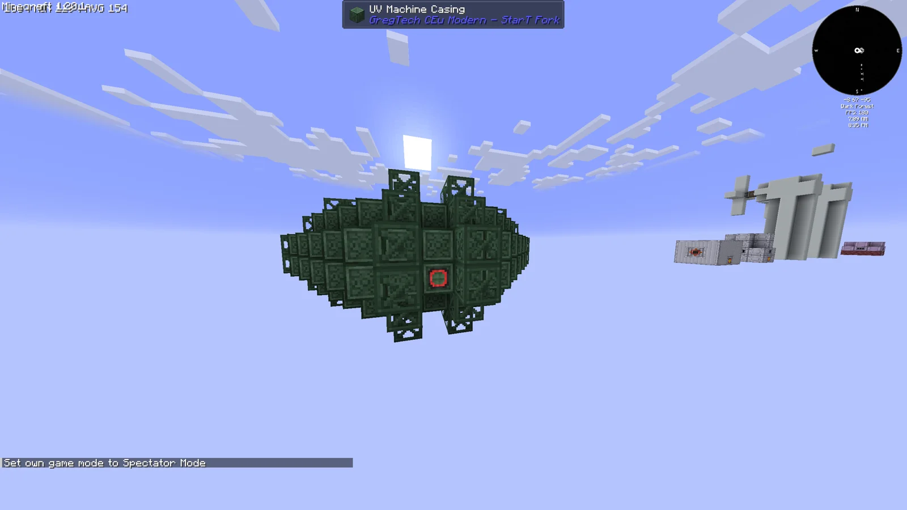
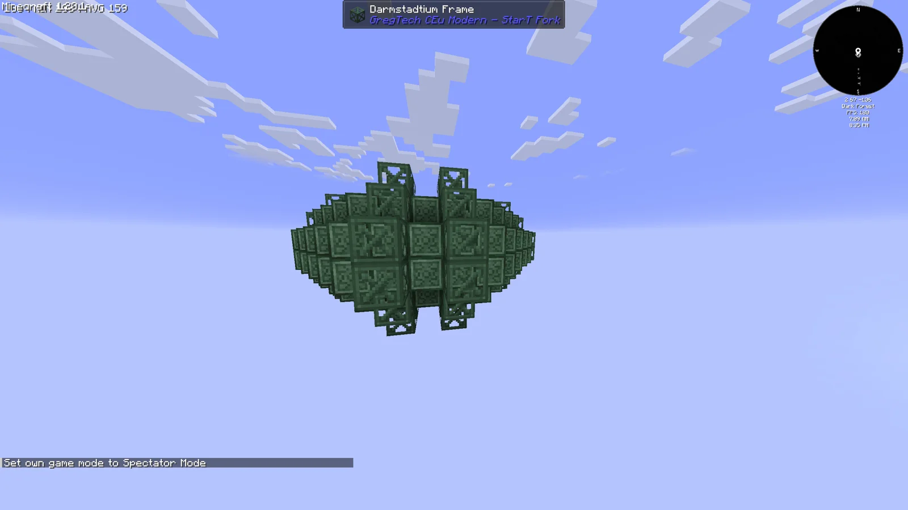
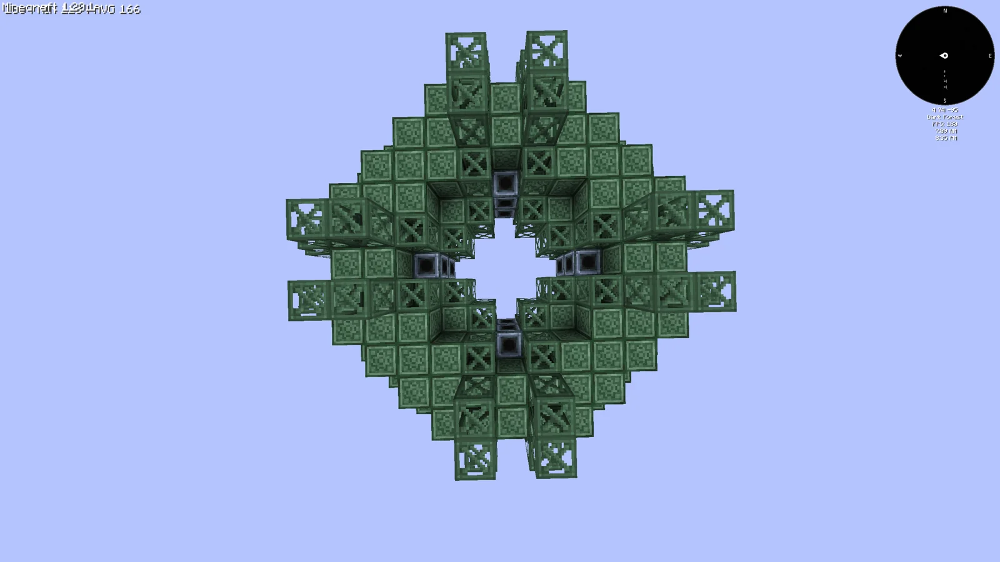
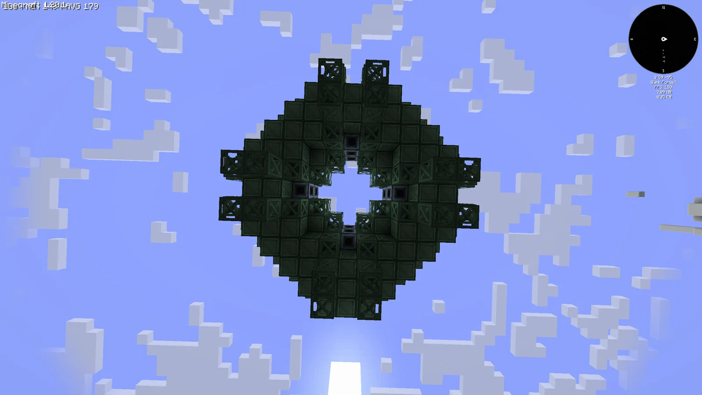

# Hawking Radiation Reactor (H.R.R)
<small>**Submitted by:** enlolers (@enlolers) · Multiblock Design Contest, September 2026</small>

!!! quote ""

| | |
|---|---|
| **Target tier** | <UV>UV</UV> |
| **Role** | Power generation — black hole generator fueled by Darkmatter |
| **Schematic** | [hrr.json](Contest_img/hawking-radiation-reactor/hrr.json) |
| **Original post** | [Hawking Radiation Reactor (H.R.R)](https://discord.com/channels/1177211394039484477/1552752465915416696) |

## Summary

A <UV>UV</UV> power generator that consumes a proposed new substance, "Darkmatter", to create a black hole and harvest its Hawking Radiation. The author describes the output only as "tons of power"; no numbers are given.

## Mechanics

- Fuel is a new material the author calls Darkmatter (or antimatter). The author left its form open (liquid, gas, or solid) and notes that none of the pack's existing materials fit the concept.
- The reactor uses the Darkmatter to create a black hole, then "harvests" the black hole's Hawking Radiation to generate power.
- No EU/t figures, fuel rates, or recipes are stated.
- The author jokingly suggests a vanishingly small chance that the reactor destroys the world on startup.

## Structure

A flattened, lens-shaped hull of UV Machine Casings with a hollow core, ringed by Darmstadtium Frame spikes on the top, bottom, and sides; according to the schematic the interior is filled with Tungstensteel Gearboxes and Tungstensteel Pipe Casings, and the whole build fits in a 14 x 6 x 15 bounding box. The screenshots use a UV Arc Furnace as the controller block, with two UV Input Hatches and one UV Energy Output Hatch set into the hull.

!!! abstract "Screenshots"

    === "Front"
        

    === "Side"
        

    === "Back"
        

    === "Opposite side"
        

    === "Top view"
        

    === "Bottom view"
        

## Files

- [hrr.json](Contest_img/hawking-radiation-reactor/hrr.json) — JSON block-state template of the structure (block palette plus position list)

## Notes from the thread

- Thread feedback felt a machine that harvests a black hole deserves a much larger build than the contest size limits allow; another reply countered that smaller black holes radiate more, so a small design is physically apt. The author did not respond to either.
- Asked why no connecting-texture blocks were used, the author replied by asking whether any <UV>UV</UV>-tier blocks with connecting textures exist.
