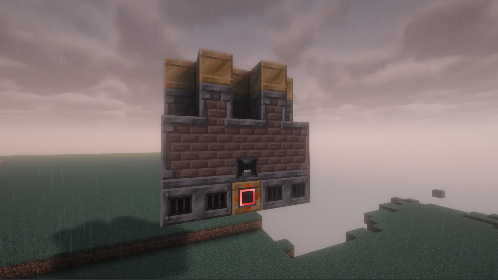
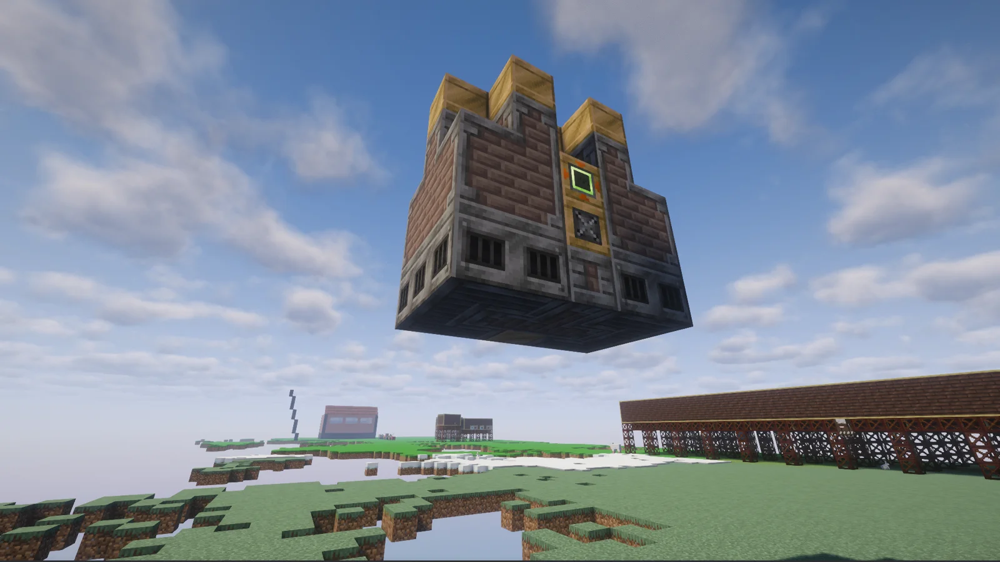
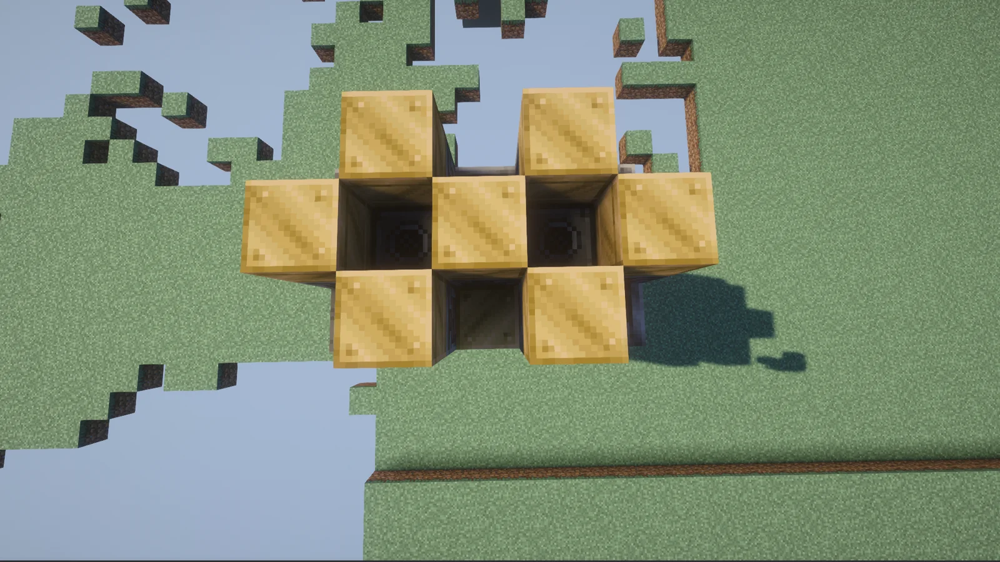
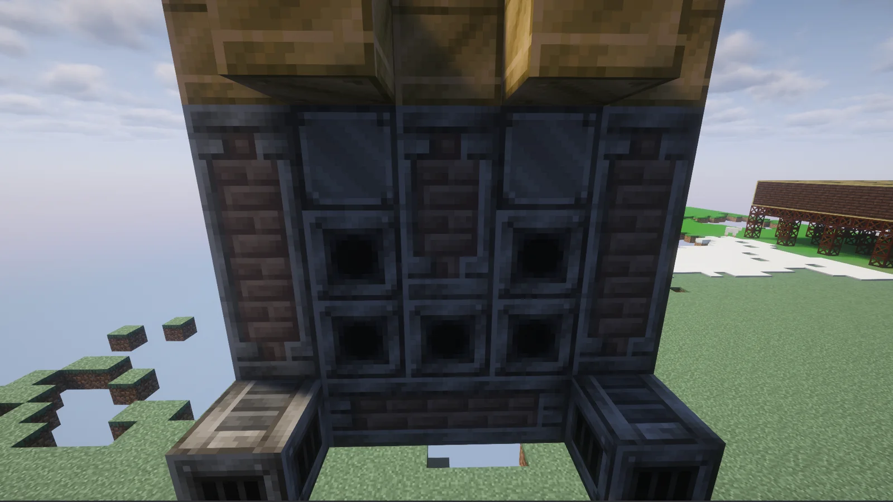

# High Pressure Steam Crucible Furnace (HPSCF)
<small>**Submitted by:** White tea (@whitetriethylamine) · Multiblock Design Contest, September 2026</small>

!!! quote ""

| | |
|---|---|
| **Target tier** | <ULV>ULV</ULV> (steam) |
| **Role** | Processing — parallel Alloy Smelter with fluid output |
| **Schematic** | [HPSS.litematic](Contest_img/high-pressure-steam-crucible-furnace/HPSS.litematic) |
| **Original post** | [Steam Alloy Smelter Multiblock](https://discord.com/channels/1177211394039484477/1552600994045755423) |

## Summary

A steam-age multiblock version of the Alloy Smelter. It runs the same recipes as the single-block Alloy Smelter, but processes **6 parallels** at once and outputs the alloy as a **fluid** instead of ingots.

## Mechanics

- Same recipe set as the Alloy Smelter; no new recipes are added.
- 6× parallel processing.
- Outputs molten alloy (fluid) rather than items. The author proposes implementing this as an extra circuit configuration on the existing multi-smelter / alloy-smelter machine mode, so the machine can also output fluids.

## Structure

A compact brick-and-steel steam structure with a hay-bale crown; the controller sits in the bottom row of the front wall, in line with the steel casings. The author did not state the dimensions.

!!! abstract "Screenshots"

    === "Front"
        

    === "Side"
        

    === "Top"
        

    === "Back"
        

## Files

- [HPSS.litematic](Contest_img/high-pressure-steam-crucible-furnace/HPSS.litematic) — Litematica schematic (added by the author on 2026-09-25)

## Notes from the thread

- Thread feedback questioned how molten output would be cooled back to ingots in the steam age (Fluid Solidifier, Create) and whether 6 parallels is too strong for <ULV>ULV</ULV>; the author did not change the design in response.
