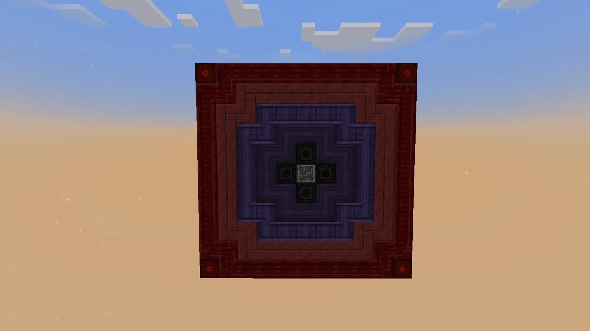
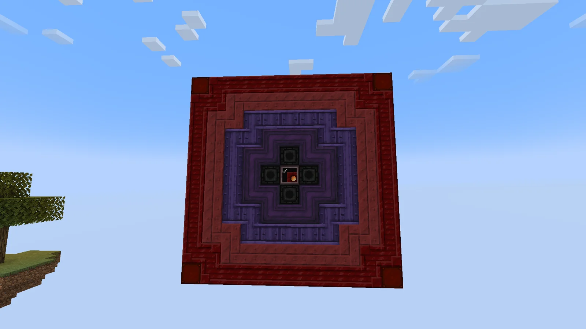
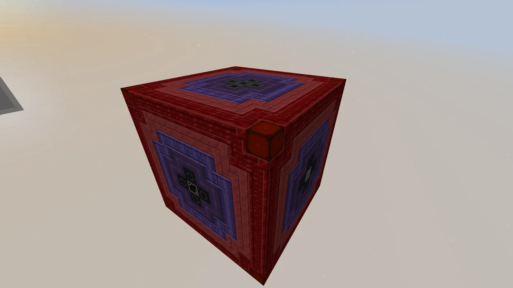
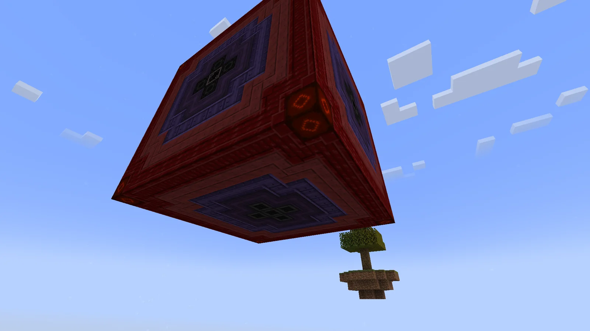
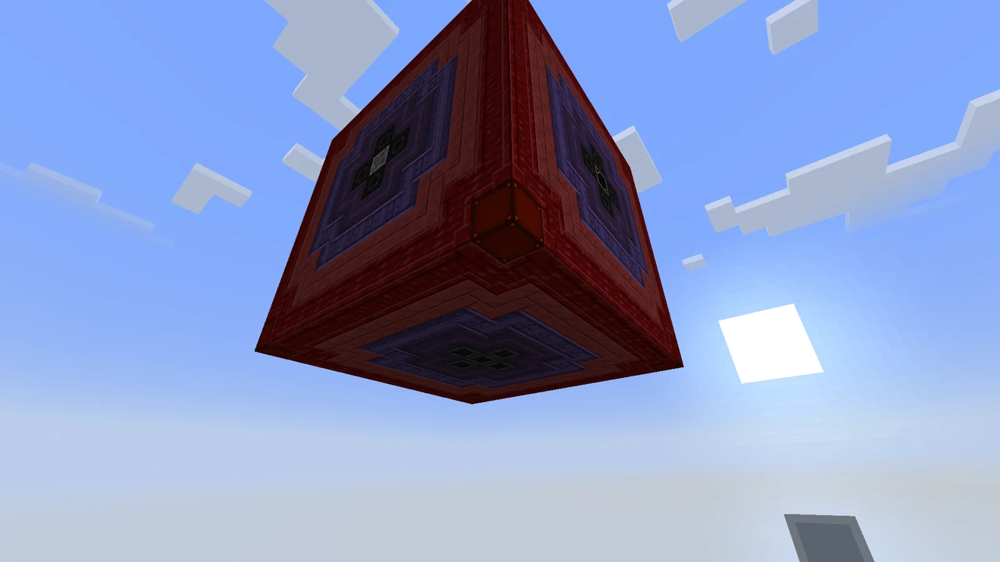

# Hyperpolarizing Object Radiation Thermojunction Holder (HORTH)
<small>**Submitted by:** IncurableDressing (@lochlan0956) · Multiblock Design Contest, September 2026</small>

!!! quote ""

| | |
|---|---|
| **Target tier** | <UEV>UEV</UEV> |
| **Role** | Processing — higher-tier Fission Reactor with radiation-scaled parallels |
| **Schematic** | [horth-structure.json](Contest_img/hyperpolarizing-object-radiation-thermojunction-holder/horth-structure.json) |
| **Original post** | [Hyperpolarizing Object Radiation Thermojunction Holder (HORTH)](https://discord.com/channels/1177211394039484477/1554222894270382131) |

## Summary

A more powerful version of the fission reactor for <UEV>UEV</UEV>. Its parallel count is not fixed: a "radiation" value that builds up with throughput scales the parallels from a quarter of normal up to 4x, with a penalty if the reactor is pushed too hard.

## Mechanics

- **Radiation.** The HORTH tracks how many recipes it has run over a period of time (the author gives 10 minutes as an example). The more it processes in that window, the higher its radiation.
- **Parallel boost.** Radiation sets the parallel multiplier: it starts at **0.25x** parallels and scales up to **4x** as more is processed.
- **Overload.** If radiation gets too high, the HORTH voids all of its inputs. Radiation only decreases while the reactor has an empty input, so it has to be starved for a while before it will accept items again.

## Structure

An 11x11x11 cube. Each face is built as concentric rings of Extreme Temperature Smelting, Reinforced Brimstone, Noble Mixing and Atomic casings around a core of Enriched Naquadah Pipe casings, with Signalum casings on the corner edges and a Reinforced Fusion Glass block at the center of each face; the controller takes the center of one face. According to the schematic, the inside is not solid: nested shells of Auxiliary Boosted Fusion Casing Mk1 and Enriched Naquadah Pipe casings are separated by air gaps, a line of Heat Vents sheathed in Enriched Naquadah Firebox casings runs through the middle along one axis, glass lines run through along the other two, and a Heart of the Flame sits at the exact center. The author points out that the schematic shows more than the screenshots do.

!!! abstract "Screenshots"

    === "Controller face"
        

    === "Glass face"
        

    === "Top corner"
        

    === "From below"
        

    === "From below (second angle)"
        

## Files

- [horth-structure.json](Contest_img/hyperpolarizing-object-radiation-thermojunction-holder/horth-structure.json) — JSON block-state dump of the full 11x11x11 structure, including a required-block count list
- [horth-explanation.txt](Contest_img/hyperpolarizing-object-radiation-thermojunction-holder/horth-explanation.txt) — the author's short write-up of the radiation mechanic
