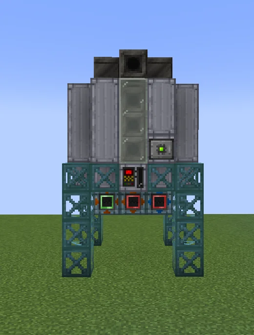
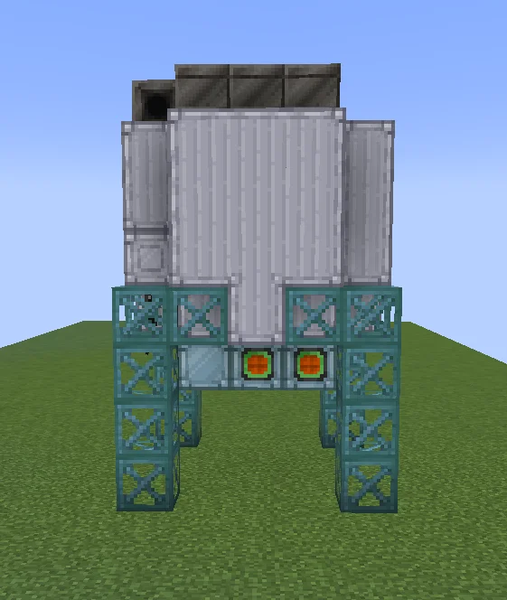
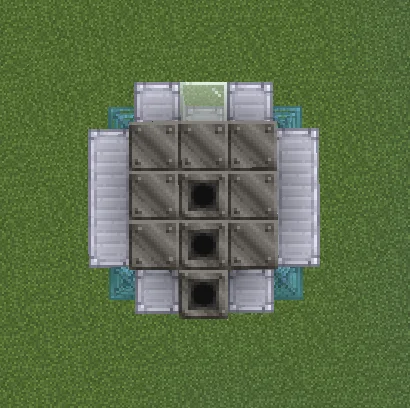
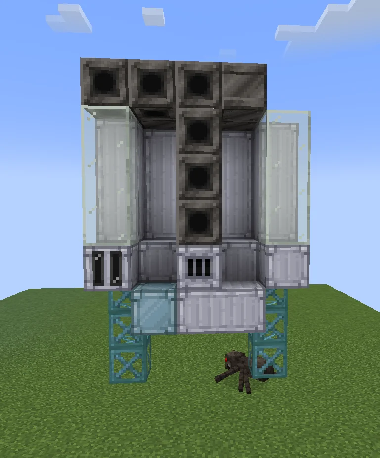
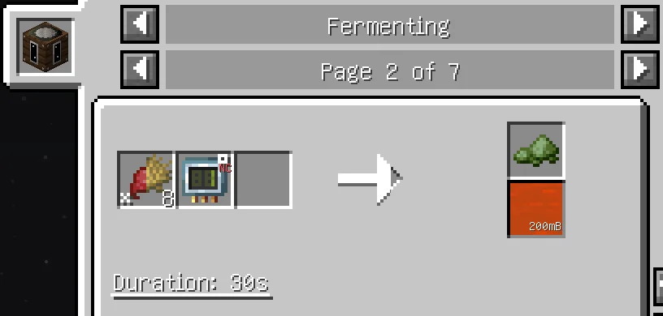

# Industrial Fermentation Tank (IFT)
<small>**Submitted by:** Slime_1001 (@slime_1001_35437) · Multiblock Design Contest, September 2026</small>

!!! quote ""

| | |
|---|---|
| **Target tier** | <HV>HV</HV> |
| **Role** | Processing — multiblock Fermenter with throughput boost and Bio Chaff output |
| **Schematic** | [ift.json](Contest_img/industrial-fermentation-tank/ift.json) |
| **Original post** | [Industrial Fermentation Tank [IFT]](https://discord.com/channels/1177211394039484477/1552931775251095622) |

## Summary

A multiblock version of the Fermenter. It runs the Fermenter's recipes with boosted throughput and, in addition, can produce Bio Chaff using the recipe of the Fermenting Casket.

## Mechanics

- Runs Fermenter recipes with a throughput boost. The author did not state the boost factor.
- Can also produce Bio Chaff via the Fermenting Casket recipe. The recipe mockup in the screenshots shows 8 Wheat plus a Programmed Circuit producing Bio Chaff and 200 mB of a fluid in 30 seconds.

## Structure

A tall tank of Clean Machine Casings on an Aluminium Frame stand, with a central column of Steel Pipe Casings and a Tempered Glass window on the front; the controller (an Industrial Barrel) sits on the front face just above the stand. The attached schematic spans a 5x5 footprint and is 8 blocks tall.

!!! abstract "Screenshots"

    === "Front"
        

    === "Back"
        

    === "Top view"
        

    === "Interior"
        

    === "Recipe mockup"
        

## Files

- [ift.json](Contest_img/industrial-fermentation-tank/ift.json) — structure schematic (JSON block list with required items)
