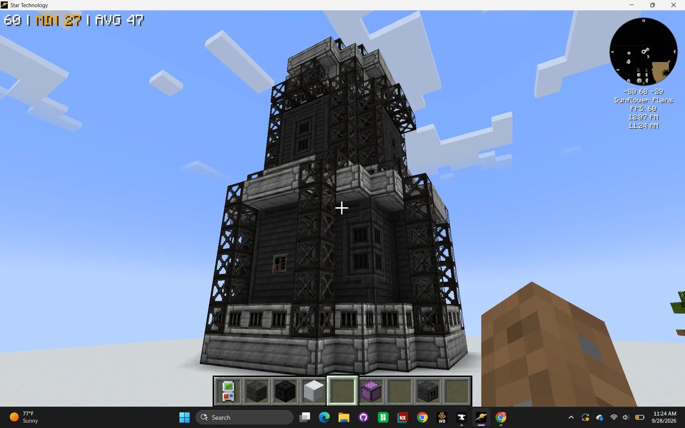
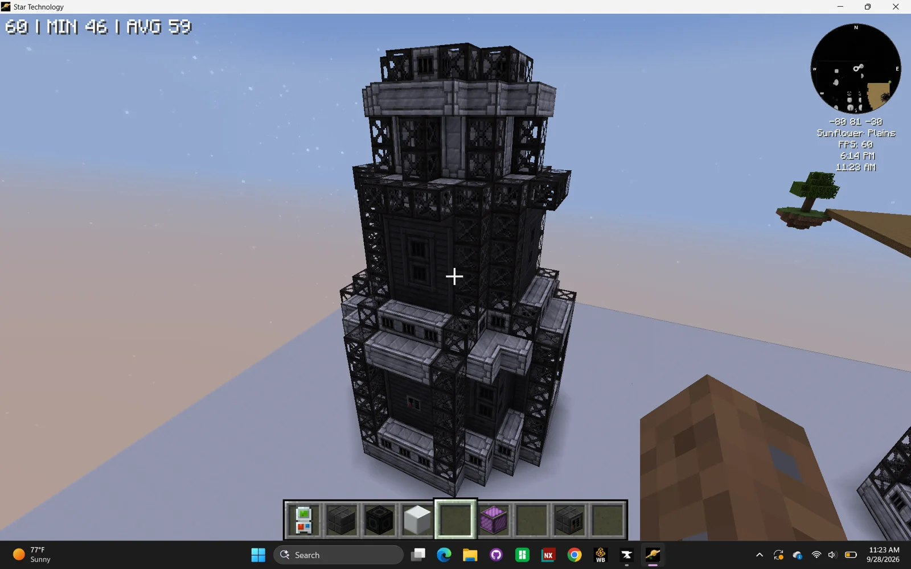
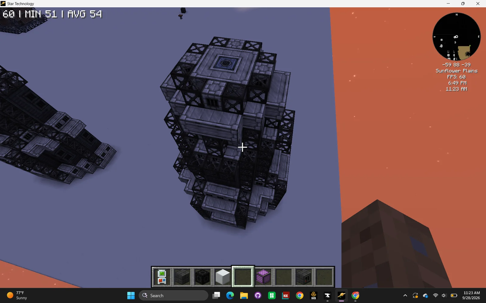
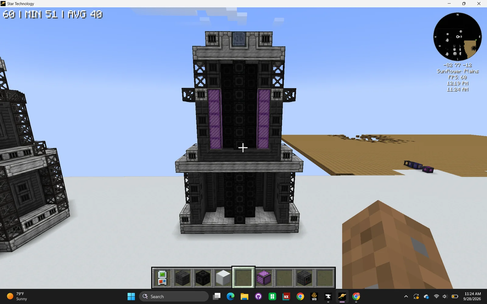
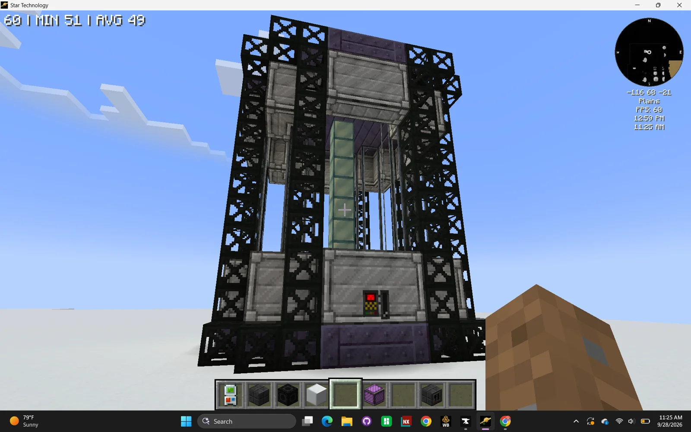
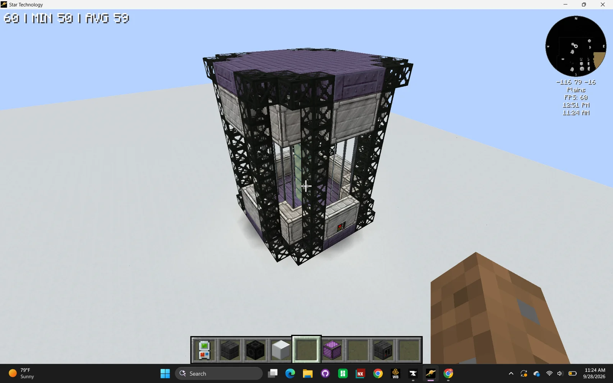
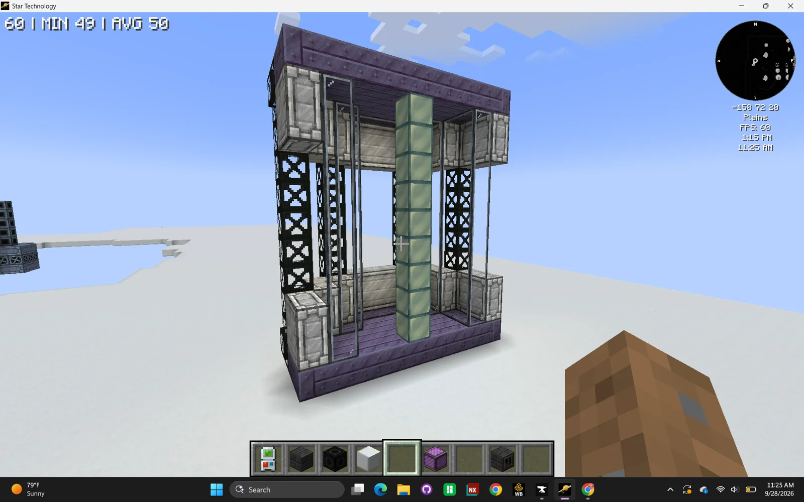

# Industrial Kitchen (IK) and Protein Synthesis Vat (PSV)
<small>**Submitted by:** Serotonintheft (@serotonintheft) · Multiblock Design Contest, September 2026</small>

!!! quote ""

| | |
|---|---|
| **Target tier** | <UV>UV</UV> (both structures) |
| **Role** | Multi-structure family — food processing lines that boost bacteria, gcrop, and wetware |
| **Schematic** | [ik.nbt](Contest_img/industrial-kitchen-and-protein-synthesis-vat/ik.nbt), [psv.nbt](Contest_img/industrial-kitchen-and-protein-synthesis-vat/psv.nbt) |
| **Original post** | [Industrial Kitchen (IK) and Protein Synthesis Vat (PSV)](https://discord.com/channels/1177211394039484477/1554223558799138837) |

## Summary

A pair of <UV>UV</UV> multiblocks that introduce new food processing lines. The lines output full dishes, which give large boosts to bacteria, gcrop, and wetware breeding and growth. The **Industrial Kitchen (IK)** handles all "kitchen" recipes, while the **Protein Synthesis Vat (PSV)** synthesizes meat and animal products without ranches. The author also proposes using the dishes to extend <UV>UV</UV>, by making some of them required to breed the special bacteria and cells used in wetware mainframes.

## Mechanics

- Both multiblocks have parallels, subtick, and batching.
- Full dishes are added as inputs to new, higher-yield versions of existing recipes: the author's examples are a stem cell recipe that triples its output with a Döner Kebab, and a wetware processor recipe that quadruples its output with a Triple Layer Chocolate Cake.
- Late game, the IK's recipes would be given as a machine mode to the FARM threading multi, and the PSV's recipes as a machine mode to the ICR.
- The author proposes removing the miscellaneous food dishes and intermediates added by Create, the Thermal series, and Farmer's Delight while keeping their crops, and, if possible, making chickens not lay eggs. Breeding animals and milking cows would be kept, on the grounds that they cannot be automated (see the thread notes below).

### Example processing lines

The author gives two example lines. The macerator, fermenter, and mixer steps use existing machines.

**Döner Kebab line**

| Machine | Inputs | Outputs |
|---|---|---|
| PSV | 16 Stem Cells + 50 mB Sterilized Growth Medium + 100 mB Mutagen + 16 Sugar | 64 Raw Beef |
| Macerator | 1 Wheat | 4 Wheat Flour |
| Macerator | 1 Onion | 4 Diced Onions |
| Macerator | 1 Bell Pepper | 2 Diced Bell Pepper |
| Fermenter | 2 Wheat Flour + 25 mB Sterilized Growth Medium | 1 Bio Chaff + 2000 mB Yeast |
| IK | 3 Wheat Flour + 500 mB Yeast + 1000 mB Water | 4 Lean Dough |
| IK | 1 Lean Dough + 1 Block of Wrought Iron (not consumed) | 1 Flatbread |
| IK | 1 Long Wrought Iron Rod (not consumed) + 32 Raw Beef | 32 Doner Beef |
| IK | 1 Flatbread + 3 Doner Beef + 3 Diced Bell Pepper + 5 Diced Onions | 1 Döner Kebab |

One Döner Kebab can be added to a new stem cell recipe that triples the output.

**Triple Layer Chocolate Cake line**

| Machine | Inputs | Outputs |
|---|---|---|
| PSV | 16 Stem Cells + 150 mB Sterilized Growth Medium + 100 mB Pyrophosphoric Acid + 8 Sugar | 128 Eggs |
| PSV | 8 Stem Cells + 100 mB Sterilized Growth Medium + 300 mB Yeast + 16 Sugar + 100000 mB Water | 64000 mB Milk |
| Mixer | 1000 mB Milk | 5 Butter |
| Macerator | 1 Cocoa Beans | 4 Cocoa Powder |
| IK | 2 Cocoa Powder + 3 Sugar + 1500 mB Seed Oil | 2000 mB Chocolate |
| IK | 1500 mB Chocolate + 2 Sodium Bicarbonate + 5 Wheat Flour + 10 Sugar + 3000 mB Water + 10 Eggs + 500 mB Seed Oil | 4000 mB Chocolate Cake Batter |
| IK | 5 Cocoa Powder + 500 mB Milk + 16 Butter + 16 Sugar | 1000 mB Chocolate Buttercream |
| IK | 500 mB Chocolate Cake Batter | 1 Chocolate Cake Base |
| IK | 3 Chocolate Cake Base + 800 mB Chocolate Buttercream | 1 Triple Layer Chocolate Cake |

One Triple Layer Chocolate Cake can be added to a new wetware processor recipe that quadruples the output.

## Industrial Kitchen (IK)

### Summary

The IK runs all of the "kitchen" recipes of the new food lines: dough, flatbread, doner meat, chocolate, batters, buttercream, and the finished dishes.

### Mechanics

- Parallels, subtick, and batching.
- At high enough voltages the IK can also do production line skips, producing full dishes directly from basic ingredients.
- Late game its recipes become a machine mode of the FARM threading multi.

### Structure

A tall, dark, stepped tower: a wide base tier with lattice-framed corners, a narrower middle tower, and a small cap on top. The controller sits in the front face of the base tier. The interior holds a central column surrounded by coils. The author did not state the dimensions.

!!! abstract "Screenshots"

    === "Front"
        

    === "Angled"
        

    === "Top"
        

    === "Cross section"
        

### Files

- [ik.nbt](Contest_img/industrial-kitchen-and-protein-synthesis-vat/ik.nbt) — Structure block (NBT) schematic of the Industrial Kitchen

## Protein Synthesis Vat (PSV)

### Summary

The PSV synthesizes meat and animal products (the author's examples are Raw Beef, Eggs, and Milk) from Stem Cells, Sterilized Growth Medium, and a few other inputs, so that no ranches are needed.

### Mechanics

- Parallels, subtick, and batching.
- While running, the inside should render as filled with a classic sci-fi green goop, possibly with amorphous floating dark blobs.
- Late game its recipes become a machine mode of the ICR.
- The author also suggests the PSV could host other thematically relevant dragon-related recipes.

### Structure

A glass-walled box with lattice-framed corners, light casing bands at the top and bottom, and a single bright column running up the center of the interior. The controller sits in the lower casing band of the front face. The author did not state the dimensions.

!!! abstract "Screenshots"

    === "Front"
        

    === "Angled"
        

    === "Cross section"
        

### Files

- [psv.nbt](Contest_img/industrial-kitchen-and-protein-synthesis-vat/psv.nbt) — Structure block (NBT) schematic of the Protein Synthesis Vat (uploaded as `growth_vat.nbt`)

## Structure

Two separate builds: the tall, dark, stepped Industrial Kitchen tower and the smaller glass-walled Protein Synthesis Vat with its central column. Screenshots for each are in the sections above.

## Files

- [ik.nbt](Contest_img/industrial-kitchen-and-protein-synthesis-vat/ik.nbt) — Structure block (NBT) schematic of the Industrial Kitchen
- [psv.nbt](Contest_img/industrial-kitchen-and-protein-synthesis-vat/psv.nbt) — Structure block (NBT) schematic of the Protein Synthesis Vat (uploaded as `growth_vat.nbt`)
- [ik-and-psv-mechanics.txt](Contest_img/industrial-kitchen-and-protein-synthesis-vat/ik-and-psv-mechanics.txt) — the author's full mechanics write-up, including the example recipe lines

## Notes from the thread

- A reader pointed out that breeding animals and milking cows can in fact be automated with Create; the author replied to use judgement when balancing.
- Two readers suggested that, for a <UV>UV</UV> multi, it would be better to add new items or fluids that are specifically food for bacteria rather than player food, possibly placed at <UHV>UHV</UHV> after the ASG, giving better bacteria yield or a better bacteria fluid. The author did not respond to this.
