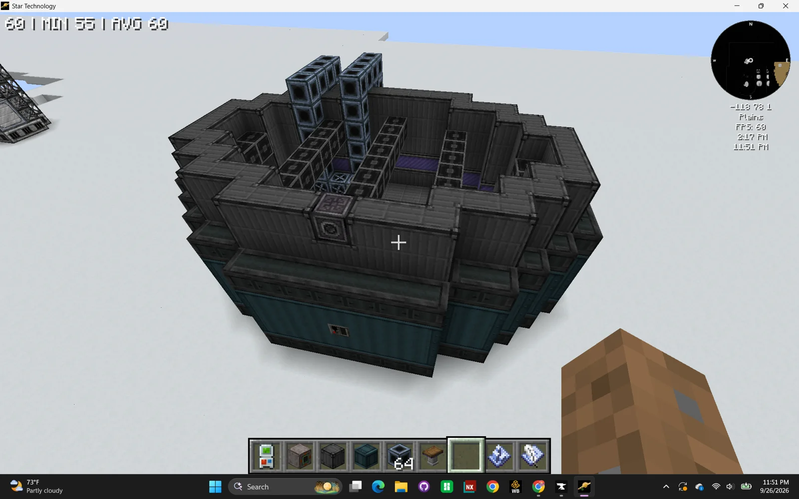
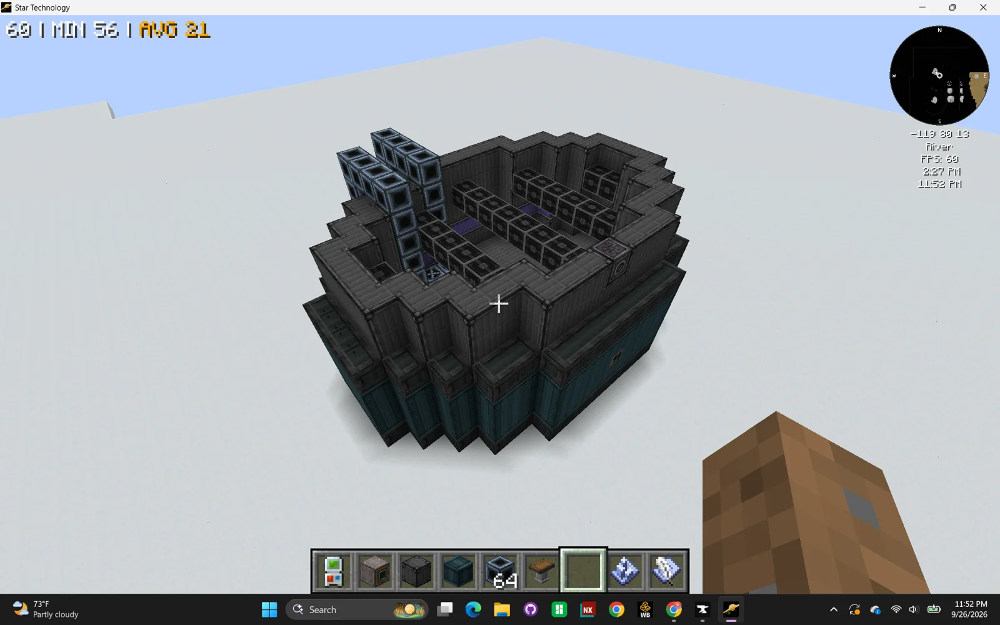
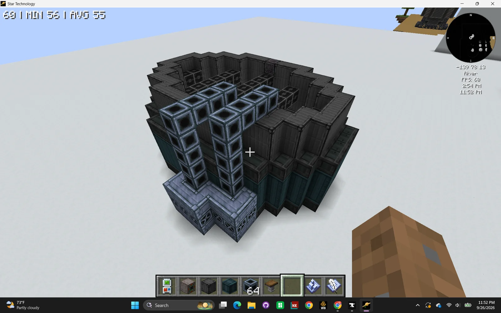
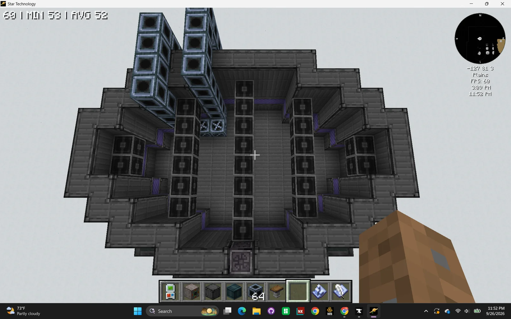

# Joule-driven Unit for Industrial Coating & Electrodeposition (JUICE)
<small>**Submitted by:** Serotonintheft (@serotonintheft) · Multiblock Design Contest, September 2026</small>

!!! quote ""

| | |
|---|---|
| **Target tier** | <IV>IV</IV> |
| **Role** | Processing — electroplating multiblock with consumable anodes |
| **Schematic** | [juice.nbt](Contest_img/joule-driven-unit-for-industrial-coating/juice.nbt) |
| **Original post** | [Joule-driven Unit for Industrial Coating & Electrodeposition (JUICE)](https://discord.com/channels/1177211394039484477/1553834527984451645) |

## Summary

An electroplating multiblock. It replaces the current recipes for Rhodium-plated Palladium items (rotor, rod, small gear, and the other intermediates) with a process that plates Rhodium onto the plain Palladium counterparts, and opens the door for many other electroplated items later in progression. While a recipe is running, the inside of the structure visually fills with liquid, similar to the chemical bath or mixer multiblocks.

## Mechanics

- **Recipe replacement.** All existing recipes for Rhodium-plated Palladium parts and intermediates are removed. Those parts are instead produced in the JUICE by electroplating Rhodium onto their Palladium counterparts (adding any Palladium counterparts that do not exist yet).
- **Anode holder.** A new hatch, the "anode holder", represented by the rotor holder. It works like the rotor holder: it holds an anode that the multiblock wears down as it runs. An anode is made by pressing a large number of a specific ingot in a Forming Press (or, more efficiently, in a Titan Forge once unlocked). Every anode has a durability, like rotors.
- **Per recipe.** The multiblock consumes electrolyte and the un-plated item (Palladium rotor, rod, etc.), outputs contaminated electrolyte and the plated item, and removes some durability from the anode. For Rhodium-plated Palladium the durability loss is calculated to keep the current 1 Rhodium : 3 Palladium ratio. The author's example: if a Rhodium anode costs 1000 Rhodium ingots, plating 30 Palladium rotors removes 4% of its durability. All consumption of the plating material goes through anode durability; the electrolyte contains neither of the two main materials.
- **Electrolyte.** The "electrolyte" is an electrolyte base, a specially crafted fluid (a mix of Distilled Water, Sulfuric Acid, etc.). Most of it can be recovered by processing the contaminated electrolyte. Higher-tier electrolytes can be used for later plating materials.
- **Parallels.** The JUICE can take a parallel hatch. Because a craft cannot consume more than 100% of an anode's durability, the author also proposes larger anode variants costing 10,000x and 100,000x the ingots so the multiblock can always run at maximum parallels.
- **Energy.** Only 16A energy hatches and above are accepted, since electroplating takes substantial current.
- **Material matching.** Each plating material gets its own anode (Rhodium anode, Duranium anode, etc.), and a recipe only runs if the input parts and the anode in the holder go together. Suggested additional plated materials: Trinium-plated Osthendah, Duranium-plated Americium 245, Chrome-plated Steel, Void-plated Zapolgium.
- **Late game.** Electroplating could be added as a machine mode on the Electromagnetic Material Ripper threading multiblock; in that mode recipes would not need an anode and would consume plating ingots/nuggets directly instead.

## Structure

An open-topped, roughly round basin of dark casings on a teal-banded base, with a grid of pillar blocks standing in the interior, the controller in the center of the front wall, and a column of glass-fronted casings stacked at the back. The author did not state the dimensions.

!!! abstract "Screenshots"

    === "Front"
        

    === "Side"
        

    === "Back"
        

    === "Top view"
        

## Files

- [juice.nbt](Contest_img/joule-driven-unit-for-industrial-coating/juice.nbt) — structure block (NBT) schematic
- [juice-mechanics.txt](Contest_img/joule-driven-unit-for-industrial-coating/juice-mechanics.txt) — the author's full write-up of the mechanics

## Notes from the thread

- Thread feedback was positive about the progression idea; one suggestion was to also make electroplating a requirement for later circuits, since it is common in real circuit production.
- Dibaryon noted that for Nickel electroplating the electrolytic solution is already obtained from the platinum line, and suggested tiering the anodes by material (e.g. graphite, TaC, Iridium, Rhenium) gated at the Assembler rather than by plating material. The author did not respond to either point.
