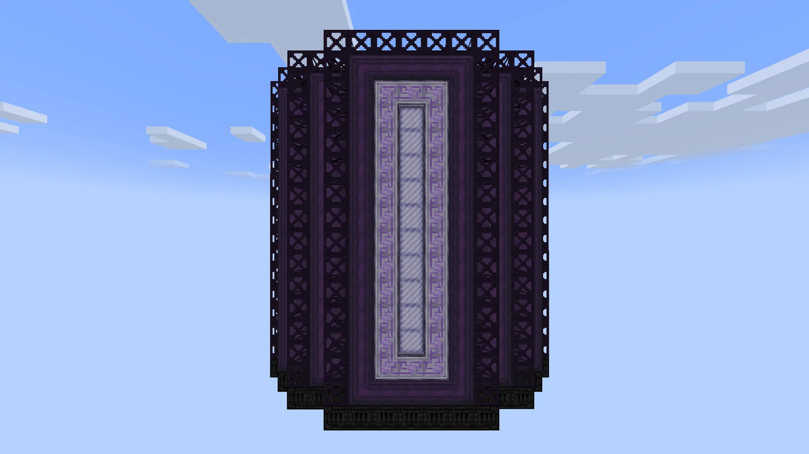
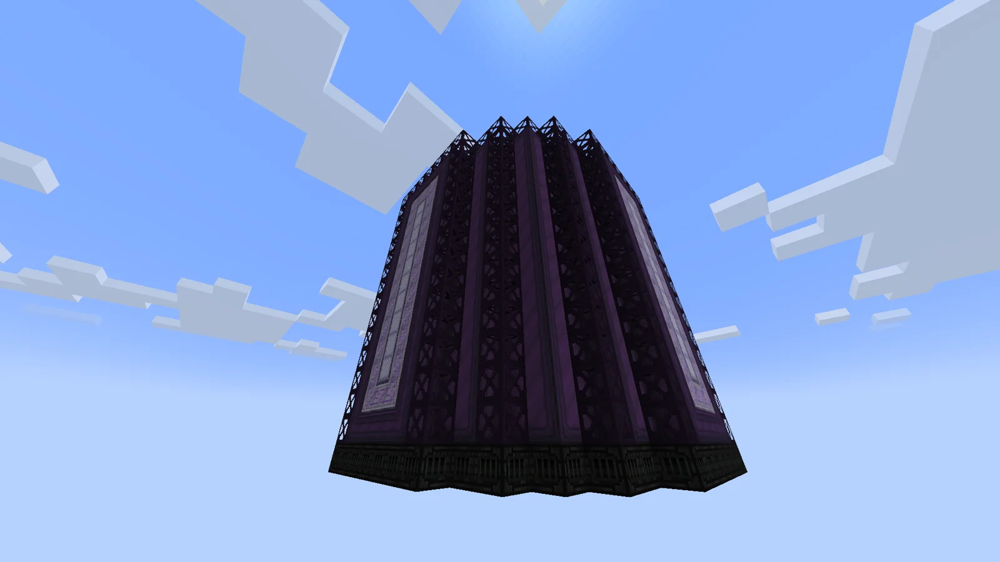
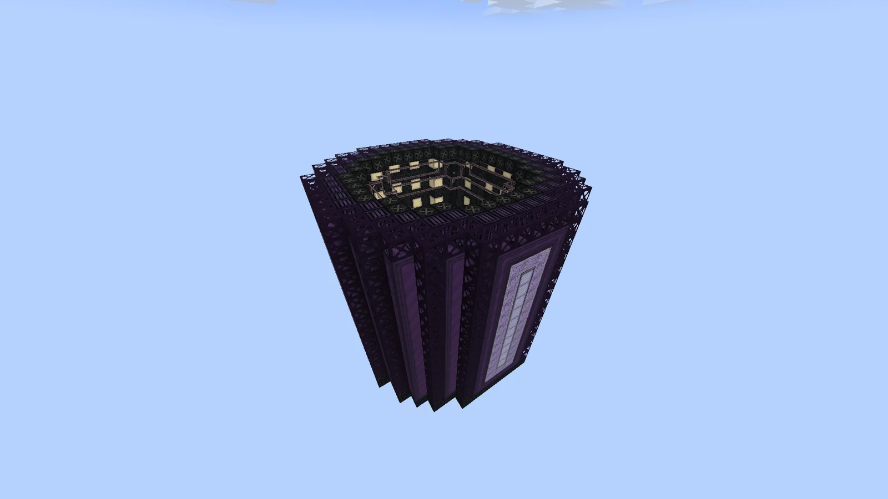
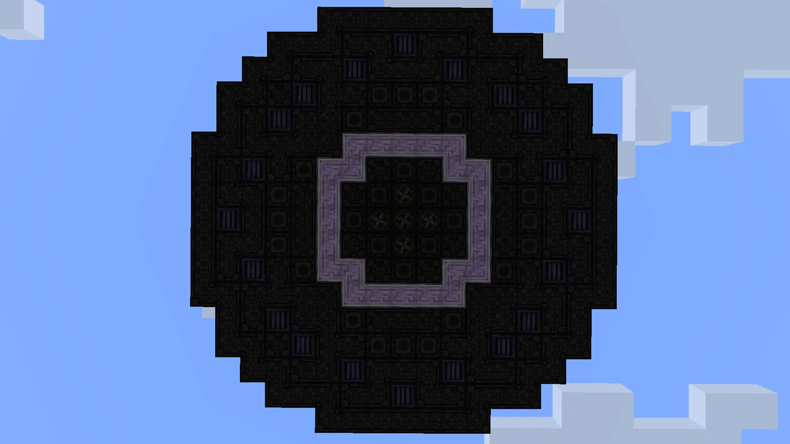
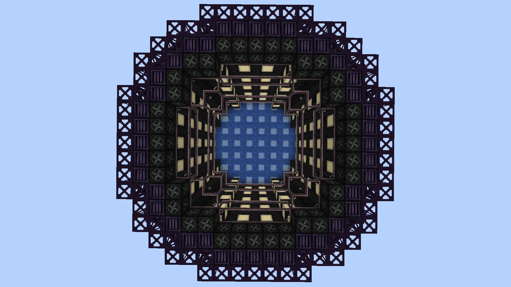
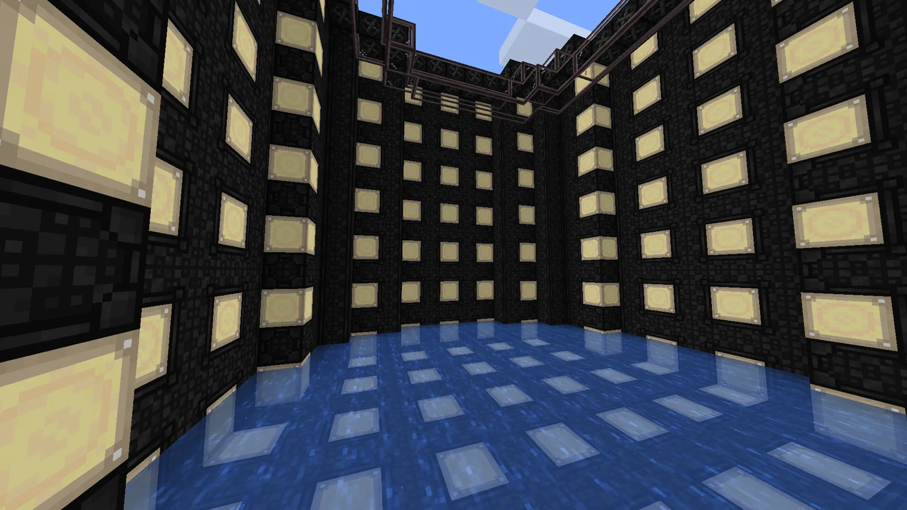
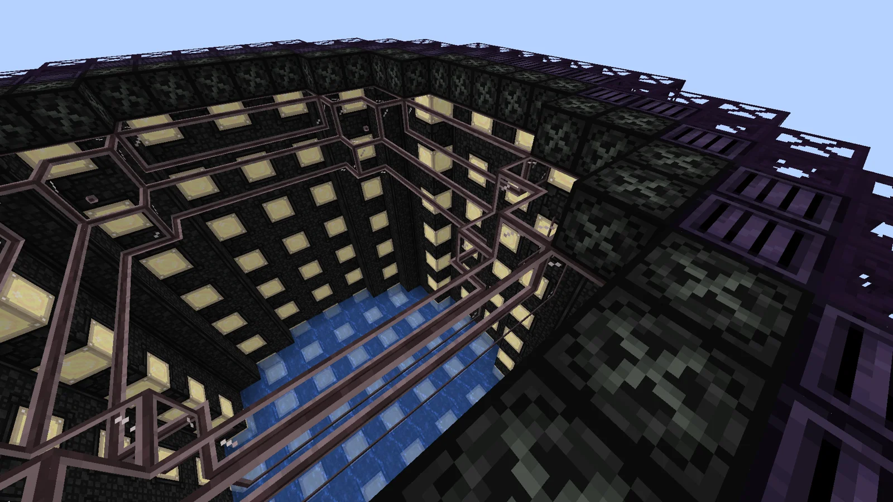

# Kamiokande Oscillation Engine (KOE)
<small>**Submitted by:** Smephy (@smephy) · Multiblock Design Contest, September 2026</small>

!!! quote ""

| | |
|---|---|
| **Target tier** | <UEV>UEV</UEV> |
| **Role** | Processing — neutrino flux production and alternative Neutronium synthesis |
| **Schematic** | [koe-blocks.txt](Contest_img/kamiokande-oscillation-engine/koe-blocks.txt) |
| **Original post** | [Kamiokande Oscillation Engine [KOE]](https://discord.com/channels/1177211394039484477/1554531969075904532) |

## Summary

A post-Draconic, pre-Abyssal production multiblock that the author proposes integrating into the new quest line following the End dimension. It produces neutrino fluxes, which enable an alternative bulk recipe for Neutronium, and the author suggests the new neutrino fluxes could also be worked into progression elsewhere (the Abyssal circuit is given as an example). The design is directly inspired by Super-Kamiokande, the neutrino observatory in Japan.

## Mechanics

The KOE has a custom mechanic intended as a new automation challenge. It works like a mix of a Fusion Reactor and a Vacuum Pump: it has an energy buffer and only runs a recipe once that buffer is full.

**Recipes**

- Two sets of 3 recipes: one set produces *electron-neutrino*, *muon-neutrino* and *tau-neutrino*; an optional second machine mode produces their antiparticle counterparts (*electron-antineutrino*, *muon-antineutrino*, *tau-antineutrino*).
- Every recipe costs the same energy and takes the same time, 10 seconds.

**Purity**

- Every recipe requires the KOE to be at 100% **Purity**.
- Purity is gained by consuming an amount of De-Ionized Water every 5 seconds (same mechanic as Lubricant-boosted turbines); each cycle raises Purity by 20%.
- The machine cannot run without De-Ionized Water. As soon as not enough is supplied, Purity instantly drops to 0% (like a Cleanroom when a wall is broken).
- The water must keep being consumed every 5 seconds even while a recipe is processing. The author notes it may be easier to implement Purity like the Hell Forge's temperature, as a running De-Ionized Water recipe.

**Efficiency**

- An **Efficiency** value from 1% to 100%, readable with the Redstone Variadic Interface.
- Efficiency drives both the energy requirement and the output chance. At 1% Efficiency the recipe consumes 100× the energy and produces its neutrino flux with only a 1% chance.
- Running the same recipe twice in a row lowers Efficiency by 15%. Running a different recipe raises it by 30% (capped at 100%), but switching recipes dumps the water inside the KOE, which sets Purity back to 0%.

**Parallels and energy**

- When the buffer is full, the machine checks Purity (anything below 100% does nothing) and Efficiency, then runs the selected recipe with a number of **Parallels** that depends on Efficiency: 1× at 1% and 4096× at 100%.
- Parallels: `P = f(E) = floor(0.5 + E^(ln(4096) / ln(100)))`
- Energy consumption per run is always `Pmax`, the full contents of the buffer; the author recommends something around 256A <UEV>UEV</UEV>.
- The minimum energy per recipe is therefore `Pmax / 4096`, only reached at 100% Efficiency.

**Intended optimization**

- Repeating the same recipe drives the KOE down to 1% Efficiency, which is not optimal.
- Always alternating recipes makes the KOE spend most of its time refilling Purity, which is also not optimal.
- The player is meant to find a balance between repeated and alternating cycles, for example `R1 -> R1 -> R1 -> R2 -> R2 -> R2 -> R3 -> R3 -> R3 -> repeat` (the author calls this the "triple 3-recipes cycle"). With the proposed numbers (15% penalty, 30% bonus, 10 s recipe time, 20% Purity per 5 s) this beats the single-recipe, simple 3-recipe and double 3-recipe cycles; the author has not checked whether a quadruple 3-recipes cycle is better still.
- The author warns that changing these numbers can completely change the intended mechanic (for example, repeating one recipe could become the optimal strategy).

## Structure

A tall, rounded tank: a dark exterior of Enriched Naquadah casings wrapped in Trinaquadalloy frames with a vertical Draco Ware strip on the front, enclosing a water-floored interior lined with rows of Lumium Casings and a ring of Rhenotax Coils under the rim. The author did not state the dimensions.

!!! abstract "Screenshots"

    === "Front"
        

    === "Exterior angle"
        

    === "Exterior from above"
        

    === "Top view"
        

    === "Top view, interior"
        

    === "Interior"
        

    === "Interior rim"
        

## Files

- [koe-blocks.txt](Contest_img/kamiokande-oscillation-engine/koe-blocks.txt) — block-state dump of the structure with a block count list (no .litematic was provided)
- [koe-mechanics.txt](Contest_img/kamiokande-oscillation-engine/koe-mechanics.txt) — the author's full in-depth mechanics write-up

## Notes from the thread

- Feedback that the build could have been larger and that the Lumium Casings are too recognizable; the author agreed the Lumium Casing is the part they like least and suggested a new custom casing in the style of the Melodium Reinforced Casing but in a yellow/gold color.
- A reader pointed out that the real Super-Kamiokande is filled with water to the top while operating (the low-water photos are taken during maintenance). The author suggested the KOE could show a rising water level while running, like a liquid recipe in the Large Mixing Vessel.
