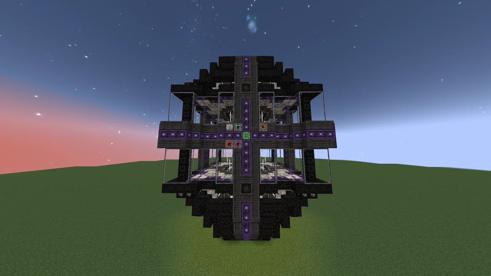
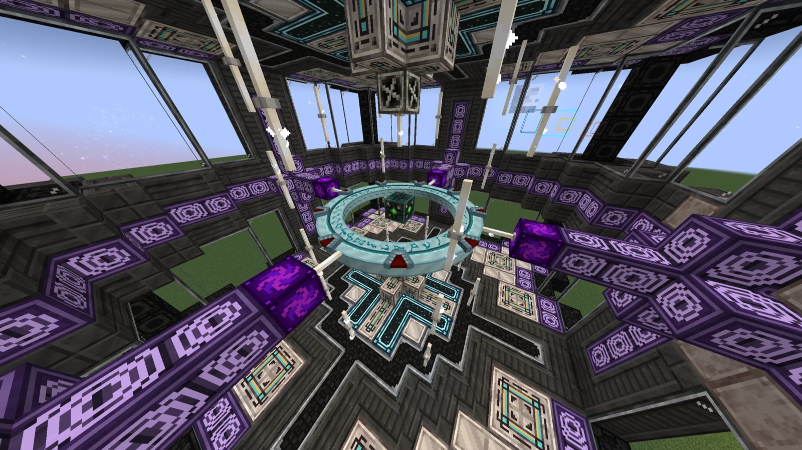
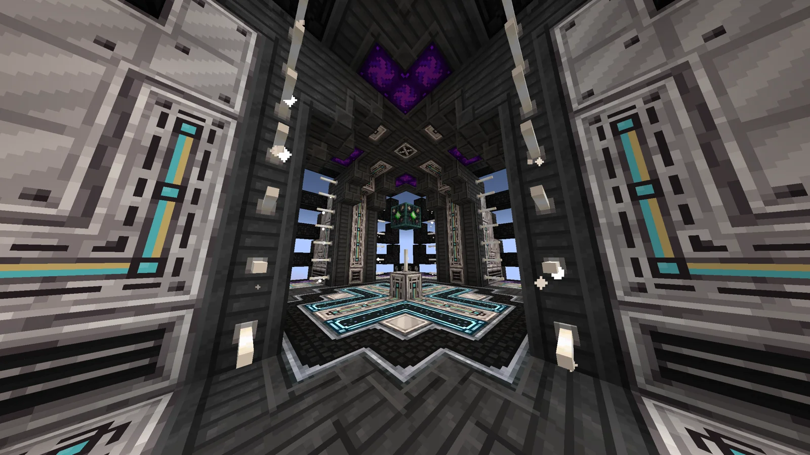
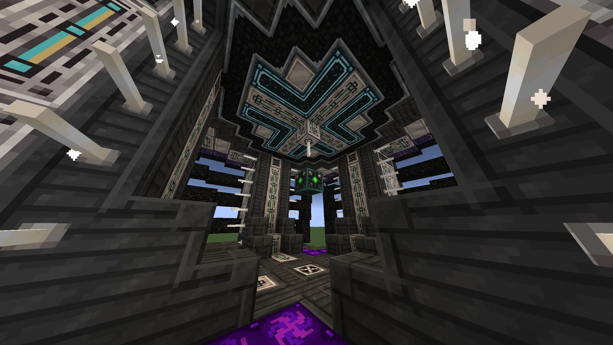

# Lagrangian Anchored Rift Pulsing Inductive Negating Generator (L.A.R.P.I.N.G.)
<small>**Submitted by:** Luck (@luckytg.), Dungeon Six Potion (@dungeonsixpotion), Cry (@dzinhth0), Martin_mc (@martin_mc) · Multiblock Design Contest, September 2026</small>

!!! quote ""

| | |
|---|---|
| **Target tier** | <UV>UV</UV> |
| **Role** | Power generation — Stargate-powered plasma generator |
| **Schematic** | [larping.litematic](Contest_img/lagrangian-anchored-rift-generator/larping.litematic) |
| **Original post** | [(L.A.R.P.I.N.G) Lagrangian Anchored Rift Pulsing Inductive Negating Generator](https://discord.com/channels/1177211394039484477/1555274486427942993) |

## Summary

A <UV>UV</UV> power generator that uses the Stargate and plasmas to produce energy. It is a side build of the authors' "Stargate Revitalization Project"; the authors point to their main entry, the [Ancient Belief Yielding Data Optimization Sanctum and Eye of Horus](data-optimization-sanctum-and-eye-of-horus.md), for the full background on the project.

## Mechanics

- The multiblock consumes Enriched Naquadah Dust and plasma to open a Stargate. Activation requires 1 GEU.
- Once the gate is open it starts producing energy. The output slowly increases over time, but so does the energy and resource cost of keeping the gate open.
- Eventually the upkeep cost exceeds the energy produced, so the gate must be shut down before it becomes a net energy loss.
- **Plasma boosting:** Helium, Nitrogen, and Iron Plasma can be fed in to improve the gate. Using more plasma types increases both the energy produced and the time the gate can stay open.
    - Helium Plasma — increases gate operating time.
    - Nitrogen Plasma — increases EU/t production.
    - Iron Plasma — reduces resource consumption.
- Americium Plasma supercharges the LARP, greatly increasing its performance.

## Structure

A roughly spherical dark-casing shell with purple-accented bands and a cross-shaped front face; the interior holds a ring on a central platform. The authors did not state the dimensions.

!!! abstract "Screenshots"

    === "Front"
        

    === "Interior ring"
        

    === "Interior entrance"
        

    === "Interior ceiling"
        

## Files

- [larping.litematic](Contest_img/lagrangian-anchored-rift-generator/larping.litematic) — Litematica (Forgematica) schematic, "Version 4"
