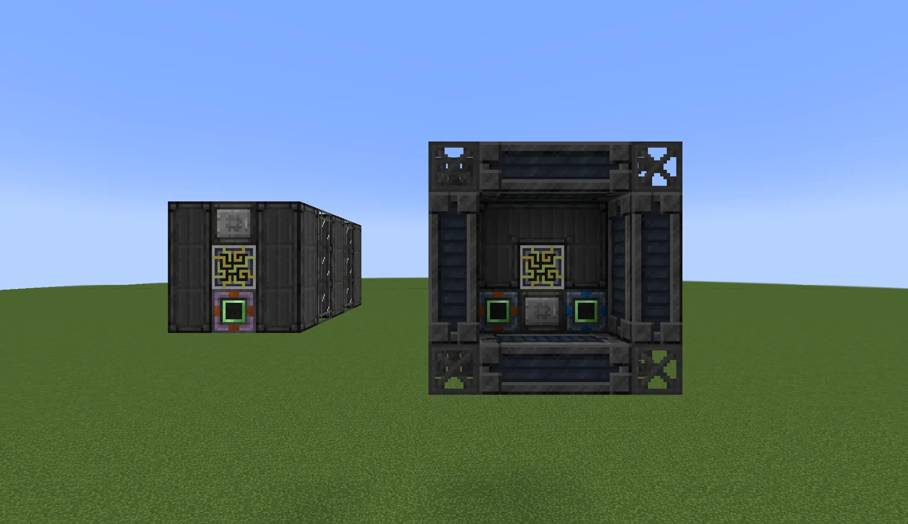
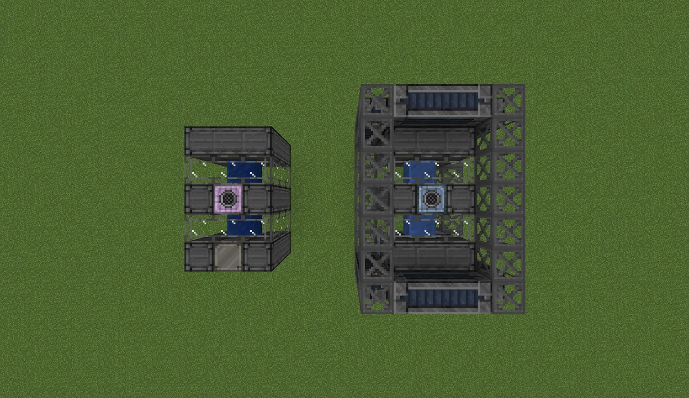
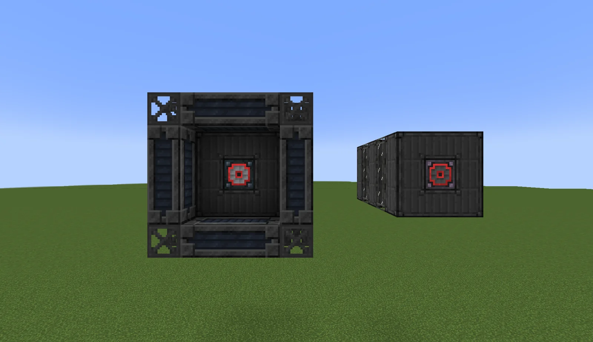
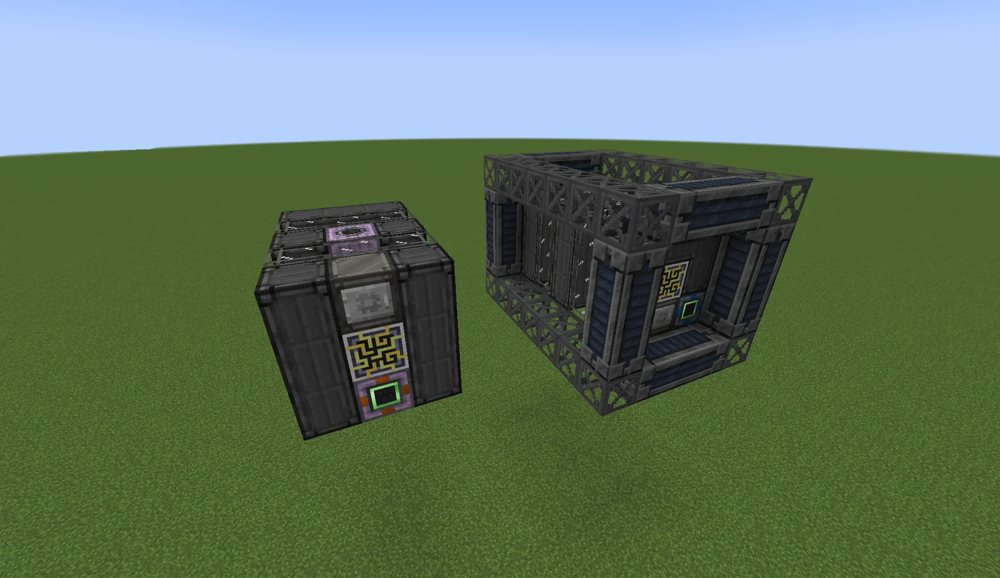
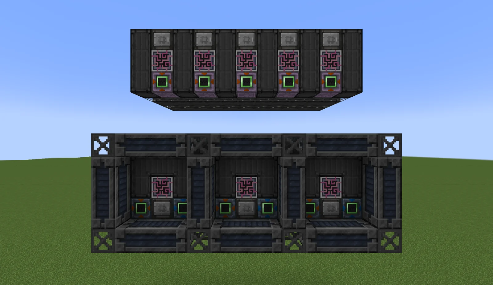
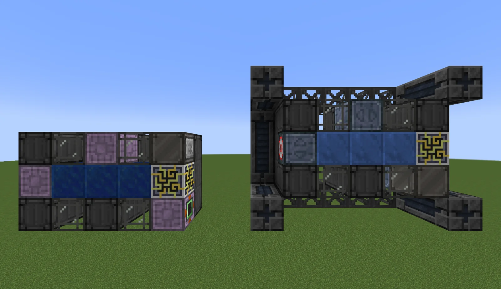

# Lapidary Extraction Unit (LEU) and Lapidary Extraction Matrix (LEM)
<small>**Submitted by:** _Scarf (@_scarf) · Multiblock Design Contest, September 2026</small>

!!! quote ""

| | |
|---|---|
| **Target tier** | LEU: <EV>EV</EV>, LEM: <IV>IV</IV> |
| **Role** | Power generation — multiblock Lapidary Dynamos that scale with gemstone variety |
| **Schematic** | [leu.txt](Contest_img/lapidary-extraction-unit-and-matrix/leu.txt), [lem.txt](Contest_img/lapidary-extraction-unit-and-matrix/lem.txt) |
| **Original post** | [Lapidary Extraction Unit \[LEU\] / Lapidary Extraction Matrix \[LEM\]](https://discord.com/channels/1177211394039484477/1553975123005014119) |

## Summary

A pair of multiblock versions of the Lapidary Dynamo. Both share one gimmick: their power output scales with the **number of unique gemstones** fed to them. The author's goal is to make lapidary power generation more interesting and let it scale further into the game, with the LEU covering <EV>EV</EV> and the LEM covering <IV>IV</IV>.

## Mechanics

- Both structures are multiblock counterparts of the single-block Lapidary Dynamo.
- Power production increases with how many different gemstones are supplied, rather than only with the amount of fuel.
- The full mechanics (including the author's discussion of diatrons) are in the author's linked document: [Lapidary Extraction Unit / Lapidary Extraction Matrix Mechanics](https://docs.google.com/document/d/1-qd3oV8AasmGixAO3p_4uy2Pe8PO-Y5Lo_VCs0HCACI/edit?usp=sharing). Only its summary was captured in the thread, so the per-gemstone numbers are not reproduced here.

## Lapidary Extraction Unit (LEU)

### Summary

The <EV>EV</EV> multiblock version of the Lapidary Dynamo.

### Structure

A 3×3×5 box of Nonconducting Casings with Laminated Glass windows and a core of 3 Lapis Blocks running down its length. The schematic places an EV Input Bus and Maintenance Hatch on the front face next to the controller, an EV Muffler Hatch on top and a 16A EV Energy Output Hatch at the back. The author used a Chisel "Futura ME Controller" block as a stand-in for the controller.

### Files

- [leu.txt](Contest_img/lapidary-extraction-unit-and-matrix/leu.txt) — LEU schematic exported as a text block list (JSON)

## Lapidary Extraction Matrix (LEM)

### Summary

The <IV>IV</IV> multiblock version of the Lapidary Dynamo.

### Structure

A 5×5×7 frame of HSLA Steel Frames and Stress-Proof Casings around an inner shell of Nonconducting Casings and Laminated Glass, with 3 Diatron Blocks forming the core. The schematic places an IV Input Bus, IV Input Hatch and Maintenance Hatch on the front face around the controller, an IV Muffler Hatch on top and a 16A IV Energy Output Hatch at the back. The same Chisel block stands in for the controller.

### Files

- [lem.txt](Contest_img/lapidary-extraction-unit-and-matrix/lem.txt) — LEM schematic exported as a text block list (JSON)

## Structure

Every screenshot shows both structures together: the smaller LEU and the larger LEM side by side.

!!! abstract "Screenshots"

    === "Front"
        

    === "Top view"
        

    === "Back"
        

    === "Angled"
        

    === "Interior layers"
        

    === "Cross-section"
        

## Notes from the thread

- A balance concern was raised that lapidaries already carry power from <LV>LV</LV> to <EV>EV</EV>/<IV>IV</IV>, and that multiblock versions could cut NBZ out of progression entirely unless lapidaries as a whole were nerfed or the <EV>EV</EV> upgrade kits were removed from single-block lapidaries. The author agreed that a non-GT single-block producing nearly 5A <EV>EV</EV> from a very simple fuel is already excessive, but did not change the entry.
- The author notes that "LEU" is a nod to the Romanian currency; "LEM" is not a reference to anything.
