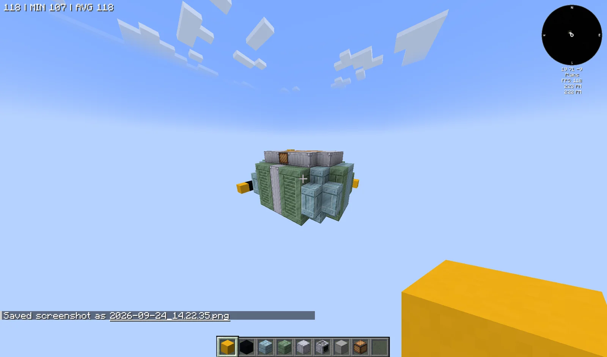
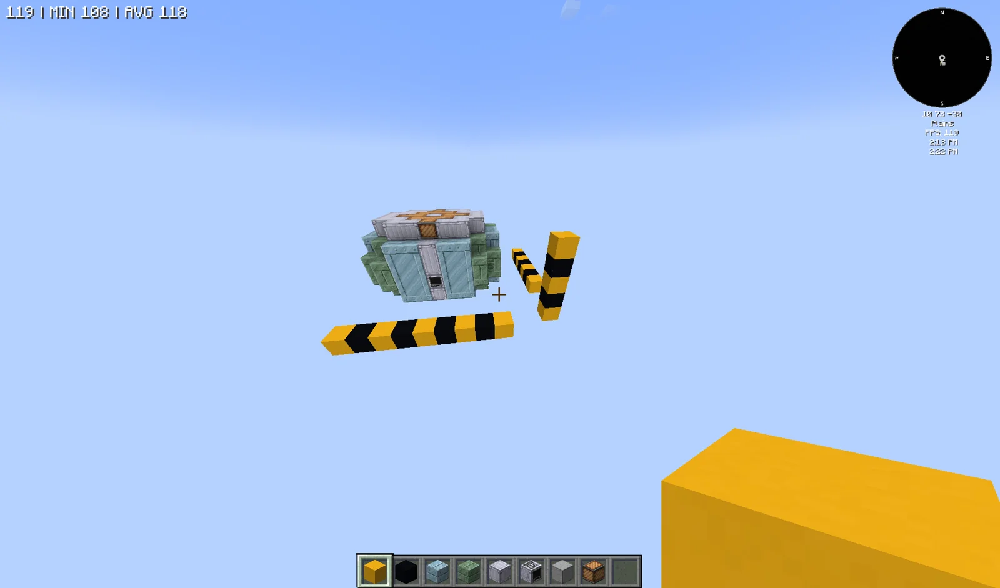
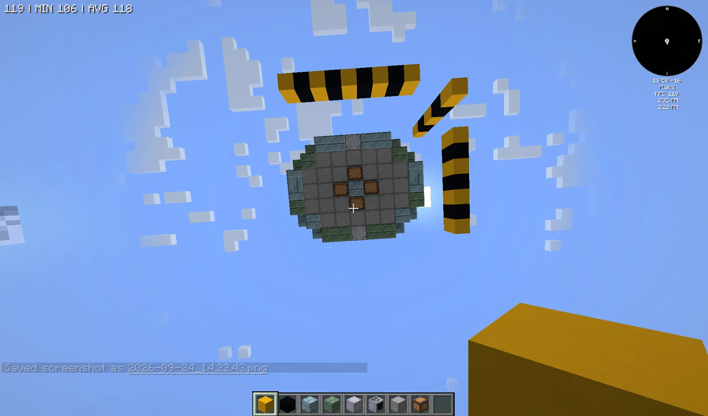
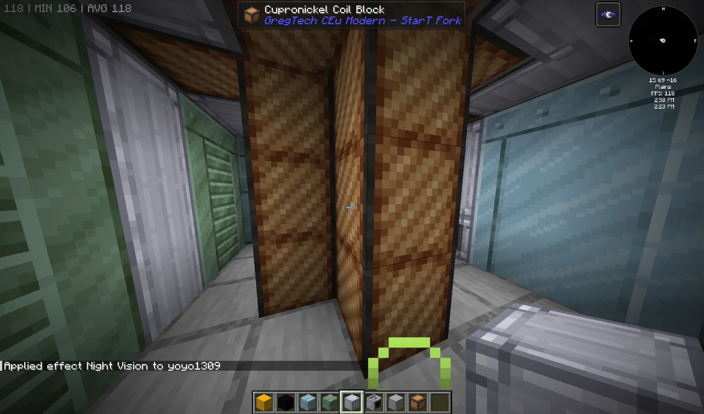

# Large Assembler (LA)
<small>**Submitted by:** Yoyo1309 (@yoyo1309) · Multiblock Design Contest, September 2026</small>

!!! quote ""

| | |
|---|---|
| **Target tier** | <EV>EV</EV> |
| **Role** | Processing — 4x parallel Assembler with coil boosting |
| **Schematic** | Copy-paste string in the post (see Files) |
| **Original post** | [Large Assembler](https://discord.com/channels/1177211394039484477/1552645852059664404) |

## Summary

A multiblock Assembler that runs **4 parallels** and supports **coil boosting**, and nothing else: no additional parallels, no subtick, no other functions. The author describes it as the Assembler equivalent of the HV cube multiblocks, with a more complex structure and more mechanics.

## Mechanics

- Assembler recipes at 4x parallel; the parallel count is fixed and cannot be raised further.
- Coil boosting is allowed (the structure uses Cupronickel Coil Blocks). The author does not state what the coils boost.
- No subtick processing and no other extra functions.
- 4x and 16x hatches are not allowed, and only one hatch is permitted.
- The author positions it as a "cube"-style machine, distinct from the parallel-oriented Large Assembly Factory at <IV>IV</IV>.

## Structure

A 9 x 5 x 7 (width x height x depth) block of Frostproof, Heatproof and Clean Machine Casings with a Smooth Stone deck and Cupronickel Coil Block columns inside, with an HV Assembler as the controller (facing north in the schematic). Block list from the author's schematic: 50 Frostproof Machine Casing, 42 Heatproof Machine Casing, 28 Clean Machine Casing, 28 Cupronickel Coil Block, 26 Smooth Stone, 1 HV Assembler.

!!! abstract "Screenshots"

    === "Front"
        

    === "Side"
        

    === "Top view"
        

    === "Interior"
        

## Files

No schematic file was attached. The author pasted the structure as a copy-paste string in the post body:

??? note "Copy-paste string"

    ```json
    {
      "name": "",
      "statePosArrayList": "{blockstatemap:[{Name:\"minecraft:air\"},{Name:\"gtceu:frostproof_machine_casing\"},{Name:\"gtceu:clean_machine_casing\"},{Name:\"gtceu:heatproof_machine_casing\"},{Name:\"gtceu:hv_assembler\",Properties:{facing:\"north\"}},{Name:\"minecraft:smooth_stone\"},{Name:\"gtceu:cupronickel_coil_block\",Properties:{active:\"false\"}}],endpos:{X:0,Y:4,Z:6},startpos:{X:-8,Y:0,Z:0},statelist:[I;0,0,1,1,2,1,1,0,2,0,3,1,1,4,1,1,3,0,0,3,1,1,2,1,1,3,0,0,0,1,1,2,1,1,0,0,0,0,0,0,0,0,0,0,0,0,3,5,5,5,5,5,3,0,3,3,0,0,0,0,0,3,3,3,3,0,0,0,0,0,3,3,0,3,0,0,0,0,0,3,0,0,0,2,2,6,2,2,0,0,1,5,5,5,6,5,5,5,1,1,0,0,0,6,0,0,0,1,1,0,0,0,6,0,0,0,1,1,0,0,0,6,0,0,0,1,0,2,2,6,6,6,2,2,0,1,5,5,6,1,6,5,5,1,1,0,0,6,3,6,0,0,1,1,0,0,6,1,6,0,0,1,1,0,0,6,3,6,0,0,1,0,2,6,6,2,6,6,2,0,3,5,5,5,6,5,5,5,3,3,0,0,0,6,0,0,0,3,3,0,0,0,6,0,0,0,3,3,0,0,0,6,0,0,0,3,0,2,2,6,6,6,2,2,0,0,1,5,5,5,5,5,1,0,1,1,0,0,0,0,0,1,1,1,1,0,0,0,0,0,1,1,0,1,0,0,0,0,0,1,0,0,0,2,2,6,2,2,0,0,0,0,3,3,2,3,3,0,0,0,1,3,3,2,3,3,1,0,0,1,3,3,2,3,3,1,0,0,0,3,3,2,3,3,0,0,2,0,0,0,0,0,0,0,0]}",
      "requiredItems": {
        "gtceu:clean_machine_casing": 28,
        "minecraft:smooth_stone": 26,
        "gtceu:cupronickel_coil_block": 28,
        "gtceu:hv_assembler": 1,
        "gtceu:frostproof_machine_casing": 50,
        "gtceu:heatproof_machine_casing": 42
      }
    }
    ```

## Notes from the thread

- Thread feedback called the design too strong for <EV>EV</EV> and pointed out that the Large Assembly Factory already arrives at <IV>IV</IV>; the author replied that the Large Assembler is a cube-style machine, not a parallel multiblock like the LAF, and that balancing is up to the devs.
- Asked whether it would get PoC like the cubes, the author left that for the devs to decide.
