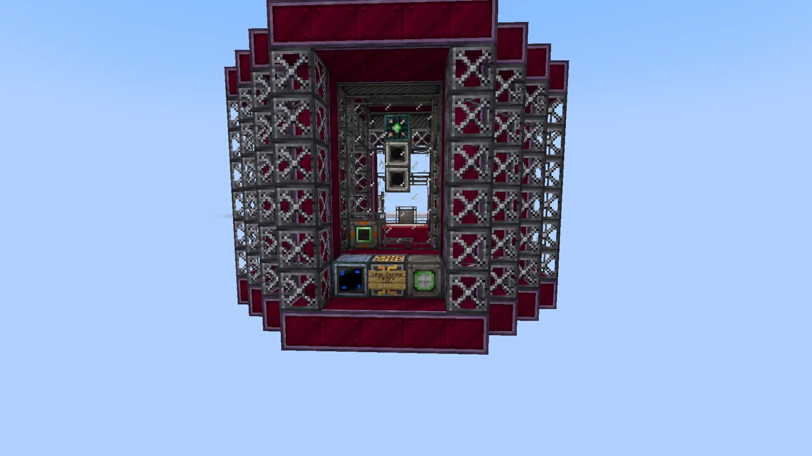
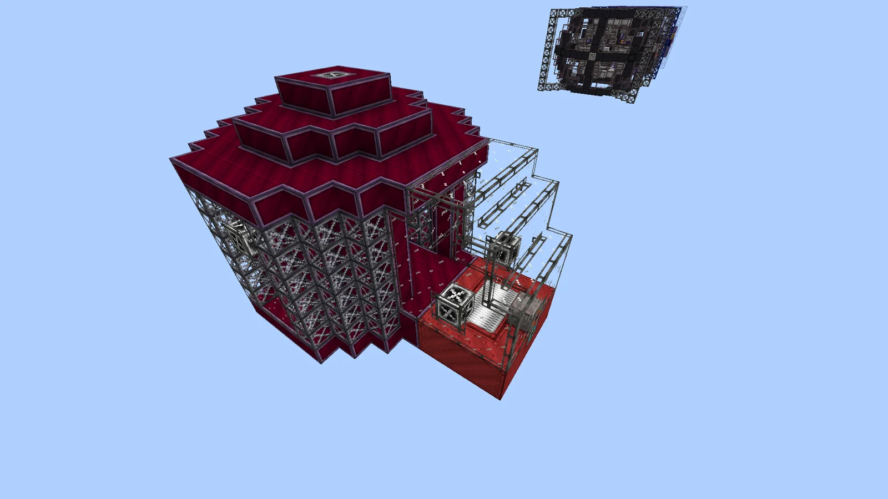
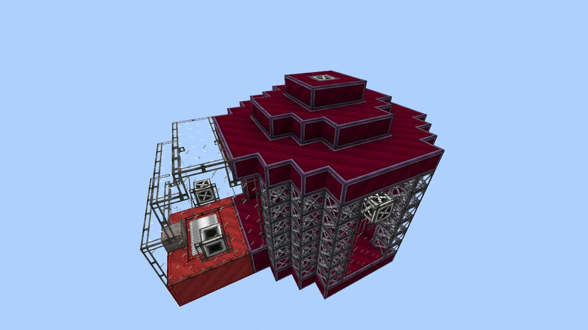
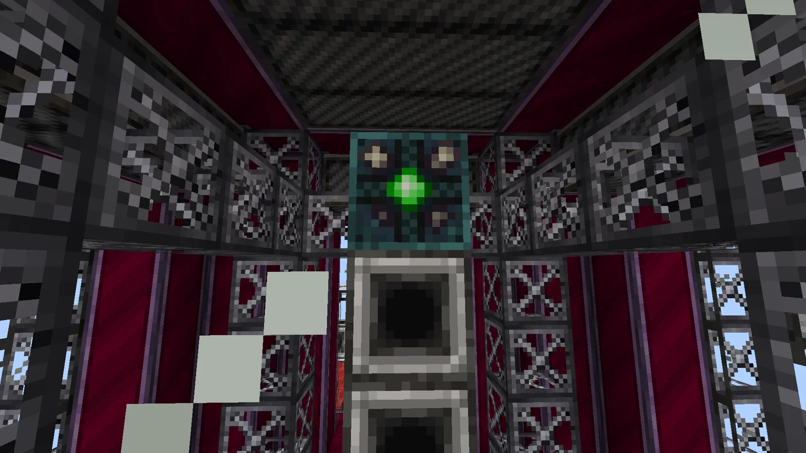
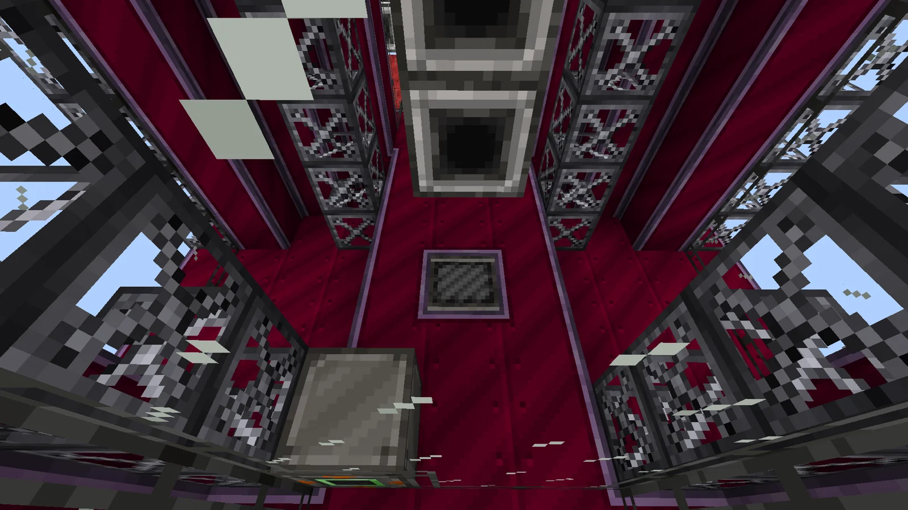

# Large Cleaving Factory (LCF)
<small>**Submitted by:** 2treehouse1 (@2treehouse1) · Multiblock Design Contest, September 2026</small>

!!! quote ""

| | |
|---|---|
| **Target tier** | <ZPM>ZPM</ZPM> |
| **Role** | Processing — combined laser engraver and cutter for chips |
| **Schematic** | [lcf.nbt](Contest_img/large-cleaving-factory/lcf.nbt) |
| **Original post** | [Large Cleaving Factory (LCF)](https://discord.com/channels/1177211394039484477/1553848613723963493) |

## Summary

A <ZPM>ZPM</ZPM> multiblock with two modes: **Laser Engraving** and **Laser Chip Factory**. Laser Chip Factory is a new recipe type that combines the functions of the Laser Engraver and the Cutter into a single step, turning wafers directly into engraved chips.

## Mechanics

- Two machine modes: Laser Engraving and Laser Chip Factory.
- Laser Chip Factory recipes: Wafer + Lens (not consumed) = n Engraved Chips of the lens' type.
- Supports batching, a Parallel Hatch, and throughput boosting.
- Hatch placement:
    - Input Busses and the Parallel Hatch replace the laminated glass at the front of the machine.
    - Energy Hatches replace Laser Casing.
    - The Input Hatch replaces Cutting Casing.

## Structure

A tall structure of dark red casings and steel frame columns with a stepped, pyramid-like roof; the front has a framed opening with the controller in the bottom row, and a glass-and-laser-casing annex sits beside the main body. The author did not state the dimensions.

!!! abstract "Screenshots"

    === "Front"
        

    === "Exterior, left"
        

    === "Exterior, right"
        

    === "Interior, looking up"
        

    === "Interior, floor"
        

## Files

- [lcf.nbt](Contest_img/large-cleaving-factory/lcf.nbt) — NBT structure schematic
