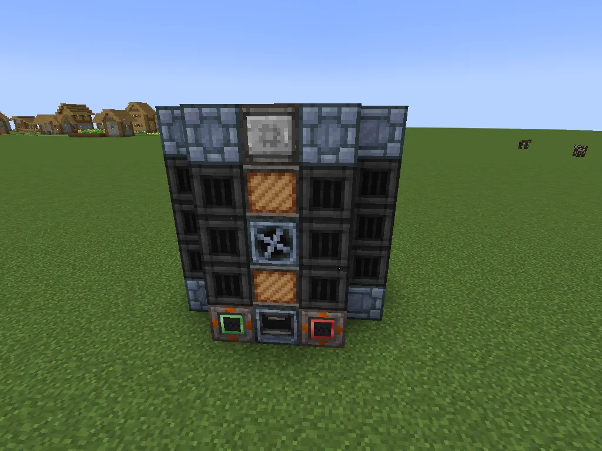
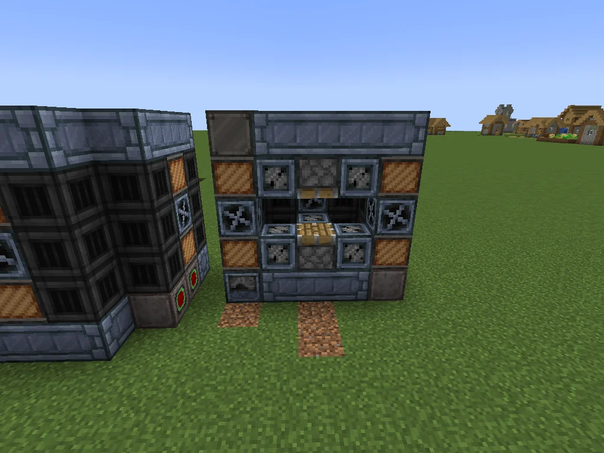

# Large Compressor
<small>**Submitted by:** joe (@tobiasw0202) · Multiblock Design Contest, September 2026</small>

!!! quote ""

| | |
|---|---|
| **Target tier** | <IV>IV</IV> |
| **Role** | Processing — batched, parallel Compressor |
| **Schematic** | [largecompressor.nbt](Contest_img/large-compressor/largecompressor.nbt) |
| **Original post** | [Large Compressor](https://discord.com/channels/1177211394039484477/1552915189836423179) |

## Summary

A larger multiblock version of the Compressor. It runs Compressor recipes only, with overclocking, batching, and parallel processing.

## Mechanics

- Only Compressor recipes; no other recipe maps are added.
- Supports overclocks, batching, and parallels.
- No coil overclocking.

## Structure

A roughly 5-wide, 5-tall block of dark machine casings with a central column of frames and a hatch, and a lighter stone-brick band along the top and bottom edges; the controller sits in the bottom row of the front face between an input and an output bus. The author did not state the dimensions.

!!! abstract "Screenshots"

    === "Front"
        

    === "Interior"
        

## Files

- [largecompressor.nbt](Contest_img/large-compressor/largecompressor.nbt) — NBT structure file (the author also linked the same file on Google Drive)

## Notes from the thread

- Thread feedback pointed out that the Large Material Press already covers everything listed (Compressor recipes with overclocks, batching, and parallels) and suggested the design should have a coil boost to differentiate it. The author replied that the more recipes they scrolled through, the more useless the machine became, and did not revise the design.
