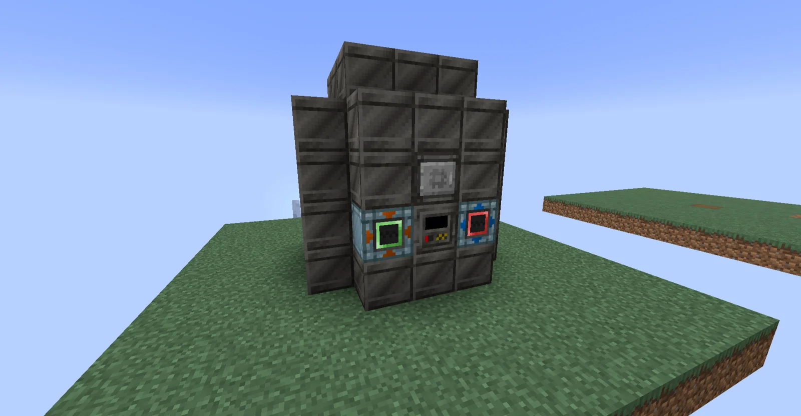
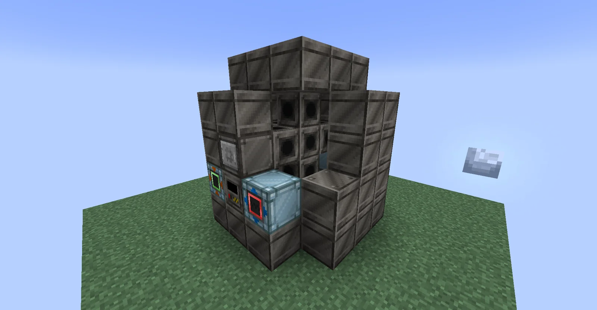
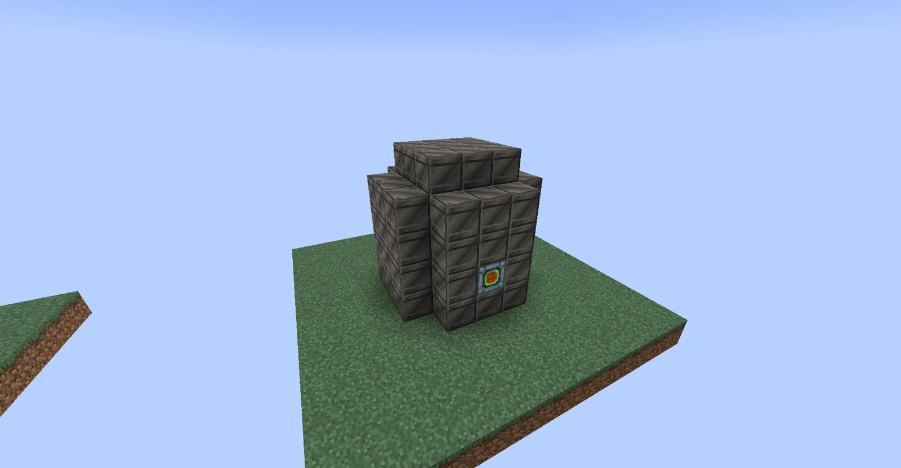

# Large Electric Anemic Fermenter (L.E.A.F.)
<small>**Submitted by:** Terralizer (@terralizor) · Multiblock Design Contest, September 2026</small>

!!! quote ""

| | |
|---|---|
| **Target tier** | <MV>MV</MV> |
| **Role** | Processing — bulk Ethanol fermentation for plastic |
| **Schematic** | [leaf.nbt](Contest_img/large-electric-anemic-fermenter/leaf.nbt) |
| **Original post** | [Large Electric Anemic Fermenter (L.E.A.F.)](https://discord.com/channels/1177211394039484477/1554299122700394507) |

## Summary

An <MV>MV</MV> multiblock fermenter for producing Ethanol in bulk, intended as the feedstock for plastic. It takes Bone Meal and some form of biomatter as input (the author compares it to Create: Diesel Generators) and outputs Ethanol en masse.

## Mechanics

- Inputs: Bone Meal plus biomatter; output: large quantities of Ethanol.
- The author suggests the multi could be upgradeable, with upgrades over several tiers unlocking new recipes.
- Alternatively, the author proposes it could be built from Stainless Steel instead of regular Steel.

## Structure

A compact tower of solid steel machine casings with a stepped top, with the controller and hatches in the front wall and an energy hatch at the back. The author did not state the dimensions.

!!! abstract "Screenshots"

    === "Front"
        

    === "Front-left angle"
        

    === "Back"
        

## Files

- [leaf.nbt](Contest_img/large-electric-anemic-fermenter/leaf.nbt) — NBT structure file

## Notes from the thread

- The author notes the design was finished on the 24th but posted late, after two other fermenter entries had already appeared, and reads that as a sign the feature is well requested.
- Thread feedback suggested using solid steel machine casing only for the top of the fermenter (with the walls as solid machine casing) to be easier on the eyes; the author replied that solid steel looked best in their opinion, and that firebox casings were originally used for the base but dropped because fermenting requires no heat and instead produces it.
