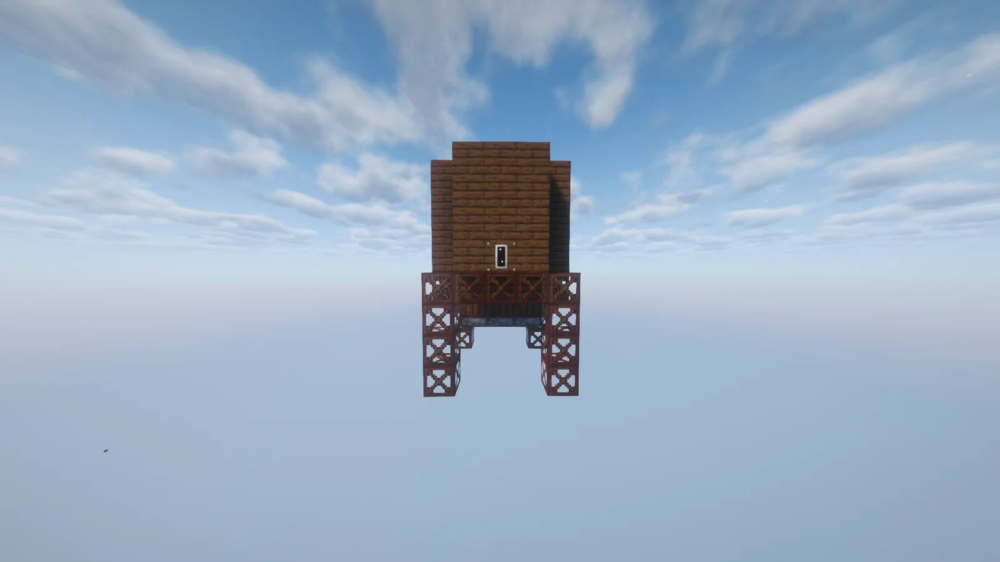
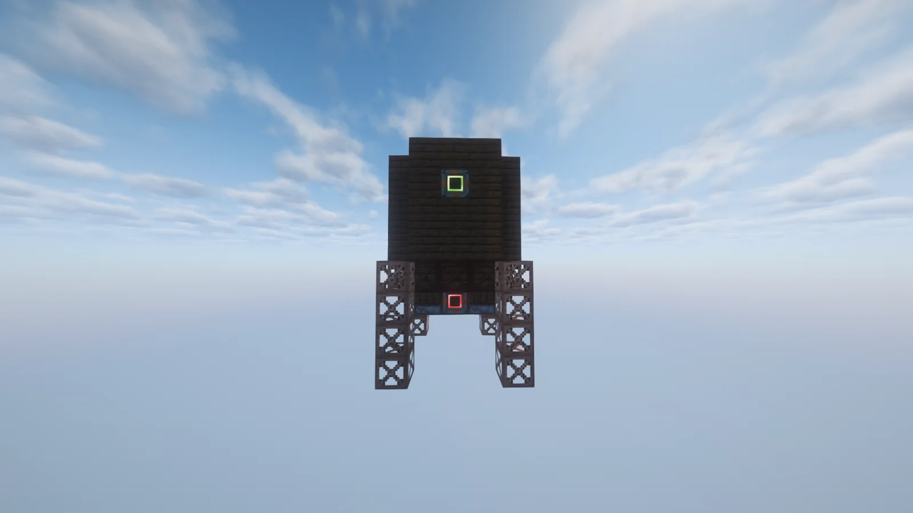
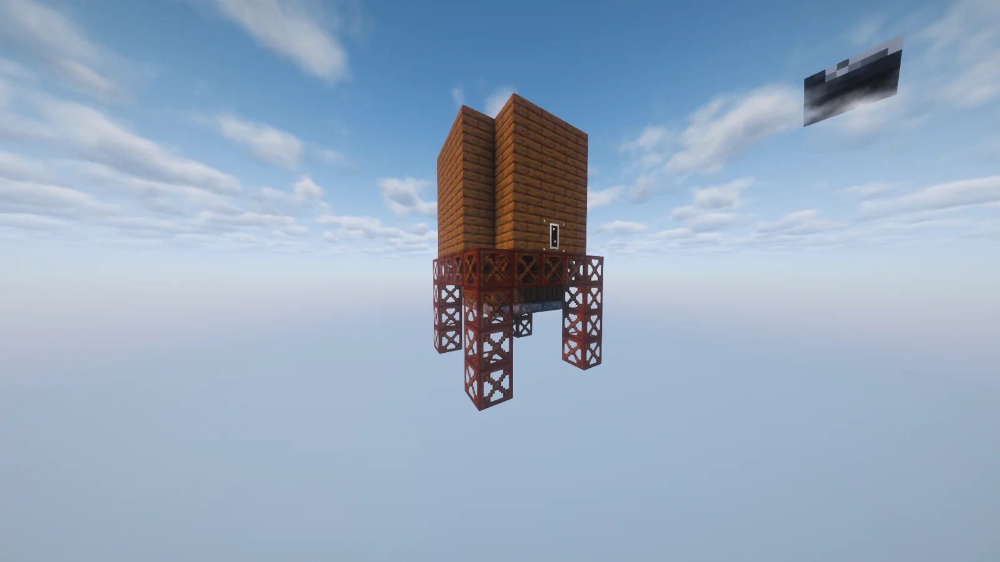
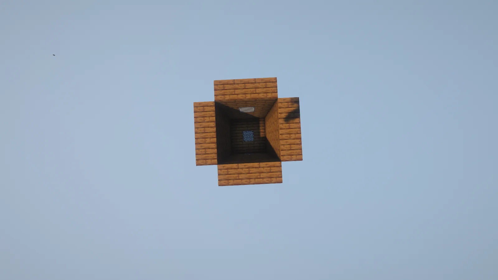
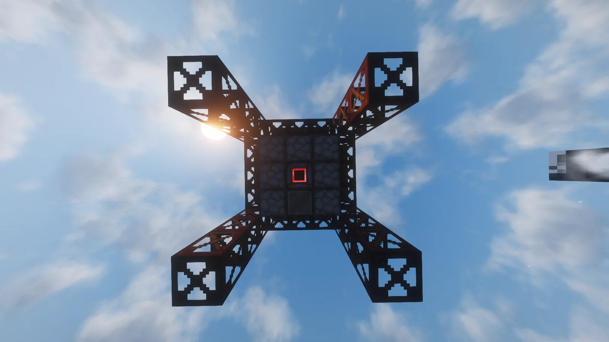

# Large Fermenting Casket (LFC)
<small>**Submitted by:** Corn Chex (@john_nutt) · Multiblock Design Contest, September 2026</small>

!!! quote ""

| | |
|---|---|
| **Target tier** | <LV>LV</LV> |
| **Role** | Processing — faster multiblock Fermenting Casket |
| **Schematic** | [large-fermenting-casket.nbt](Contest_img/large-fermenting-casket/large-fermenting-casket.nbt) |
| **Original post** | [Large Fermenting Casket](https://discord.com/channels/1177211394039484477/1553721935827836938) |

## Summary

A multiblock version of the standard Fermenting Casket that runs the same recipes faster. When making Ethanol it keeps the Bio Chaff byproduct output. The author's goal is to simplify setting up large processing lines for Crude Biodiesel.

## Mechanics

- Works the same way the Large Barrel does: reduced recipe times and wall sharing between adjacent structures.
- Keeps the Bio Chaff output when making Ethanol.
- The mesh at the bottom of the structure is meant to "catch" the Bio Chaff before the fluid output.
- No numbers for the speed bonus were given.

## Structure

A tall wooden casket raised on four steel-frame legs, with the controller on the front wall above the mesh floor; the hollow interior is visible from the top. The author did not state the dimensions.

!!! abstract "Screenshots"

    === "Front"
        

    === "Back"
        

    === "Angled"
        

    === "Top (interior)"
        

    === "Bottom"
        

## Files

- [large-fermenting-casket.nbt](Contest_img/large-fermenting-casket/large-fermenting-casket.nbt) — Schematic Cannon (NBT) structure file
