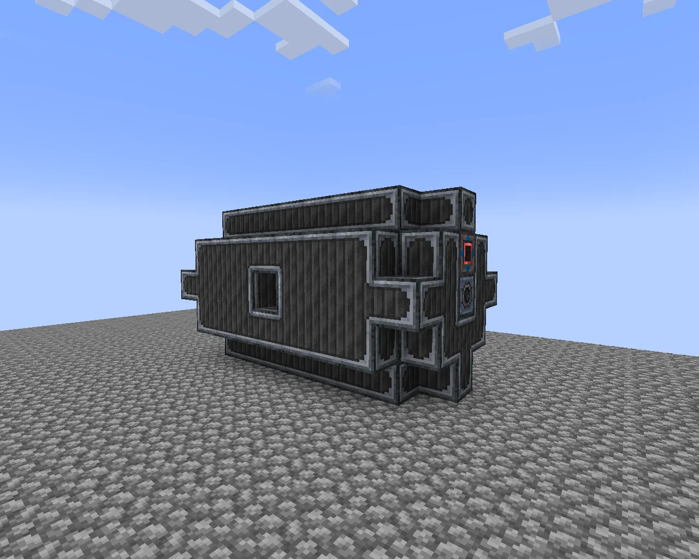
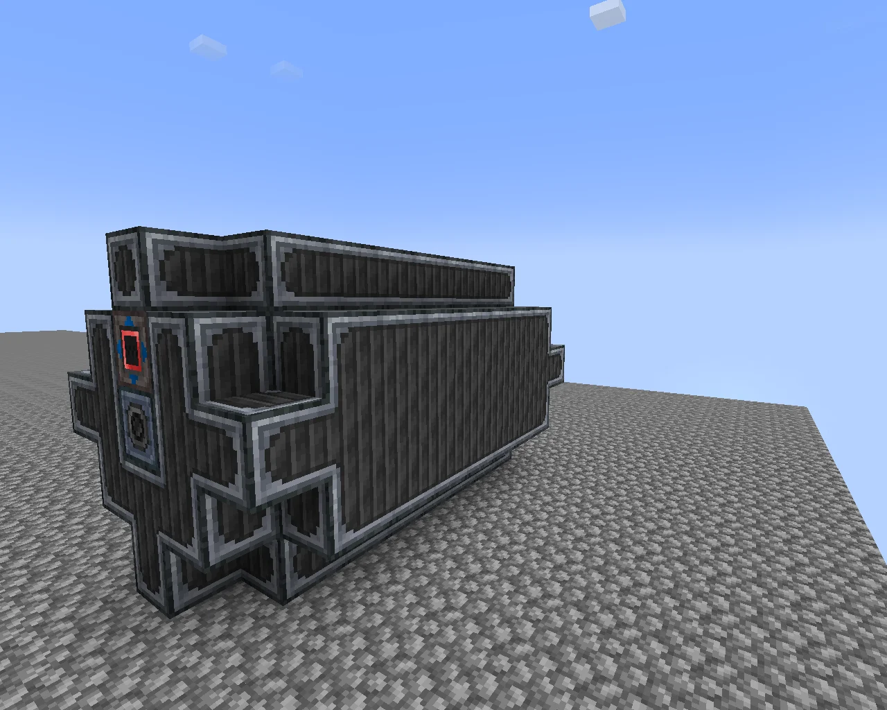

# Large Turbine
<small>**Submitted by:** kiso2019 (@kiso2019_j) · Multiblock Design Contest, September 2026</small>

!!! quote ""

| | |
|---|---|
| **Target tier** | <IV>IV</IV>-<UV>UV</UV> |
| **Role** | Power generation — higher-tier steam turbine |
| **Schematic** | [large-turbine.nbt](Contest_img/large-turbine/large-turbine.nbt) |
| **Original post** | [The Large turbine](https://discord.com/channels/1177211394039484477/1552677601179336755) |

!!! warning "Incomplete submission"

    The post gives only a one-sentence functional summary. No power output figures, steam consumption, dimensions, or in-depth mechanics were provided.

## Summary

A larger steam turbine for the <IV>IV</IV>-<UV>UV</UV> range. The author proposes that the existing Large Turbine be renamed to "Medium" turbine, with this structure taking the "Large" name above it.

## Mechanics

- Produces more power per unit of steam than the current turbine.
- Intended to run on steam from the Nuclear reactor. The author's motivation is that the current turbine stops whenever its energy buffer is full, while reactors keep boiling water.
- No output numbers, steam rates, or rotor details were given.

## Structure

An elongated, boxy turbine built from dark striped casings with light-colored frame edging, with the controller and a hatch on one end face and a window-like block on the long side. The author did not state the dimensions.

!!! abstract "Screenshots"

    === "Side"
        

    === "Controller end"
        

## Files

- [large-turbine.nbt](Contest_img/large-turbine/large-turbine.nbt) — NBT structure file of the build

## Notes from the thread

- A reader asked whether the block next to the rotor hatch was a fluid hatch or a muffler; the author acknowledged the placement as a mistake but did not post a corrected build.
