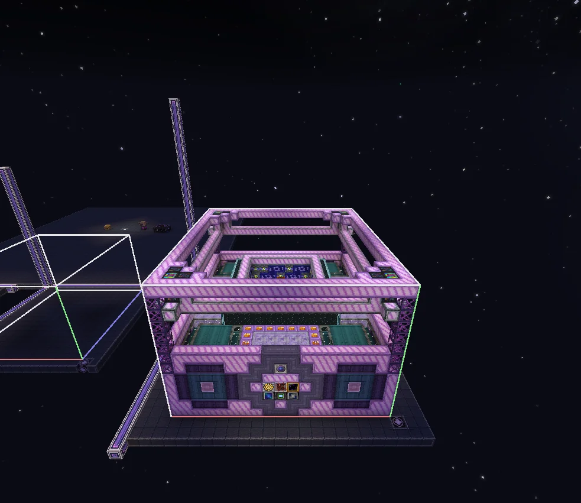
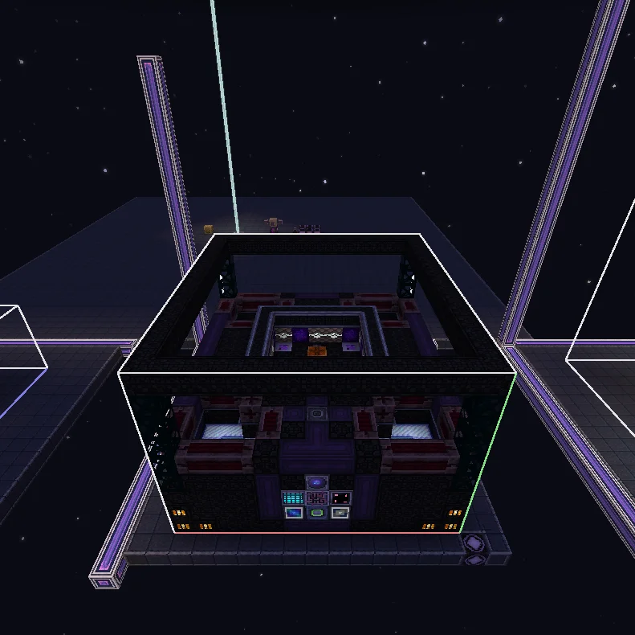
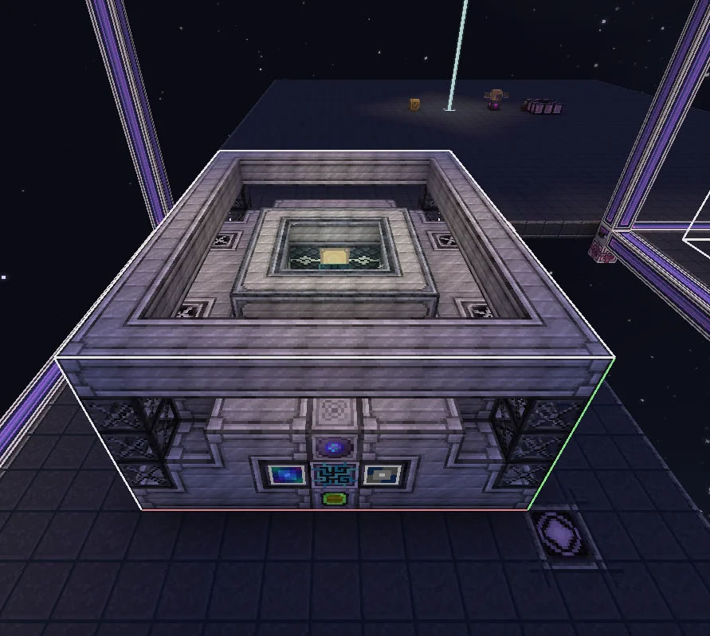

# Layered Universal Circuit Machines
<small>**Submitted by:** Joyal (@j.yal) · Multiblock Design Contest, September 2026</small>

!!! quote ""

| | |
|---|---|
| **Target tier** | <ZPM>ZPM</ZPM> (SCAC), <UHV>UHV</UHV> (GFWC), <UIV>UIV</UIV> (SCRAM) |
| **Role** | Multi-structure family — three tiered bulk circuit assemblers |
| **Schematic** | [sequenced-chip-assembly-chamber.nbt](Contest_img/layered-universal-circuit-machines/sequenced-chip-assembly-chamber.nbt), [gage-freeflow-welding-complex.nbt](Contest_img/layered-universal-circuit-machines/gage-freeflow-welding-complex.nbt), [syntactic-circuitries-reconstructive-alignment-matrix.nbt](Contest_img/layered-universal-circuit-machines/syntactic-circuitries-reconstructive-alignment-matrix.nbt) |
| **Original post** | [Layered Universal Circuit Machines (names below)](https://discord.com/channels/1177211394039484477/1554770069412913182) |

## Summary

A family of three "layered" circuit machines that replace the Draconic Circuit Assembler's `Draco Bulk Circuiter` mode and spread it across the later gates: the **Sequenced Chip Assembly Chamber (SCAC)** at <ZPM>ZPM</ZPM>, the **Gage Freeflow Welding Complex (GFWC)** at <UHV>UHV</UHV>, and the **Syntactic Circuitries: Reconstructive Alignment Matrix (SCRAM)** at <UIV>UIV</UIV>. Each tier is restricted to one circuit tier, needs a progressively higher-tiered soldering alloy, and in return consumes less solder and (at tier 3) yields more.

## Mechanics

Shared by all three machines:

- Recipes that use these machines have their inputs, outputs, and duration multiplied by **24**, to accommodate the latency of layered automation.
- Later tiers may provide additional bonuses, but require increasingly higher-tiered soldering alloy to operate.
- All three require **absolute stabilisation**. Tier 2 and tier 3 additionally require **cleanroom** and **sterile cleanroom** status respectively, to keep the environment pure enough to run; this means the higher tiers carry two "maintenance" hatches. If the required status is missing, recipe outputs are reduced to **tier-1 circuit(s)** and soldering alloy consumption is multiplied by **4^tier**.
- Structure voids in the schematics need not strictly be air.

Per-tier restrictions and solder, as clarified by the author from the world download:

| Machine | Tier | Circuit tier | Soldering alloy | Solder cost | Extra |
|---|---|---|---|---|---|
| SCAC | 1 | <HV>HV</HV> | regular | full | — |
| GFWC | 2 | <IV>IV</IV> | ITLC | 1/2 | — |
| SCRAM | 3 | <ZPM>ZPM</ZPM> | naquadated | 1/4 | +50% yield (proposed; the author leaves the exact bonus to the devs) |

## Sequenced Chip Assembly Chamber (SCAC)

### Summary

Tier 1 of the family, targeted at <ZPM>ZPM</ZPM>. Restricted to <HV>HV</HV> circuits and uses regular soldering alloy at full cost.

### Structure

A pink Palladium Substation shell with Pallaridium engine, turbine, and pipe casings, Fusion Glass, Assembly Line Units, and a superconducting coil in the interior; the controller sits centered on the front wall. The structure dump spans 11 × 5 × 9 blocks.

!!! abstract "Screenshots"

    === "Front"
        

### Files

- [sequenced-chip-assembly-chamber.nbt](Contest_img/layered-universal-circuit-machines/sequenced-chip-assembly-chamber.nbt) — structure NBT

## Gage Freeflow Welding Complex (GFWC)

### Summary

Tier 2 of the family, targeted at <UHV>UHV</UHV>. Restricted to <IV>IV</IV> circuits, uses ITLC solder at half cost, and requires cleanroom status in addition to absolute stabilisation.

### Structure

A dark Enriched Naquadah machine-casing shell with Atomic Casings, Tritanium Coil Blocks, Tritanic Blasting Casings, and Reinforced Fusion Glass, with a Cleaning Maintenance Hatch and an Auxiliary Fusion Coil Mk1. The structure dump spans 15 × 9 × 13 blocks.

!!! abstract "Screenshots"

    === "Front"
        

### Files

- [gage-freeflow-welding-complex.nbt](Contest_img/layered-universal-circuit-machines/gage-freeflow-welding-complex.nbt) — structure NBT

## Syntactic Circuitries: Reconstructive Alignment Matrix (SCRAM)

### Summary

Tier 3 of the family, targeted at <UIV>UIV</UIV>. Restricted to <ZPM>ZPM</ZPM> circuits, uses naquadated solder at a quarter of the cost with an added benefit (the author put 50% extra yield), and requires sterile cleanroom status in addition to absolute stabilisation.

### Structure

A large Nyanium machine-casing structure with Atomic Convergence, Stellarium, Draneko, and Draco Ware casings, Runic Computer Casings, an Advanced Fusion Coil, eight Auxiliary Fusion Coil Mk2, Absolute Annihilators, and a Sterile Cleaning Maintenance Hatch. The author gives its size as 21 × 19 × 13, which was permitted by UltraPuPower1 (@ultrapupower1).

!!! abstract "Screenshots"

    === "Front"
        

### Files

- [syntactic-circuitries-reconstructive-alignment-matrix.nbt](Contest_img/layered-universal-circuit-machines/syntactic-circuitries-reconstructive-alignment-matrix.nbt) — structure NBT

## Files

- [sequenced-chip-assembly-chamber.nbt](Contest_img/layered-universal-circuit-machines/sequenced-chip-assembly-chamber.nbt) — SCAC structure NBT
- [gage-freeflow-welding-complex.nbt](Contest_img/layered-universal-circuit-machines/gage-freeflow-welding-complex.nbt) — GFWC structure NBT
- [syntactic-circuitries-reconstructive-alignment-matrix.nbt](Contest_img/layered-universal-circuit-machines/syntactic-circuitries-reconstructive-alignment-matrix.nbt) — SCRAM structure NBT
- [structures.txt](Contest_img/layered-universal-circuit-machines/structures.txt) — text dump of all three structures (block state lists and required block counts)
- [multi-showcase.zip](Contest_img/layered-universal-circuit-machines/multi-showcase.zip) — world download with all three machines built

## Notes from the thread

- Thread feedback pointed out that the Absolute Stabilization Module is only unlocked at <UHV>UHV</UHV>, which would softlock the <ZPM>ZPM</ZPM> tier 1 machine. The author proposed using a Cleaning Maintenance Hatch instead for tier 1; a later reply noted that the Cleaning Hatch is still <UV>UV</UV>. The author did not post a resolved version.
- The SCRAM's 21 × 19 × 13 footprint was approved by UltraPuPower1 (@ultrapupower1), per the author.
