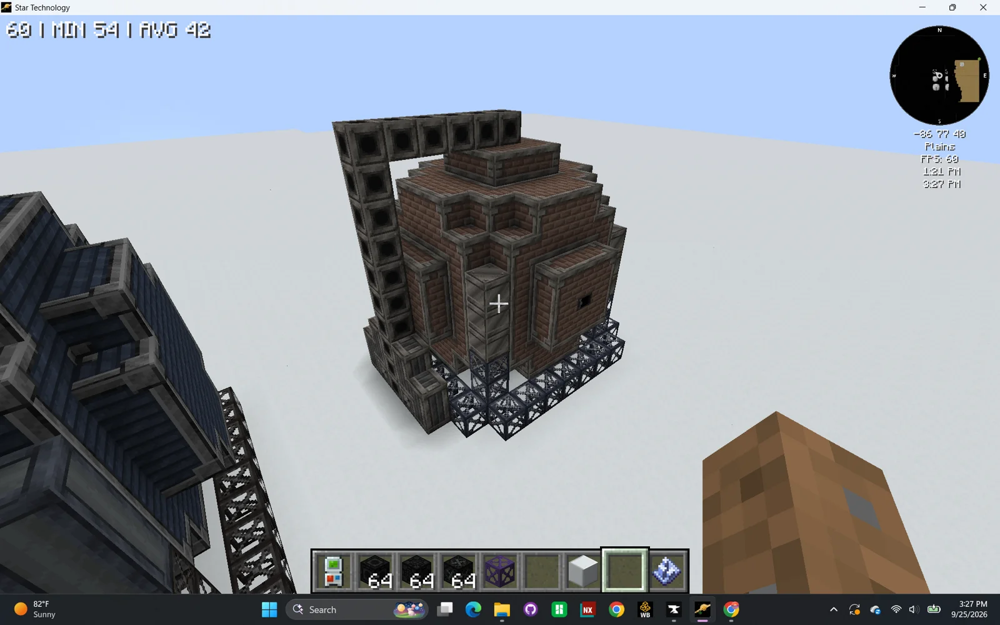
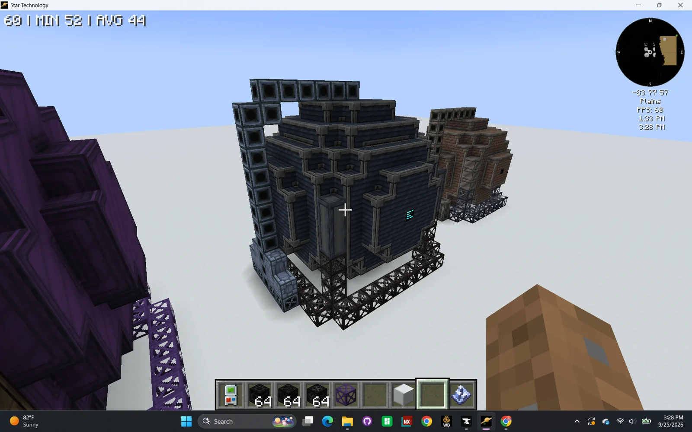
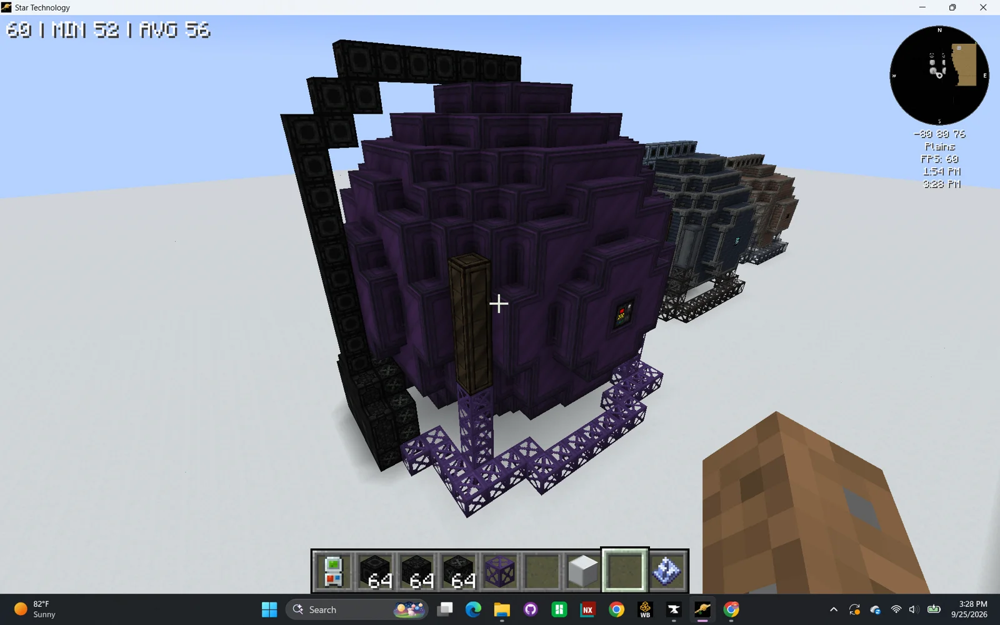
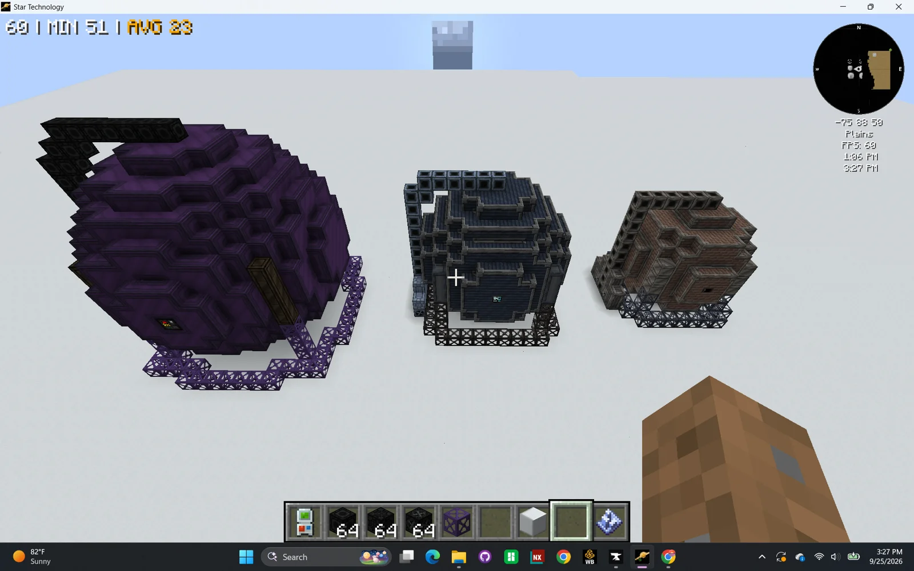
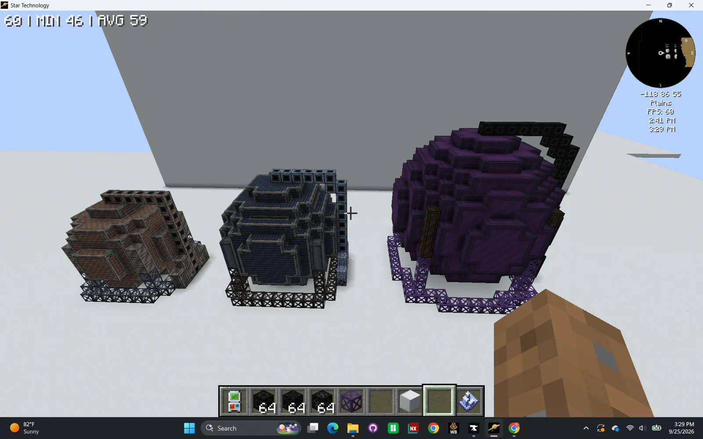
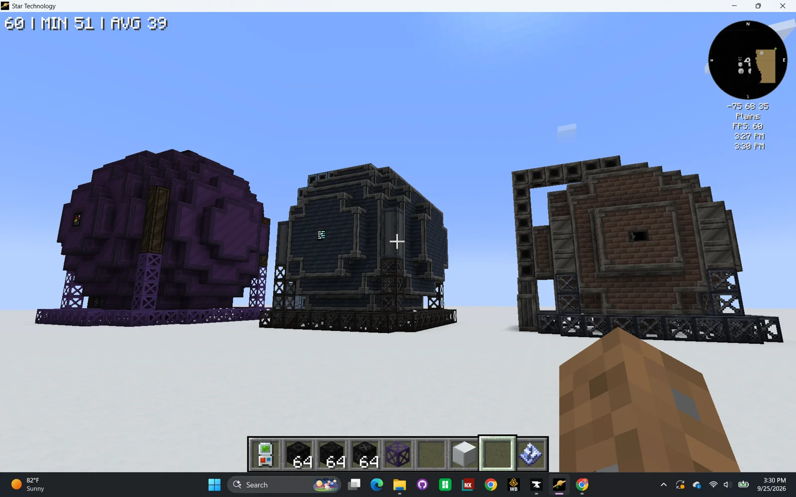
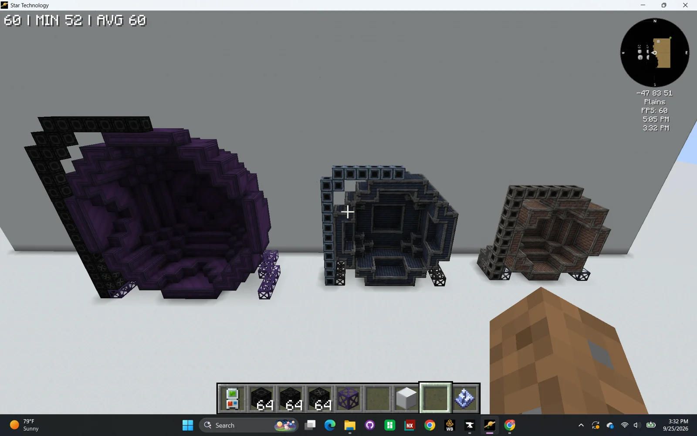

# Low Temperature Pressure Chambers (Multiblock Family)
<small>**Submitted by:** Serotonintheft (@serotonintheft), credited to Hash Browns · Multiblock Design Contest, September 2026</small>

!!! quote ""

| | |
|---|---|
| **Target tier** | <MV>MV</MV> (SPC), <IV>IV</IV> (BALL), <UHV>UHV</UHV> (COLOSSUS) |
| **Role** | Multi-structure family — high-pressure reactors replacing Chemical Reactor recipes |
| **Schematic** | [spc.nbt](Contest_img/low-temperature-pressure-chambers/spc.nbt), [ball.nbt](Contest_img/low-temperature-pressure-chambers/ball.nbt), [colossus.nbt](Contest_img/low-temperature-pressure-chambers/colossus.nbt) |
| **Original post** | [Low Temperature Pressure Chambers (Multiblock Family)](https://discord.com/channels/1177211394039484477/1553202881388089475) |

## Summary

A family of three high-pressure reactors, one per stage of the game, that take over several key high-pressure chemical recipes from the Chemical Reactor. All three share one recipe set and differ only in how they are powered and how much parallel processing and throughput they offer:

- **Steam Pressure Chamber (SPC)** — <MV>MV</MV>, steam-powered, 8 steam parallels.
- **Bulk Atmospheric Load Laboratory (BALL)** — <IV>IV</IV>, uses a parallel hatch.
- **Chamber for Overpressure Loading, Operational Stress Simulation, and Uniform Sealing (COLOSSUS)** — <UHV>UHV</UHV>, parallel hatch plus throughput boosting and bulk processing.

## Mechanics

- Thematically these are pure pressure chambers that operate at a comparatively low temperature. They replace the Chemical Reactor for several key high-pressure recipes (Polyethylene, Acetic Acid, Nitrobenzene, etc.). As an alternative, if they should not be mandatory for progression, the author suggests they could instead run faster and much more efficient versions of those recipes.
- The pressure system works like the vacuum reactors, but in reverse: instead of lowering pressure, the chamber raises it, and every recipe has a pressure it must reach before it starts. There are no pump hatches; the rate at which pressure rises depends on which of the three multiblocks is used.
- Recipes are rebalanced so that only a handful of each multiblock is ever needed, to keep the performance cost low.
- Hatches and buses can only be placed on the casings at the bottom left, at the base of the "piping".
- If the structure unforms while a recipe is running, the multiblock explodes.
- The author would make the interior of the sphere mandatory air blocks to prevent extreme wall-sharing.

## Steam Pressure Chamber (SPC)

### Summary

The <MV>MV</MV> entry of the family, built from brick and steel. It runs off steam with 8 steam parallels. The author did not state its dimensions.

### Screenshots

!!! abstract "Screenshots"

    === "SPC"
        

### Files

- [spc.nbt](Contest_img/low-temperature-pressure-chambers/spc.nbt) — structure file for the SPC

## Bulk Atmospheric Load Laboratory (BALL)

### Summary

The <IV>IV</IV> entry, in dark blue-grey casings. It uses a parallel hatch instead of fixed parallels. The author did not state its dimensions.

### Screenshots

!!! abstract "Screenshots"

    === "BALL"
        

### Files

- [ball.nbt](Contest_img/low-temperature-pressure-chambers/ball.nbt) — structure file for the BALL

## Chamber for Overpressure Loading, Operational Stress Simulation, and Uniform Sealing (COLOSSUS)

### Summary

The <UHV>UHV</UHV> entry, a large purple sphere measuring **16x16x15**. It supports a parallel hatch together with throughput boosting and bulk processing.

### Screenshots

!!! abstract "Screenshots"

    === "COLOSSUS"
        

### Files

- [colossus.nbt](Contest_img/low-temperature-pressure-chambers/colossus.nbt) — structure file for the COLOSSUS

## Structure

All three share the same silhouette: a roughly spherical chamber of tiered casings on a frame base, with a run of "piping" rising up one side and over the top, and the hatch casings at its base on the bottom left. Each is larger than the last.

!!! abstract "Screenshots"

    === "Family overview"
        

    === "Lineup"
        

    === "Front"
        

    === "Cutaway"
        

## Files

- [spc.nbt](Contest_img/low-temperature-pressure-chambers/spc.nbt) — structure file for the Steam Pressure Chamber
- [ball.nbt](Contest_img/low-temperature-pressure-chambers/ball.nbt) — structure file for the Bulk Atmospheric Load Laboratory
- [colossus.nbt](Contest_img/low-temperature-pressure-chambers/colossus.nbt) — structure file for the COLOSSUS
