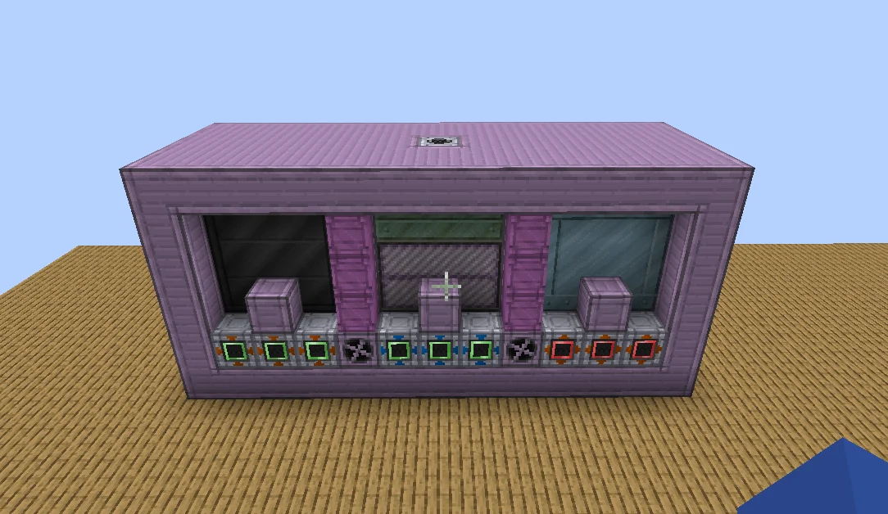
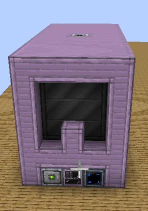
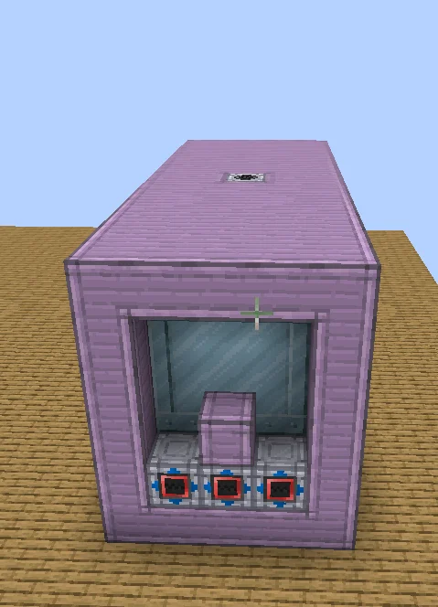
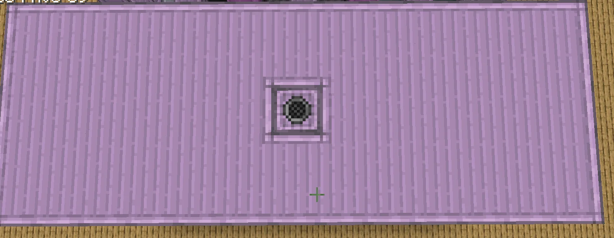
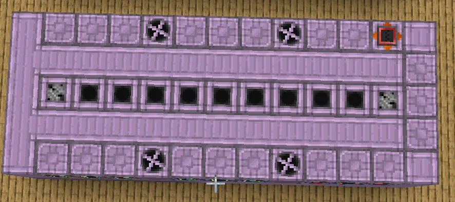
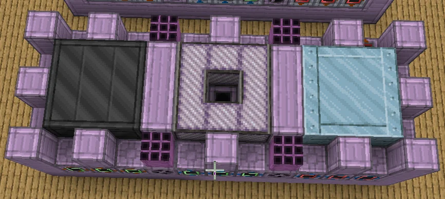
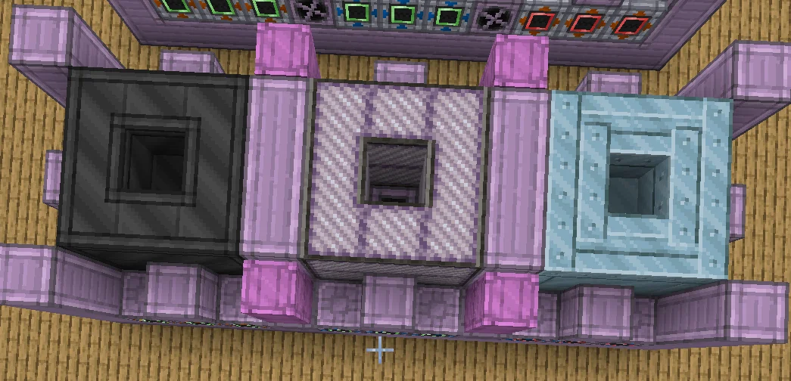
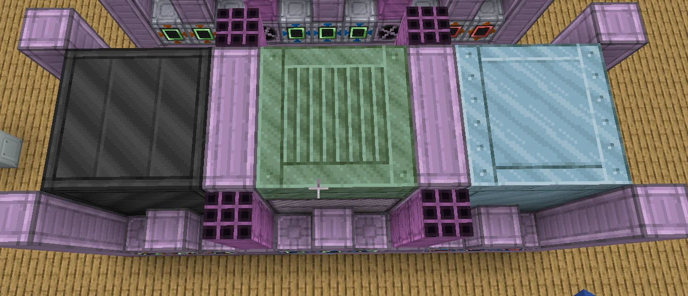

# Mass Multi Ore Processing Facility (MMOPF)
<small>**Submitted by:** Uncraftable204 (@uncraftable204) · Multiblock Design Contest, September 2026</small>

!!! quote ""

| | |
|---|---|
| **Target tier** | <EV>EV</EV> |
| **Role** | Processing — mass ore processing of similar ores |
| **Schematic** | Copy Paste Gadget pastable in the author's [Google Doc](https://docs.google.com/document/d/17VSowJdb7LVg1RZZPCHf2FyiAIPU5MplNfwde5-Mh3Y/edit?usp=sharing) (see Files) |
| **Original post** | [MMOPF ( Mass Multi Ore Processing facility )](https://discord.com/channels/1177211394039484477/1553242255668813834) |

## Summary

An <EV>EV</EV> multiblock for processing ores in bulk. The trade-off the author describes is that ores have to be processed together with similar ores to get the most out of the machine's ore efficiency.

## Mechanics

- Mass processing of ores.
- To maximize ore efficiency, ores need to be processed alongside similar ores; the author does not spell out in the post how "similar" is defined or what the efficiency gain is.
- The post itself contains only the summary above. The author's general information and the Copy Paste Gadget pastable are in the linked Google Doc, which is not reproduced here.

## Structure

A long, rectangular box of Stable Machine Casings with a single block set into the middle of the roof. One long wall carries a row of buses and hatches along its base beneath three window openings; each short end wall has a recessed opening, one of them fronted by three more hatches. The interior holds three distinct blocks of different materials side by side (dark, pink-and-white striped, light blue), each with a hollow center. The author did not state the dimensions.

!!! abstract "Screenshots"

    === "Front"
        

    === "End"
        

    === "Opposite end"
        

    === "Roof"
        

    === "Interior cross-section"
        

    === "Interior 1"
        

    === "Interior 2"
        

    === "Interior 3"
        

## Files

No schematic file was attached. The author linked a [Google Doc](https://docs.google.com/document/d/17VSowJdb7LVg1RZZPCHf2FyiAIPU5MplNfwde5-Mh3Y/edit?usp=sharing) titled "MMOPF doc" containing the Copy Paste Gadget pastable and general information about the structure. The pastable's block list (as far as the link preview shows it) uses Stable Machine Casings, an IV Parallel Hatch, an EV Chemical Reactor, and an Auto Maintenance Hatch.
