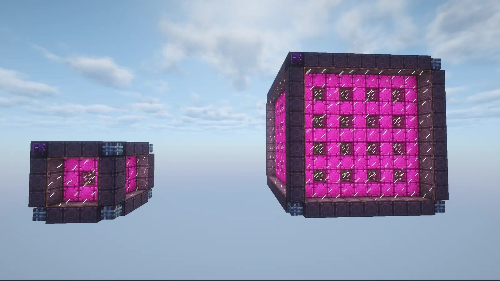
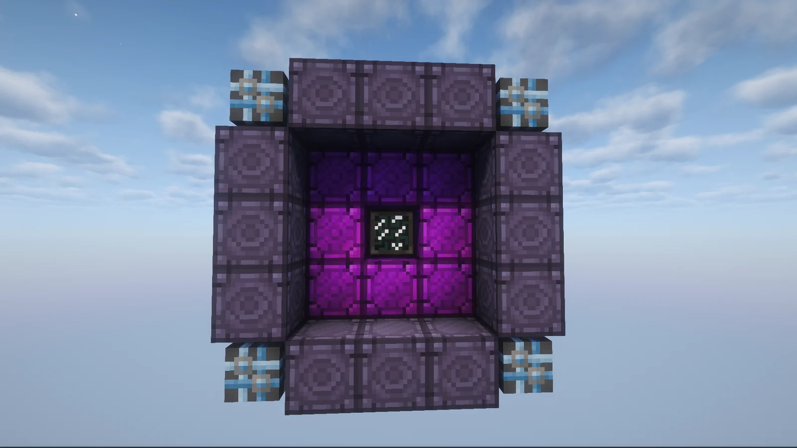

# ME Wireless Bridge
<small>**Submitted by:** White tea (@whitetriethylamine) · Multiblock Design Contest, September 2026</small>

!!! quote ""

| | |
|---|---|
| **Target tier** | <UV>UV</UV> |
| **Role** | Logistics/storage — cross-dimensional ME Quantum Link Hub |
| **Schematic** | [min.litematic](Contest_img/me-wireless-bridge/min.litematic) (5³) / [max.litematic](Contest_img/me-wireless-bridge/max.litematic) (11³) |
| **Original post** | [ME Wireless Bridge](https://discord.com/channels/1177211394039484477/1554608201062817802) |

## Summary

A multiblock ME Quantum Link Hub. It does the same job as an ME Wireless Hub, but can connect ME networks **across dimensions**. It is intended as a connection hub for the quantum ring.

## Mechanics

- Works like an ME Wireless Hub, except that links can be cross-dimensional.
- The number of valid controllers placed inside the structure determines how many links the bridge can hold.
- The author suggests it could also consume power for each active link.
- It connects to the local Wireless links in order to access the channels it will work with.
- The structure is built from Sky Stone and Fluix casings. To compensate for the cheap casings, the author proposes a long recipe for the controller block, and suggests that the quantum rings might be better as full blocks.

## Structure

A hollow cube of Sky Stone casings framed with Fluix blocks, with the controller on the front face; the schematic comes in a minimum 5³ and a maximum 11³ size.

!!! abstract "Screenshots"

    === "Min and max sizes"
        

    === "Front (min)"
        

## Files

- [min.litematic](Contest_img/me-wireless-bridge/min.litematic) — Litematica schematic, minimum size (5³)
- [max.litematic](Contest_img/me-wireless-bridge/max.litematic) — Litematica schematic, maximum size (11³)

## Notes from the thread

- Asked whether this is just a quantum ring, the author clarified that it is meant to be a connection hub for the quantum ring, expecting quantum links to be used a lot.
- The author themselves asked whether the idea is feasible or counts as a joke submission; no ruling was given in the thread.
