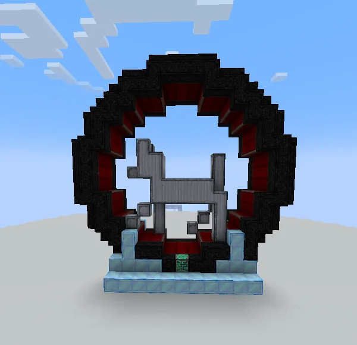
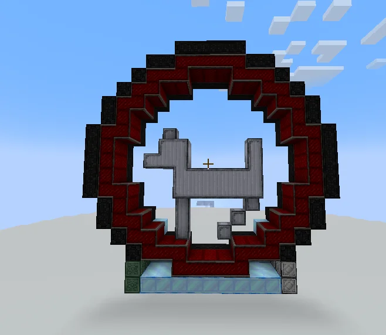
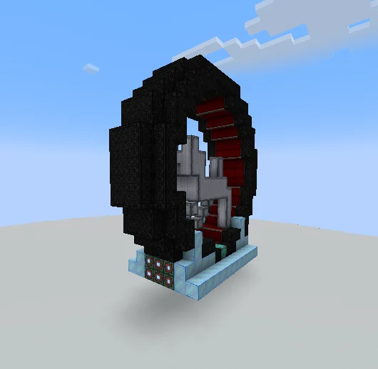
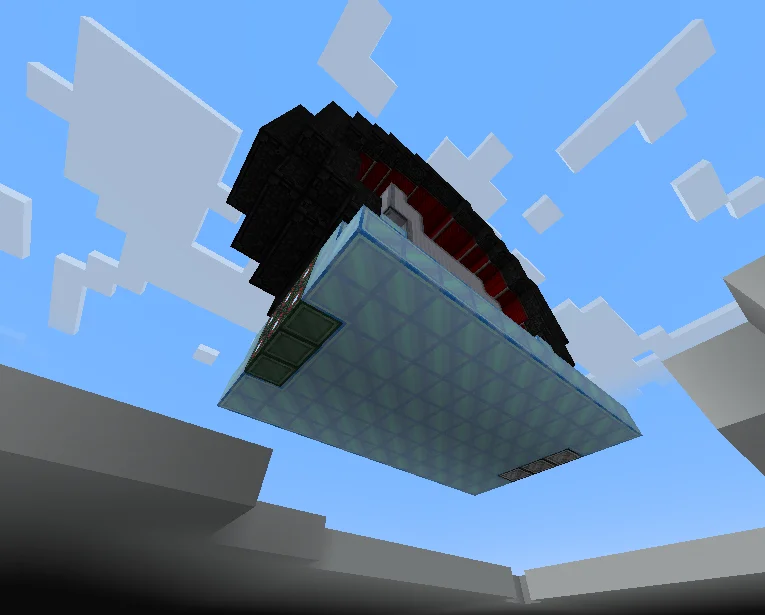
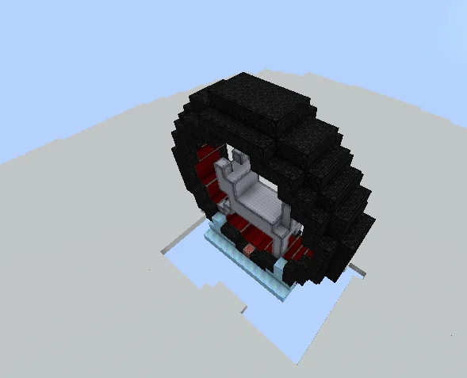

# Mega Epic Omni Wheel (M.E.O.W)
<small>**Submitted by:** KampfWolf (@kampfwolf) · Multiblock Design Contest, September 2026</small>

!!! quote ""

| | |
|---|---|
| **Target tier** | <UV>UV</UV> |
| **Role** | Power generation — expensive multi-amp generator |
| **Schematic** | [meow.nbt](Contest_img/mega-epic-omni-wheel/meow.nbt) |
| **Original post** | [Mega Epic Omni Wheel (M.E.O.W)](https://discord.com/channels/1177211394039484477/1552656006113402942) |

## Summary

A giant wheel with a mechanical cat running inside it. The author intends it as an optional, expensive way to generate power that pays off by outputting many amps at once. It was designed with <UV>UV</UV> in mind, but the author is not attached to the tier, the name, or the exact implementation.

## Mechanics

- **Input:** either an existing material (the author names Minced Meat or Wetware Circuits as examples) or something new such as "catfuel"; the author leaves the choice open.
- **Output:** multiple amps of power. The author did not give a figure.
- **Coil scaling (proposed):** better coils should boost the output. The author's suggestion is something like `coil temperature / 100` as an amp multiplier.
- The coils should glow while the multiblock is running.
- **Hatch placement:** the author is fine with either all superalloy casings being hatch-replaceable, or only the ones shown as I/O in the screenshots.
- The fake ME Controller block in the base is the multiblock controller.
- The author later floated two alternatives in the thread: having the wheel output Create rotational power (SU) instead of EU, and using a cat (e.g. Komaru) as a non-consumable item in an upgrade slot for a power boost, similar to oxygen boosting on a Combustion Engine, where a cat would tire and need to "recharge" before going back on the wheel.
- The author explicitly leaves implementation details and balance to the developers and invites remodeling of the cat.

## Structure

A large vertical ring of dark casings around an inner ring of coils (the author estimates about three stacks of coil blocks), with a gray block cat standing inside and a light-blue base holding the controller and hatches. The author kept the build within a 17x17x17 box. The ring outside the cat is meant to be symmetric; the author noted a symmetry mistake to the left of the controller in the posted build (see Notes).

!!! abstract "Screenshots"

    === "Front"
        

    === "Inner coil ring"
        

    === "Side with hatches"
        

    === "Underside"
        

    === "Top view"
        

## Files

- [meow.nbt](Contest_img/mega-epic-omni-wheel/meow.nbt) — Schematicannon (.nbt) schematic of the build as posted

## Notes from the thread

- A commenter suggested <ZPM>ZPM</ZPM> or <UHV>UHV</UHV> instead, since <UV>UV</UV> is a very short tier; the author replied that any tier is fine if the multiblock is added.
- A commenter pointed out that a casing at the bottom left is missing, making the ring asymmetric; the author confirmed it was a mistake and edited the post to say the ring outside the cat is supposed to be symmetric. The posted schematic and screenshots still show the mistake.
- The cost of roughly three stacks of coils for a power generator was raised as a balance concern; the author answered that "expensive but strong" is the intent and leaves balancing to the developers.
- The author declined a suggestion to replace the cat with wool, wanting to use only GregTech casings.
