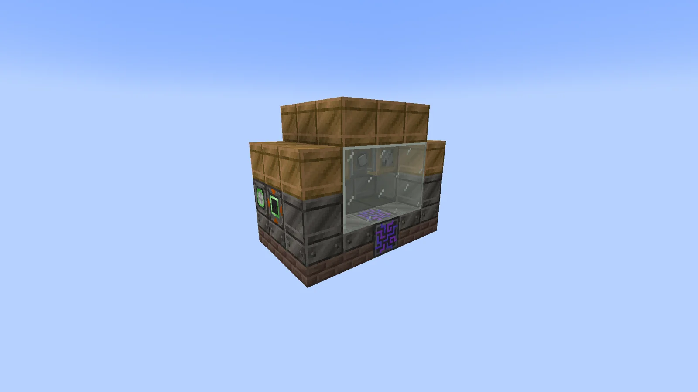
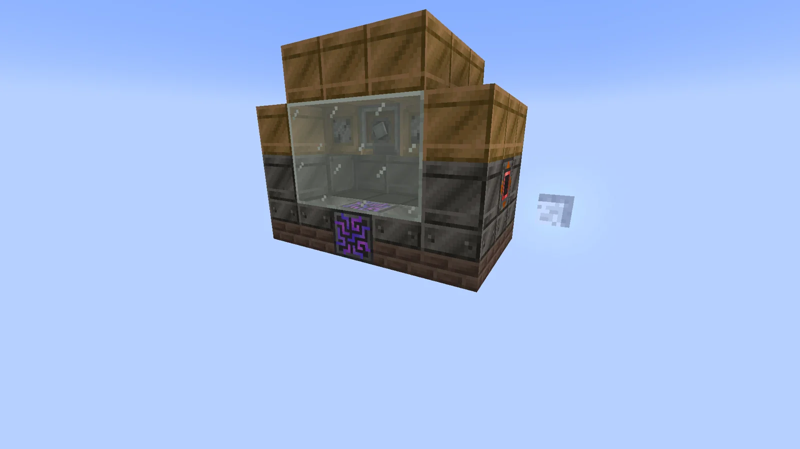

# Mega Mechanical Plate Presser (MMPP)
<small>**Submitted by:** TheSkadoodler (@rythebreadloaf), on behalf of his little brother (no Discord account) · Multiblock Design Contest, September 2026</small>

!!! quote ""

| | |
|---|---|
| **Target tier** | late <LV>LV</LV> |
| **Role** | Processing — 2-parallel multiblock Bender limited to LV energy hatches |
| **Schematic** | [mmpp.nbt](Contest_img/mega-mechanical-plate-presser/mmpp.nbt) |
| **Original post** | [Mega Mechanical Plate Presser (MMPP)](https://discord.com/channels/1177211394039484477/1555267067345772564) |

## Summary

An early-game multiblock pressing machine for the late <LV>LV</LV> stage. It runs Bender recipes with **2 parallels**, but can only be powered through <LV>LV</LV> energy hatches.

## Mechanics

- Runs the Bender recipe set with 2× parallel processing.
- Only <LV>LV</LV> energy hatches are accepted, but the 16A <LV>LV</LV> hatch is allowed.
- Although it is an <LV>LV</LV> machine, the controller recipe needs an <MV>MV</MV> circuit.
- In the structure, hatches take the place of Solid Steel casings, and a Futura block stands in for the machine controller.

## Structure

A small box of Solid Steel casings on a brick base, topped with wooden crate-style blocks and a glass front window; the Futura controller sits in the bottom row of the front wall. The author did not state the dimensions.

!!! abstract "Screenshots"

    === "Front-left"
        

    === "Front"
        

## Files

- [mmpp.nbt](Contest_img/mega-mechanical-plate-presser/mmpp.nbt) — structure block (NBT) schematic
