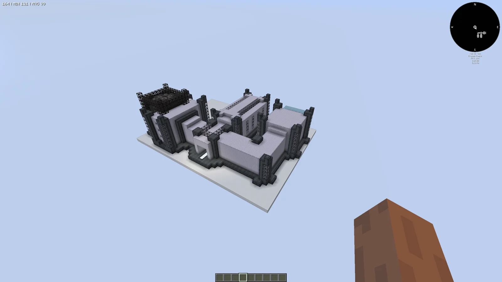
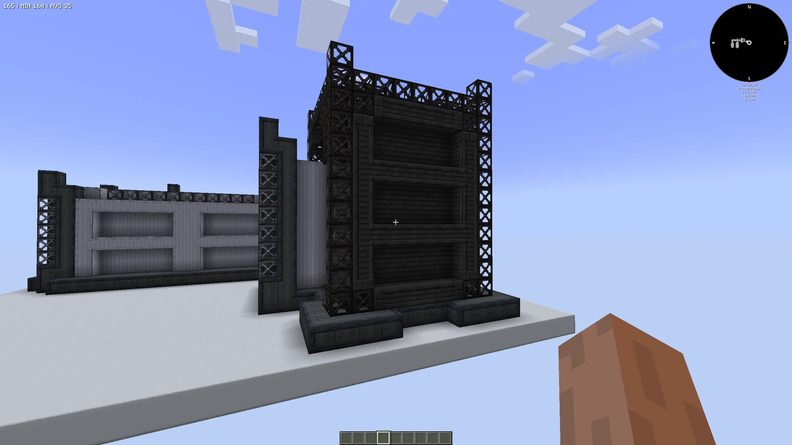
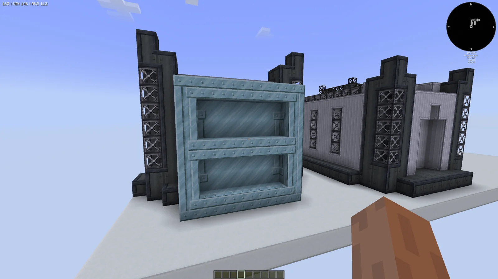
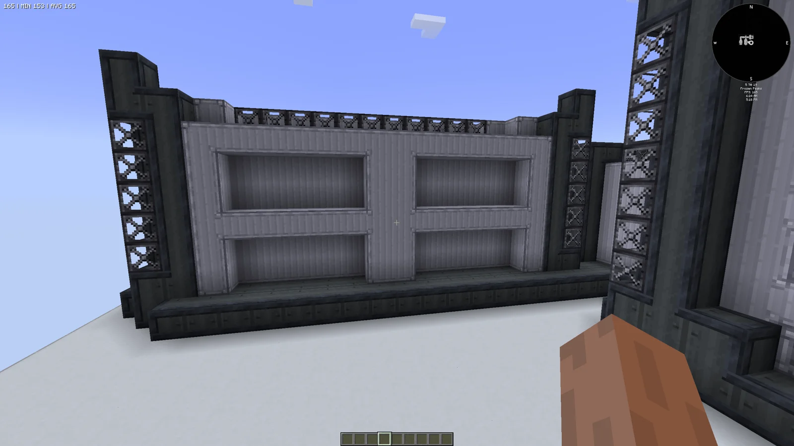
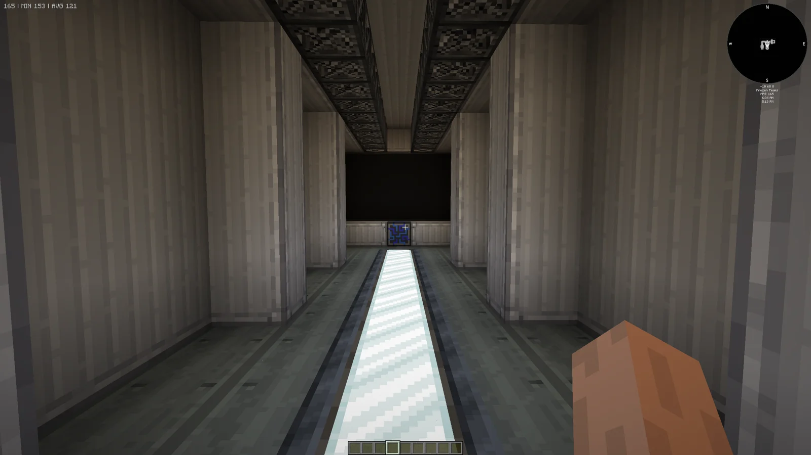
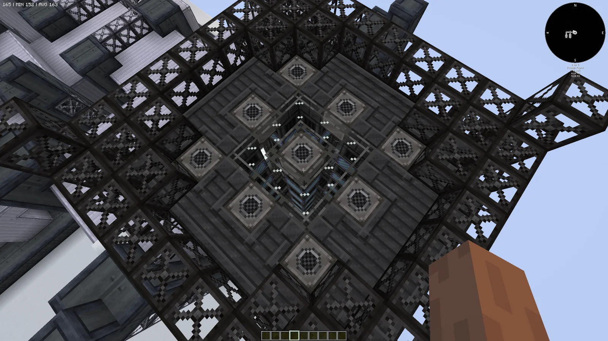
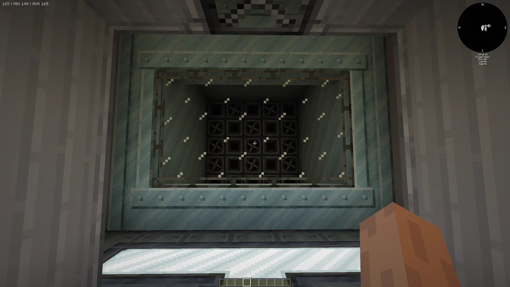
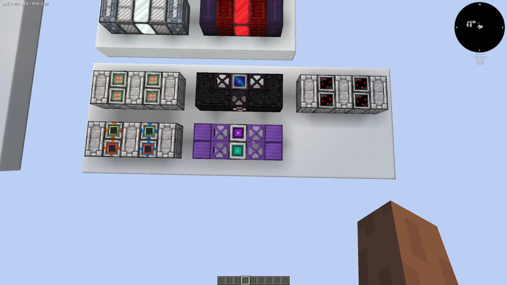
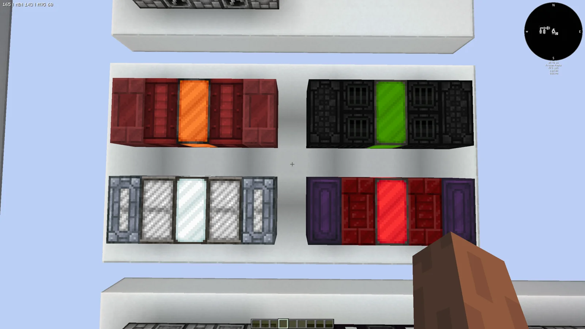
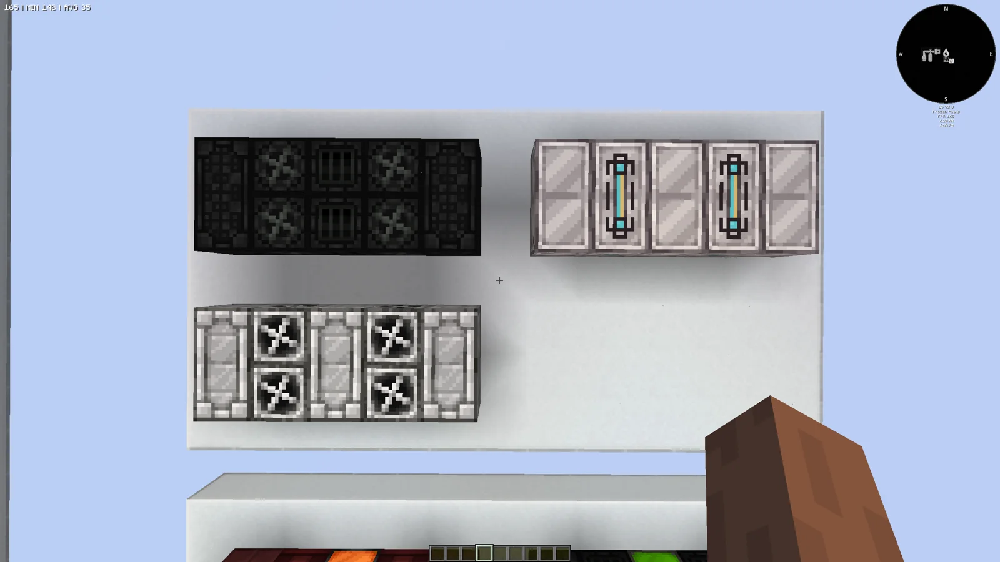

# Modular Ingot Processing Facility (MIPF)
<small>**Submitted by:** Wad (@wadzio50) · Multiblock Design Contest, September 2026</small>

!!! quote ""

| | |
|---|---|
| **Target tier** | <LuV>LuV</LuV> (the author says it could go up to <ZPM>ZPM</ZPM>/<UV>UV</UV> if needed) |
| **Role** | Processing — modular EBF, ABS and Vacuum Freezer in one facility |
| **Schematic** | [mipf.nbt](Contest_img/modular-ingot-processing-facility/mipf.nbt) |
| **Original post** | [Modular Ingot Processing Facility [MIPF]](https://discord.com/channels/1177211394039484477/1555237350412390551) |

## Summary

A single giant multiblock that combines the Electric Blast Furnace, Alloy Blast Smelter and Vacuum Freezer, and that can be upgraded throughout the game with specialized modules as needed. It is meant to reduce the need to spam more and more smelting multiblocks to keep up with ingot demand: the facility is upgraded over time instead, at the cost of needing many different resources to keep it running at maximum speed. The author stresses that it is **not strictly an upgrade** over the existing blasting, alloying and chilling machines, but a stronger and more expensive answer to smelting needs, with the modularity leaving the player free to choose what to feed it.

## Mechanics

The facility is made of three parts that pass items between each other internally:

- **Control Station** — the center of the MIPF. It takes in all resources and outputs all finished products. The controller has two modes, **Blasting** and **Alloying**, which control the Smeltery's behavior. A central monitor shows each part's module slot and the module currently inside it. The controller block goes where the ME controller block sits in the schematic.
- **Smeltery** — takes the inputs from the Control Station and turns them into hot ingots or molten alloy depending on the mode. Each recipe tier requires its voltage and coils, as in a regular EBF or ABS. It does not output into a hatch; hot ingots are sent on to the Chiller.
- **Chiller** — cools the Smeltery's products down for use in the factory, then sends the finished product back to the Control Station to be extracted by the player.

Each part has its own module slot. The author gives the following example modules and notes that these are only examples: many more could be made, and they did not have time to make them.

**Control Station modules**

- *Energy Module* — provides power to the multiblock. It always consumes 16 amps of the given power.
- *Resource Insertion/Extraction Module* — lets you insert items and fluids into the multiblock. Hatches can be replaced with the multi-fluid variants.
- *ME Insertion/Extraction Module* — same as the previous one, but connected to your AE2 network.
- *Dual ME Insertion/Extraction Module* — "self explanatory".
- *Parallel Module* — runs recipes in parallel. The parallel count is set by the tier of parallel hatch used (for example, master hatches give 16 parallels). Only one of these modules can be used.

**Smeltery modules**

- *Blazing Module* — lets the Smeltery consume liquid blaze to speed up smelting.
- *Plasma Module* — lets the Smeltery consume plasma to speed up smelting; higher-temperature plasmas give more speed.
- *Nuclear Module* — lets the Smeltery consume fuel rods to speed up smelting; better rods give more speed. Only one can be inserted.
- *Infernal Module* — lets the Smeltery consume Hellforge fuels to speed up smelting; better fuels give more speed. Only one can be inserted.

**Chiller modules**

- *Improved Chilling Module* — improves the Chiller's speed and coolant use.
- *Greatly Improved Chilling Module* — greatly improves the Chiller's speed and coolant use.
- *Hi-Tec Chilling Module* — allows PCB coolant to be used to halve recipe time in the Chiller. Only one can be inserted.

If the design were added, the author says many more modules would be needed, along with a way for players to learn how to build them; they suggest a separate menu inside the controller listing each module, its material cost and how it works.

## Structure

A large three-part complex on a single footprint: a dark, truss-framed Smeltery, a grey Control Station with a glass-topped corridor, and a Chiller block, each with an exposed slot where a module is placed. The author did not state the dimensions. The floor was originally Stress Proof Casings but was switched to Zamak Casings because of the cost for an <LuV>LuV</LuV> player.

!!! abstract "Screenshots"

    === "Overview"
        

    === "Module slot (dark truss)"
        

    === "Module slot (teal frame)"
        

    === "Module slot (grey wall)"
        

    === "Interior corridor"
        

    === "Interior from above"
        

    === "Interior fan chamber"
        

    === "Control Station modules"
        

    === "Smeltery modules"
        

    === "Chiller modules"
        

## Files

- [mipf.nbt](Contest_img/modular-ingot-processing-facility/mipf.nbt) — structure NBT schematic of the whole facility (the controller goes where the ME controller block is)

## Notes from the thread

- Feedback suggested the target voltage tier should be a bit higher; the author replied that it could go up to <ZPM>ZPM</ZPM>/<UV>UV</UV> if needed.
