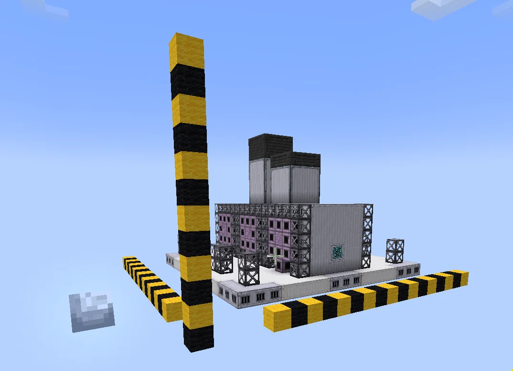
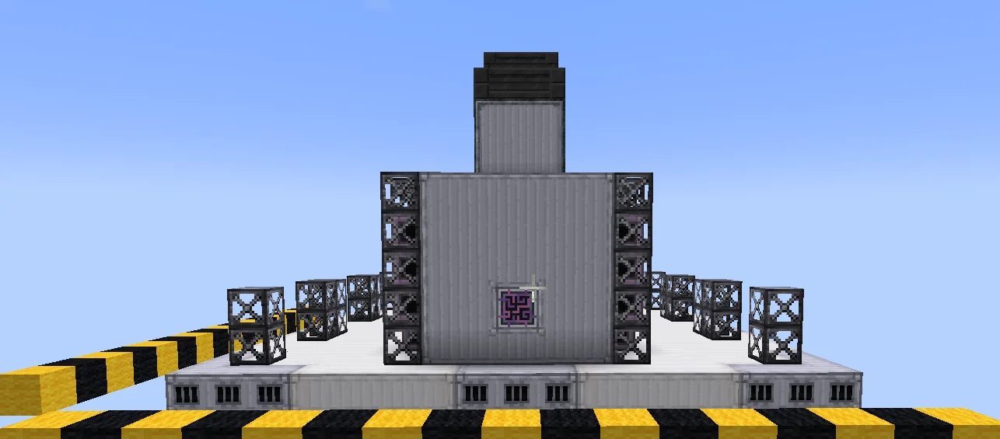
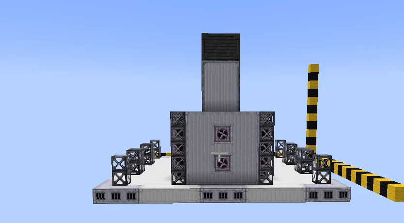
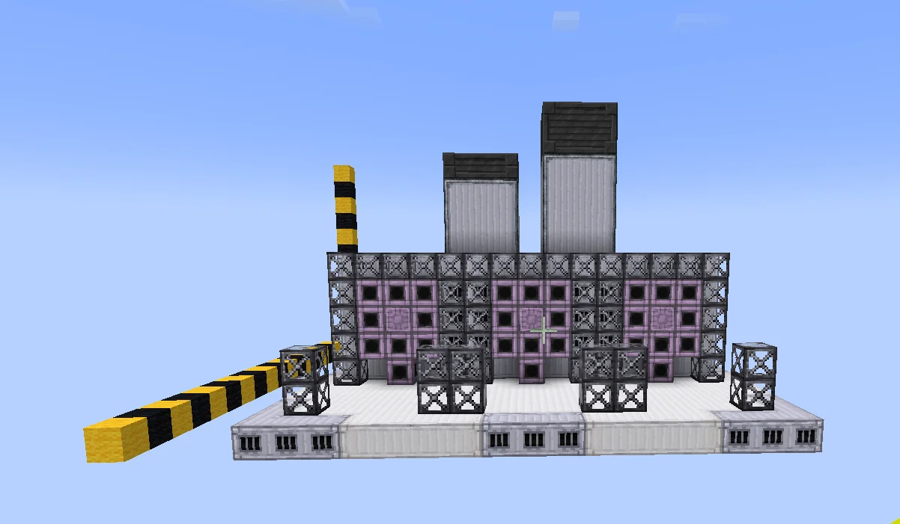
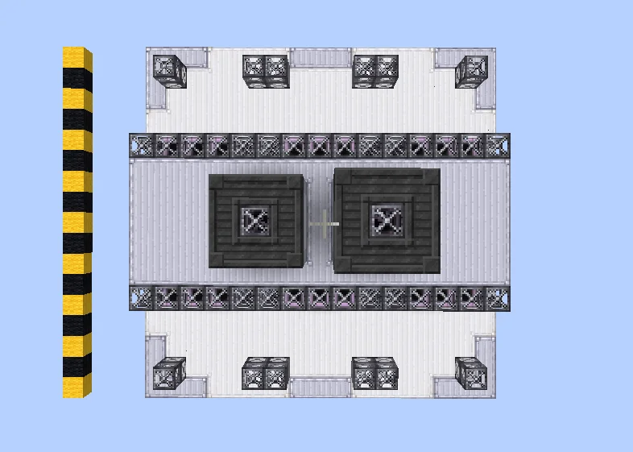
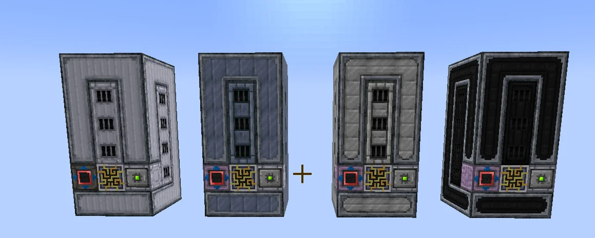
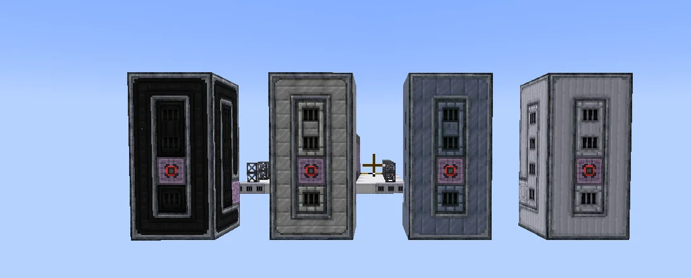
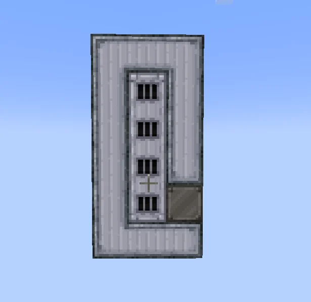
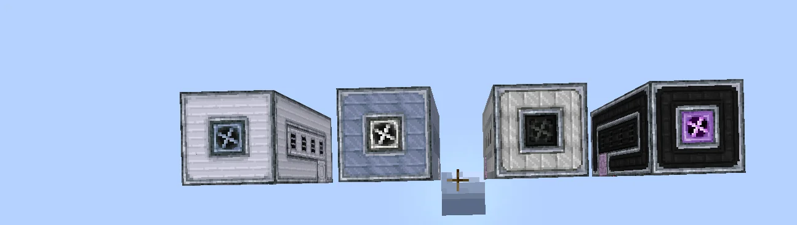

# Modular Thermal Distillation Plant (MTDP)
<small>**Submitted by:** ArcadeGamer62 (@arcadegamer62) · Multiblock Design Contest, September 2026</small>

!!! quote ""

| | |
|---|---|
| **Target tier** | Unlocked in <LuV>LuV</LuV>, upgradable |
| **Role** | Processing — modular, hot-fluid-boosted distillation plant |
| **Schematic** | [mtdp.litematic](Contest_img/modular-thermal-distillation-plant/mtdp.litematic) (plus one schematic per module, see Files) |
| **Original post** | [Modular Thermal Distillation Plant](https://discord.com/channels/1177211394039484477/1555100542420656178) |

## Summary

A distillation plant that accepts **up to 6 modules**, each of which can handle a different recipe. Every module consumes a hot fluid to give its recipe a speed boost and an energy reduction, and the main block must be fed a coolant whose tier depends on the modules installed. The author describes it as "essentially a boosted distillery."

## Mechanics

- Up to 6 modules can be attached to the main block; modules come in four tiers.
- Each module tier is driven by a different hot fluid, in order:
    - Tier 1: Extremely Hot Steam (100 B/h)
    - Tier 2: Lava (150 B/h)
    - Tier 3: Abydos Naquadite Dense Magma (200 B/h)
    - Tier 4: Americium Plasma (100 B/h)
- Each module tier also requires a different type and level of coolant, in order:
    - Tier 1: Distilled Water (100 b/m/h)
    - Tier 2: Liquid Ice (100 B/m/h)
    - Tier 3: Liquid Helium (50 B/m/h)
    - Tier 4: Superstate Helium 3 (40 B/m/h)
- The coolant the main block requires is determined by the **highest-tier module** installed.
- Proposed bonus per module tier:

| Module tier | Energy requirement | Efficiency | Output bonus |
|---|---|---|---|
| Tier 1 | 90% | 120% | — |
| Tier 2 | 80% | 150% | — |
| Tier 3 | 65% | 180% | +10% |
| Tier 4 | 45% | 200% | +25% |

- The machine also contains coils. Upgrading them reduces coolant cost by 2.5% for each tier past Nichrome; Kanthal and Cupronickel instead increase coolant cost by 5% and 10% respectively.

## Structure

A large rectangular plant on a casing platform: a central main block with two chimney-like towers on top, the controller in the middle of one end wall, and two rows of module slots along the long sides. Each module is a separate tall structure in one of four casing styles, one per tier. The author did not state the dimensions.

!!! abstract "Screenshots"

    === "Overview"
        

    === "Front"
        

    === "Back"
        

    === "Side"
        

    === "Top view"
        

    === "Modules, tiers 1-4"
        

    === "Modules, other side"
        

    === "Module front"
        

    === "Module blocks"
        

## Files

- [mtdp.litematic](Contest_img/modular-thermal-distillation-plant/mtdp.litematic) — Litematica schematic of the main plant
- [mtdp-module-1.litematic](Contest_img/modular-thermal-distillation-plant/mtdp-module-1.litematic) — Litematica schematic, tier 1 module
- [mtdp-module-2.litematic](Contest_img/modular-thermal-distillation-plant/mtdp-module-2.litematic) — Litematica schematic, tier 2 module
- [mtdp-module-3.litematic](Contest_img/modular-thermal-distillation-plant/mtdp-module-3.litematic) — Litematica schematic, tier 3 module
- [mtdp-module-4.litematic](Contest_img/modular-thermal-distillation-plant/mtdp-module-4.litematic) — Litematica schematic, tier 4 module
