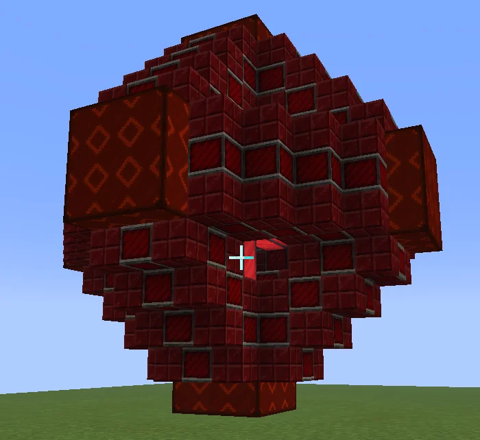

# Nefarious Extradimensional Temporally Hyper Energetic Roaster (N.E.T.H.E.R)
<small>**Submitted by:** Dr. Hans (@usernameisfalse_91584) · Multiblock Design Contest, September 2026</small>

!!! quote ""

| | |
|---|---|
| **Target tier** | <UXV>UXV</UXV> |
| **Role** | Processing — configurable heat-based processing multiblock |
| **Schematic** | Not provided |
| **Original post** | [nefarious extradimensional temporally hyper energetic roaster(N.E.T.H.E.R)](https://discord.com/channels/1177211394039484477/1552787947244224583) |

!!! warning "Incomplete submission"

    The post does not follow the contest template. No schematic was uploaded (the author said creating one was "too complex"), only one screenshot was posted, and the mechanics are described in a single sentence.

## Summary

A <UXV>UXV</UXV> multiblock that covers every heat-based process: cooking, smelting, smoking, melting, and "anything that heats up stuff." It processes faster and with more parallels the more energy it is given.

## Mechanics

- Handles cooker, smelter, smoking, and Melter recipes, as well as any other recipe that heats things.
- The author proposes a fixed trade-off between energy, speed, and parallels, roughly `EU * speed * parallels = some constant`.
- All three values can be adjusted by the player, each in exchange for the others.

## Structure

An octahedron (the author's description) built from dark red brick-style blocks, with larger cube blocks at the tips. No dimensions or block list were given.

!!! abstract "Screenshots"

    === "Exterior"
        

## Notes from the thread

- Moderators asked the author to follow the post template and to upload a schematic in one of the accepted formats; the author said they would do so the next day but then replied that it was "too complex," so no schematic was provided.
