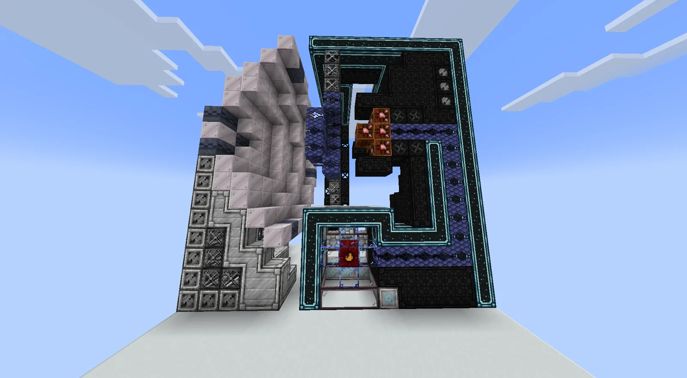
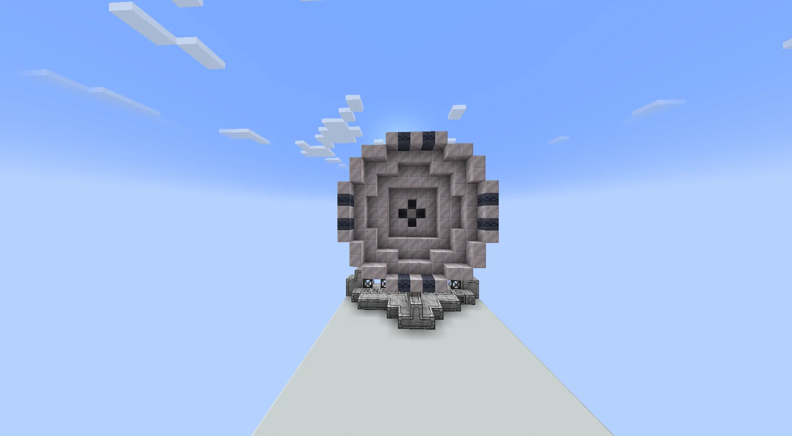
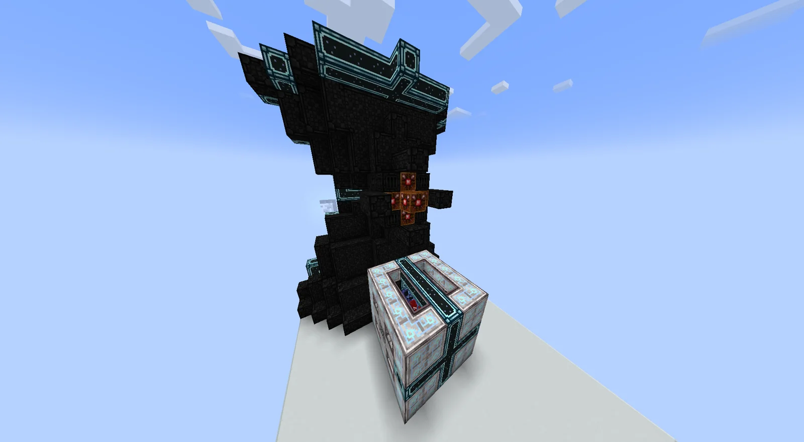
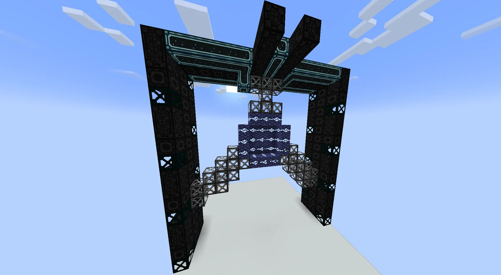
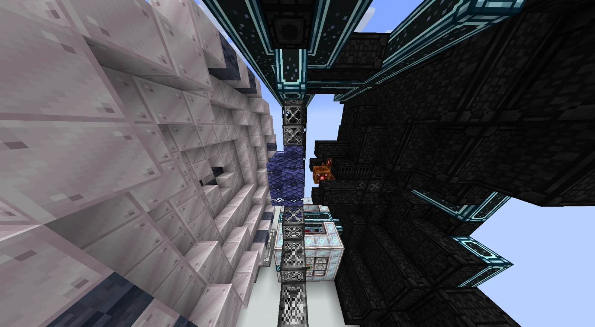

# Neutron-conserving Atom Destabilizer (NCAD)
<small>**Submitted by:** Lumen (@deyth), unknown user · Multiblock Design Contest, September 2026</small>

!!! quote ""

| | |
|---|---|
| **Target tier** | Late <UHV>UHV</UHV> - Early <UEV>UEV</UEV> |
| **Role** | Processing — alternative Neutronium production with Hydrogen and element byproducts |
| **Schematic** | [ncad-template.txt](Contest_img/neutron-conserving-atom-destabilizer/ncad-template.txt) |
| **Original post** | [Neutron-conserving atom destabilizer](https://discord.com/channels/1177211394039484477/1554771570717630535) |

## Summary

An alternative way to produce Neutronium. The NCAD uses immense voltage to rip the protons and electrons away from an atom, leaving pure Neutronium; the "not-neutrons" that are stripped off are returned as byproducts. The authors pitch it as a more flexible route to Neutronium than the existing one.

## Mechanics

- Input is a pure metal dust, which acts as the precursor.
- Yield scales with atomic mass: heavier elements give more neutrons per conversion, while lighter particles give exponentially fewer. Naquadria gives the best conversion.
- The stripped protons and electrons have to go somewhere, so in the base operating mode the machine also produces a supply of Hydrogen. As an illustration, the authors note that converting 4 Naquadria into 1 Neutronium would produce 500 buckets of Hydrogen, assuming Naquadria is element 125 and 100% capture.
- **Lossy operating mode:** material efficiency is reduced, but the "lost" neutrons recombine with protons and electrons into heavier elements. Overall this means more byproducts, more material consumed, and less energy used.
- Possible tweaks proposed by the authors:
    - Remove the energy hatch limit.
    - Base the byproducts on a normal distribution that depends on the precursor material.
    - Change the processing type from EU/t to instant processing once the energy buffer is filled.

## Structure

Two tall halves facing each other across a gap: a pale, rounded dish built from pale casings with dark bands, and a dark cyan-trimmed casing tower whose open frame holds a cluster of superconducting coils and heat-related casings between the two. The attached template spans a 16 × 17 × 15 block region.

!!! abstract "Screenshots"

    === "Side view"
        

    === "Dish face"
        

    === "Casing tower"
        

    === "Coil cluster"
        

    === "Between the halves"
        

## Files

- [ncad-template.txt](Contest_img/neutron-conserving-atom-destabilizer/ncad-template.txt) — Building Gadgets template (JSON block list) of the full structure
