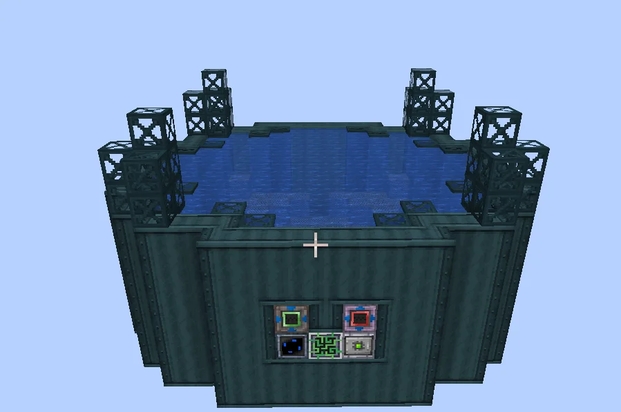
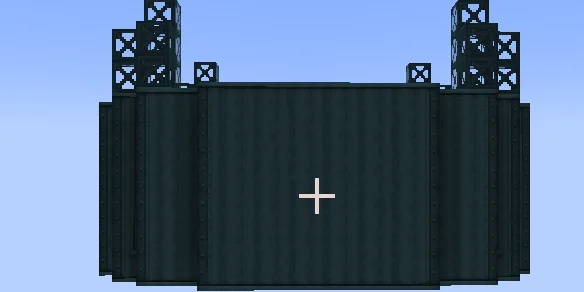
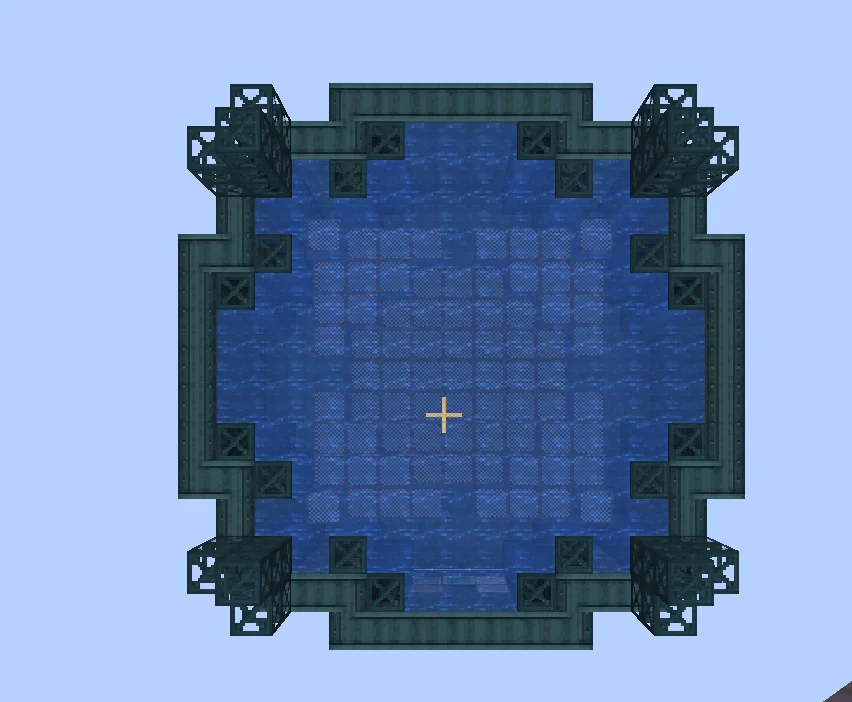

# Ocean Draining Device (O.D.D)
<small>**Submitted by:** ArcadeGamer62 (@arcadegamer62) · Multiblock Design Contest, September 2026</small>

!!! quote ""

| | |
|---|---|
| **Target tier** | <ZPM>ZPM</ZPM> |
| **Role** | Resource generation — bulk fishery and seawater processing |
| **Schematic** | [ocean-draining-device.litematic](Contest_img/ocean-draining-device/ocean-draining-device.litematic) |
| **Original post** | [Ocean Draining Device](https://discord.com/channels/1177211394039484477/1555261995350237294) |

## Summary

A <ZPM>ZPM</ZPM>-tier multiblock that the author describes as a boosted, bulk version of the Industrial Fishery. Beyond fishing, it is meant to open up other recipes that involve seawater, such as extracting ores or salt from it directly.

## Mechanics

- Acts as a boosted, higher-throughput ("bulking") counterpart to the Industrial Fishery.
- Also gives access to further seawater-based recipes; the author names extracting ores and salt directly from seawater as examples.
- No recipe numbers, speeds, or parallel counts were stated.

## Structure

A squat, wide block of dark casings with an open pool of water across the top, ringed by frame-block towers at the corners and along the rim; the controller and hatches sit low on the front wall. The author did not state the dimensions.

!!! abstract "Screenshots"

    === "Front"
        

    === "Side"
        

    === "Top view"
        

## Files

- [ocean-draining-device.litematic](Contest_img/ocean-draining-device/ocean-draining-device.litematic) — Litematica schematic
